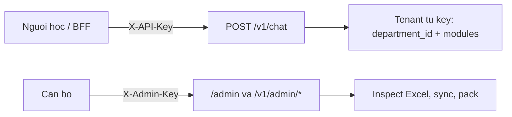

# Hướng dẫn khóa và danh tính (API key, admin, hạ tầng)

PoC. Secret chỉ nằm trong `.env` (gitignored), **không** lưu trong `configs/departments.yaml` hay trên `/admin`. Sửa key xong phải **recreate API** (`docker compose up -d --no-build --force-recreate api`). Sửa YAML phòng/mô-đun **không** cần đổi khóa.

Mẫu biến: `.env.example`. Nạp dữ liệu: `HUONG_DAN_ONBOARDING.md`. Cách bot nói: `HDSD_QUAN_LY_BOT.md`.

Không dán secret thật vào chat, commit, hay screenshot Swagger.

---

## 1. Hai cửa vào API RAG (`:8000`)



| Header | Biến `.env` | Việc |
|---|---|---|
| `X-API-Key` | `API_CLIENTS[].api_key` hoặc `APP_API_KEY` | Chat, `GET /v1/modules` |
| `X-Admin-Key` | `APP_ADMIN_API_KEY` | Nạp Excel, registry, thử bot |

Body chat **không** có `department_id`. Phòng lấy từ key. `module_code` trên body chỉ được chọn nếu key đã được cấp mô-đun đó.

Swagger `/docs` → **Authorize**: điền đúng ô `X-API-Key` hoặc `X-Admin-Key`.

---

## 2. Khóa chat — một phòng PoC (`APP_API_KEY`)

Khi `API_CLIENTS=[]` hoặc bỏ trống, hệ thống dùng **một** key:

| Biến | Ý nghĩa | Ví dụ |
|---|---|---|
| `APP_API_KEY` | Giá trị gửi trong `X-API-Key` (≥ 16 ký tự) | `replace-with-a-long-random-value` |
| `APP_DEPARTMENT_ID` | Tenant gắn với key đó | `bao_dam_chat_luong` |
| `APP_MODULE_CODE` | Mô-đun duy nhất của key legacy | `khao_khi` |

**Không** phát `APP_API_KEY` cho từng phòng mới. Đó là key tương thích PoC Khảo khí.

Ví dụ gọi chat (thay `YOUR_APP_API_KEY`):

```http
POST /v1/chat HTTP/1.1
Host: 127.0.0.1:8000
X-API-Key: YOUR_APP_API_KEY
Content-Type: application/json

{
  "message": "Thời hạn phúc khảo đại học chính quy là mấy ngày?",
  "module_code": "khao_khi"
}
```

Sai key → `401 Invalid API key`. `module_code` khác `khao_khi` → `403`.

Demo sảnh ĐBCL: `frontend/run-bff.ps1` copy `APP_API_KEY` sang `CHATBOT_RAG_API_KEY` của BFF (không in ra màn hình).

`development` / `test`: trang `/admin` cũng **chấp nhận** `X-Admin-Key: APP_API_KEY` cho tiện. UAT/production thì không.

---

## 3. Khóa chat — nhiều tenant (`API_CLIENTS`)

Đúng khi có từ hai phòng, hoặc một phòng nhiều mô-đun, hoặc muốn tắt key legacy.

JSON **một dòng** trong `.env`. Mỗi phần tử:

| Field | Bắt buộc | Ý nghĩa |
|---|---|---|
| `id` | có | Tên service ổn định (`bdcl-service`). Không tái dùng cho chủ khác |
| `department_id` | có | **Một** tenant (`a-z0-9_`) |
| `modules` | ≥ 1 | Mã mô-đun **của đúng phòng đó** |
| `api_key` | ≥ 16 ký tự | Giá trị `X-API-Key`. Mỗi client một key, không trùng |

Khi list **không rỗng**, `APP_API_KEY` **không còn** cho `POST /v1/chat`.

### Ví dụ A — chỉ Khảo khí (thay thế legacy)

```env
API_CLIENTS=[{"id":"bdcl-service","department_id":"bao_dam_chat_luong","modules":["khao_khi"],"api_key":"bdcl-chat-key-16chars"}]
```

Gọi giống mục 2, nhưng `X-API-Key: bdcl-chat-key-16chars`. Key cũ `APP_API_KEY` chat sẽ `401`.

### Ví dụ B — một phòng, hai mô-đun

```env
API_CLIENTS=[{"id":"bdcl-service","department_id":"bao_dam_chat_luong","modules":["khao_khi","cong_khai"],"api_key":"bdcl-chat-key-16chars"}]
```

- Key một phòng, chọn mô-đun trên body.
- Một mô-đun: có thể bỏ `module_code`.
- Hai mô-đun mà không gửi `module_code` → `422 Select module_code`.
- `GET /v1/modules` chỉ trả `khao_khi` và `cong_khai`.

```http
POST /v1/chat HTTP/1.1
X-API-Key: bdcl-chat-key-16chars
Content-Type: application/json

{"message": "Hình thức thi kết thúc học phần?", "module_code": "khao_khi"}
```

### Ví dụ C — hai phòng, hai key

```env
API_CLIENTS=[{"id":"bdcl-service","department_id":"bao_dam_chat_luong","modules":["khao_khi"],"api_key":"bdcl-chat-key-16chars"},{"id":"pdt-service","department_id":"phong_dao_tao","modules":["dang_ky_hoc_phan"],"api_key":"pdt-chat-key-16chars-min"}]
```

| Client | `X-API-Key` | Được hỏi |
|---|---|---|
| ĐBCL | `bdcl-chat-key-16chars` | chỉ `bao_dam_chat_luong` / `khao_khi` |
| PĐT | `pdt-chat-key-16chars-min` | chỉ `phong_dao_tao` / `dang_ky_hoc_phan` |

Key ĐBCL gửi `module_code: dang_ky_hoc_phan` → `403 Module access denied`.  
Không gắn **hai** `department_id` trên một client.

Qdrant vẫn chung collection `uel_knowledge`; cách ly bằng filter `department_id` + `module_code` trên payload.

### Ví dụ D — giữ PoC, chưa cấp multi-tenant

```env
API_CLIENTS=[]
```

Chat = `APP_API_KEY` + Khảo khí. Đây là trạng thái sau khi bổ sung biến vào `.env`.

PowerShell (JSON một dòng, không xuống dòng giữa ngoặc):

```powershell
# Sai: xuống dòng làm pydantic không parse
# Đúng: cả mảng trên một dòng, quote bọc bởi dấu nháy đơn nếu cần
```

`id` trùng hoặc `api_key` trùng → API không start (`API client IDs must be unique` / `API keys must be unique`).

---

## 4. Khóa admin (`APP_ADMIN_API_KEY`)

| | |
|---|---|
| Header | `X-Admin-Key` |
| Dùng cho | `/admin`, `POST /v1/admin/packages/inspect`, `releases`, `sync`, `GET/PUT /v1/admin/registry` |
| Nên | Khác hẳn key chat, ≥ 16 ký tự (bắt buộc nếu `APP_ENV` không phải `development` và đã đặt key) |

```http
GET /v1/admin/tenants HTTP/1.1
X-Admin-Key: YOUR_ADMIN_KEY
```

Tab **Thử chat** trên `/admin` đi đường admin: xem bot sau khi nạp dữ liệu, **không** cần `API_CLIENTS`. Người học trên `/` thì cần key chat.

Thiếu/sai → `401 Invalid admin credential`. Chưa recreate sau khi sửa `.env` → vẫn 401.

---

## 5. Khóa hạ tầng (không phân tenant)

Không gửi trên header chat.

| Biến | Việc | Lưu ý |
|---|---|---|
| `POSTGRES_PASSWORD` (+ user/db) | Silver | Đổi mật khẩu mà giữ volume `postgres_data` cũ → readiness lỗi |
| `MINIO_ACCESS_KEY` / `MINIO_SECRET_KEY` | Bronze; Compose = MinIO root | ≥ 8 ký tự |
| `LLM_API_KEY` | Groq/Gemini | `LLM_PROVIDER=fake` thì để trống. **Không** phải key chat UEL |
| `LLM_PROVIDER` / `LLM_MODEL` | Chọn nhà cung cấp | PoC hay dùng `groq` + `openai/gpt-oss-20b` |

Qdrant PoC trong compose thường không có API key riêng.

---

## 6. Biến retrieval / HTTP (không phải danh tính)

Có trong `.env.example`; thiếu thì dùng mặc định code.

| Biến | Mặc định | Ý nghĩa |
|---|---|---|
| `DEPARTMENTS_CONFIG_PATH` | `configs/departments.yaml` | Registry tenant/module |
| `CORS_ORIGINS` | `[]` | JSON origin được phép, ví dụ `["http://127.0.0.1:5173"]` |
| `CHAT_TIMEOUT_SECONDS` | `90` | Timeout `POST /v1/chat` |
| `ADMIN_TIMEOUT_SECONDS` | `600` | Timeout ETL admin |
| `REQUEST_MAX_BYTES` | `16384` | Trần body chat |
| `SOURCE_UPLOAD_MAX_BYTES` | `16777216` | Trần upload Excel |
| `QDRANT_COLLECTION` | `uel_knowledge` | Tên collection Gold |
| `EMBEDDING_MODEL` | `BAAI/bge-m3` | Dense + sparse; test dùng `hash-test` |
| `GOLD_FAQ_SCORE_BOOST` | `0.12` | Cộng điểm chunk FAQ sau hybrid |
| `RAG_TOP_K` / `RAG_SCORE_THRESHOLD` | `5` / `0.4167` | Cắt hit retrieve |

---

## 7. BFF GitHub (`frontend/chatbot-api`) — lớp khác

Người học lounge **không** cầm `APP_API_KEY`.

| Biến / header | Ý nghĩa |
|---|---|
| `CHATBOT_RAG_API_KEY` | BFF gọi RAG `:8000` bằng `X-API-Key`. `run-bff.ps1` copy từ `APP_API_KEY` |
| `CHATBOT_RAG_BASE_URL` | Mặc định `http://127.0.0.1:8000` |
| `CHATBOT_PROVIDER` | `rag` = gọi graph; `stub` = catalog mô phỏng |
| Bearer (login BFF) | User FE khi `CHATBOT_AUTH_DISABLED=false` |
| `X-Department-ID` | Id FE: `dbcl`, `qtts`, `khcn`… **không** phải `bao_dam_chat_luong` |

Map RAG hiện tại:

`dbcl` + mode `module_1` → `bao_dam_chat_luong` / `khao_khi`

Phòng stub không dùng key RAG. Bật `API_CLIENTS` mà không nhét key ĐBCL vào list → BFF ĐBCL `401`/`502`. Phải dùng đúng `api_key` của `bdcl-service` trong `CHATBOT_RAG_API_KEY`.

---

## 8. Trình tự cấp phòng mới (kèm khóa)

1. Nạp 3 Excel (`HUONG_DAN_ONBOARDING.md`) bằng `X-Admin-Key`.
2. Registry có `department_id` + `module_code` (`enabled: true`).
3. Thêm một object vào `API_CLIENTS` (key ≥ 16, `id` mới).
4. Recreate API.
5. `GET /v1/modules` với `X-API-Key` mới → đúng danh sách mô-đun.
6. Chat thử. Tab admin **Thử chat** không thay bước 3–4.

---

## 9. Sự cố

| Hiện tượng | Nguyên nhân thường gặp |
|---|---|
| Chat `401` | Sai `X-API-Key`; đã bật `API_CLIENTS` nhưng FE/BFF vẫn gửi `APP_API_KEY` |
| Chat `403` | `module_code` không nằm trong `modules` của key; YAML `enabled: false` |
| Chat `422 Select module_code` | Key có nhiều mô-đun, body thiếu `module_code` |
| Admin `401` | Sai `APP_ADMIN_API_KEY`; chưa recreate |
| API không lên | `API_CLIENTS` JSON hỏng / xuống dòng; `id` hoặc `api_key` trùng; thiếu cả `API_CLIENTS` lẫn `APP_API_KEY` đủ 16 ký tự |
| ĐBCL sảnh 502 | BFF thiếu `CHATBOT_RAG_API_KEY` khớp key RAG đang hiệu lực |
| Ready postgres lỗi | Đổi `POSTGRES_PASSWORD` nhưng volume cũ |

---

## 10. Không làm

- Commit `.env`, dán key lên issue/chat.
- Gắn hai tenant trên một `API_CLIENTS` item.
- Lưu key trong YAML / prompt pack / Excel.
- Dùng `LLM_API_KEY` thay `X-API-Key`.
- Coi `X-Department-ID` của FE GitHub là `department_id` RAG.
- Đổi key rồi chỉ reload uvicorn trong container cũ mà không đọc lại `.env` (Compose: recreate).
