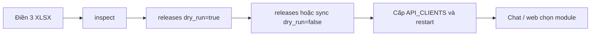

# Hướng dẫn thêm phòng ban hoặc mô-đun mới

Một **phòng ban = một tenant**. Mỗi tenant có một hoặc nhiều **mô-đun**. Không sửa mã nguồn nếu dữ liệu đúng ba template chuẩn.

Mẫu PoC hiện có: `bao_dam_chat_luong` / `khao_khi`. Tài liệu vận hành kỹ thuật: `docs/operations-multi-tenant.md`. Swagger: http://127.0.0.1:8000/docs. Sau khi nạp Qdrant, cấu hình cách bot nói: `HDSD_QUAN_LY_BOT.md` và http://127.0.0.1:8000/admin.

## Dữ liệu điền trong template lưu ở đâu?

Ba file trong `template/` là **mẫu trống**. Bạn copy ra máy mình, điền Excel — lúc đó dữ liệu **chỉ nằm trên máy bạn**, hệ thống chưa biết.

Sau khi **upload qua API**, server copy nguyên 3 file `.xlsx` (+ `release-manifest.yaml`) vào thư mục nguồn:

`data/{department_id}/{module_code}/{release_id}/`

Ví dụ: `data/phong_dao_tao/dang_ky_hoc_phan/pdt-dkhp-2026-11-11-001/`

| Môi trường | Chỗ file Excel thật sự nằm |
|---|---|
| API chạy Docker (mặc định) | Volume `api_sources` gắn vào `/app/data` **trong container**. Folder `data/` trên máy Windows **không** tự hiện file vừa upload. Xem bằng `docker compose exec api ls /app/data/...` |
| API chạy trực tiếp trên máy | Đúng folder `data/` trong repo |

`POST .../inspect` và `inspect-upload` **không lưu** file; chỉ đọc tạm rồi trả JSON.

Khi `dry_run=false` (ETL), dữ liệu được **tách ra 3 lớp** — chat không đọc Excel lúc hỏi:

| Lớp | Chỗ lưu | Dùng để |
|---|---|---|
| Nguồn | `data/...` (volume) | Bản gốc workbook + manifest |
| Bronze | MinIO | Snapshot file + checksum |
| Silver | PostgreSQL | Phạm vi Template 1, FAQ, đoạn tài liệu đã parse |
| Gold | Qdrant | Vector để truy hồi khi chat |

Cập nhật nội dung = điền Excel mới + upload **release_id mới**. Không ghi đè thư mục cũ.

## Upload như nào?

Cách khuyến nghị: http://127.0.0.1:8000/admin tab **Thêm mô-đun** — điền thông tin, kéo thả 3 Excel, kiểm tra template, nạp dữ liệu.

Cách Swagger: mở http://127.0.0.1:8000/docs → **Authorize** (nhập `X-Admin-Key`) → chọn file Excel.

1. `POST /v1/admin/packages/inspect-upload` — chọn 3 file, chưa ghi gì. Kiểm tra đúng Template 1/2/3.
2. `POST /v1/admin/releases/upload` — cùng 3 file + điền `department_id`, `module_code`, `release_id`, `module_name`.
   - `dry_run=true`: ghi vào `data/...` + registry, **chưa** MinIO/Postgres/Qdrant.
   - Nếu thư mục đã tạo ở bước dry-run: `POST /v1/admin/sync` với `dry_run=false`.
   - Hoặc lần đầu dùng `releases/upload` luôn với `dry_run=false` để ETL một phát.

Ba ô file trên Swagger:

- `workbook_module` = Template 1 (thông tin mô-đun / phạm vi)
- `workbook_faq` = Template 2
- `workbook_documents` = Template 3

Cần `.env` có `APP_ADMIN_API_KEY` ≥ 16 ký tự rồi recreate API; không có thì mọi `/v1/admin/*` trả 401.

Máy/script không dùng Swagger thì gửi JSON + base64 tới `POST /v1/admin/packages/inspect` và `POST /v1/admin/releases` (mục 2 bên dưới).

## 1. Điều kiện trước khi làm

| Mục | Quy tắc |
|---|---|
| ID phòng `department_id` | Chỉ `a-z`, `0-9`, `_` (ví dụ `phong_dao_tao`) |
| Mã mô-đun `module_code` | Chỉ `a-z`, `0-9`, `_` (ví dụ `dang_ky_hoc_phan`) |
| `release_id` | Bắt đầu bằng chữ/số, sau đó `a-z0-9._-` (ví dụ `pdt-dkhp-2026-11-11-001`) |
| Tên mô-đun | Ô tên trong Template 1 phải **khớp** `module_name` gửi API |
| Ba file nguồn | Copy từ `template/`, giữ cấu trúc sheet/cột; đổi tên file được |
| Profile | `generic` cho phòng/mô-đun mới. Chỉ dùng `assessment` khi cần logic khảo thí (hệ đào tạo, lệ phí, điểm I) |
| Quyền admin | `.env` có `APP_ADMIN_API_KEY` ≥ 16 ký tự, rồi recreate API |
| Chat | Key nằm trong `API_CLIENTS`, **không** lưu trong YAML. Đổi key phải restart API |

Ba template:

1. `template/1. Thông tin Mô-đun - [Tên Mô-đun].xlsx` — phạm vi trả lời (Template 1)
2. `template/2. FAQ - Câu hỏi thường gặp.xlsx`
3. `template/3. Tài liệu nghiệp vụ.xlsx`

Không sửa file nguồn đang dùng của Khảo khí trong `data/P.BDCL/`.

## 2. Thêm phòng mới (tenant mới + mô-đun đầu tiên)



### Bước 1 — Chuẩn bị workbook

Copy ba file trong `template/`. Điền:

- Template 1: tên mô-đun, các dòng phạm vi (`Trong phạm vi trả lời` / cần cán bộ hỗ trợ / ngoài phạm vi), contact nếu có.
- Template 2: FAQ đã duyệt.
- Template 3: quy định, thủ tục, hồ sơ, bước.

Nên đặt `rule_id` ổn định ở cột H (header `rule_id` hoặc `MÃ PHẠM VI`) để sửa mô tả sau này không đổi ID.

### Bước 2 — Upload (chọn file trên Swagger, khuyến nghị)

http://127.0.0.1:8000/docs → Authorize → `POST /v1/admin/packages/inspect-upload` rồi `POST /v1/admin/releases/upload`. Không cần base64.

Nếu gọi JSON (script), mã hóa file (PowerShell):

```powershell
function Encode-File([string]$Path) {
  [Convert]::ToBase64String([IO.File]::ReadAllBytes((Resolve-Path $Path)))
}
$files = @{
  "1. Thong tin Mo-dun.xlsx" = Encode-File ".\du-lieu-moi\1.xlsx"
  "2. FAQ.xlsx" = Encode-File ".\du-lieu-moi\2.xlsx"
  "3. Tai lieu nghiep vu.xlsx" = Encode-File ".\du-lieu-moi\3.xlsx"
}
```

Tên file trong JSON không được chứa `\` hoặc `..`.

### Bước 3 — Inspect (nhận diện template, sinh manifest)

`POST /v1/admin/packages/inspect-upload` (chọn file) hoặc `POST /v1/admin/packages/inspect` (JSON).  
Header: `X-Admin-Key`

```json
{
  "department_id": "phong_dao_tao",
  "department_name": "Phòng Đào tạo",
  "module_code": "dang_ky_hoc_phan",
  "module_name": "Đăng ký học phần",
  "release_id": "pdt-dkhp-2026-11-11-001",
  "files": { "...": "base64..." }
}
```

Kỳ vọng HTTP 200, đủ ba role `module_and_routing`, `faq`, `business_documents`, và `expected_counts`. Lỗi 422 = sai template/thiếu sheet.

### Bước 4 — Validate (chưa ghi MinIO / Postgres / Qdrant)

`POST /v1/admin/releases/upload` (chọn file) hoặc `POST /v1/admin/releases` (JSON) với cùng metadata, thêm:

```json
{
  "audience": "nguoi_hoc",
  "profile": "generic",
  "dry_run": true,
  "contact": {
    "support_contact": "Phòng Đào tạo",
    "contact_information": "email-or-phone",
    "verified": false
  }
}
```

API sẽ:

- thêm phòng/mô-đun vào `configs/departments.yaml`
- ghi gói vào `data/{department_id}/{module_code}/{release_id}/` (kèm manifest nếu bạn không gửi sẵn)
- chạy validate

Kỳ vọng `status=validated` và `error_count=0`. Thư mục nguồn **không ghi đè**; lần sau phải `release_id` / `source_path` mới.

### Bước 5 — Ghi Bronze → Silver → Gold

Cùng `POST /v1/admin/releases` với `dry_run=false` **chỉ khi chưa ghi thư mục nguồn**. Nếu bước 4 đã tạo thư mục, dùng:

`POST /v1/admin/sync`

```json
{
  "department_id": "phong_dao_tao",
  "module_code": "dang_ky_hoc_phan",
  "dry_run": false
}
```

Luồng dữ liệu:

1. **Bronze** — snapshot file + checksum lên MinIO  
2. **Silver** — policy Template 1, FAQ, tài liệu vào PostgreSQL  
3. **Gold** — STAIR + embedding, upsert Qdrant (lọc theo tenant/module/`release_id`)

Xem `sync.status`: `completed` mới coi là đủ ba lớp. HTTP 200 mà `partial_failed` = Silver xong, Gold lỗi; chat sẽ thiếu bằng chứng thay vì dùng vector cũ.

Lần Gold đầu trên container có thể chậm vì tải model embedding.

### Bước 6 — Cấp quyền chat

Trong `.env`, `API_CLIENTS` (JSON một dòng), ví dụ:

```json
[
  {
    "id": "pdt-service",
    "department_id": "phong_dao_tao",
    "modules": ["dang_ky_hoc_phan"],
    "api_key": "thay-bang-bi-mat-dai-it-nhat-16-ky-tu"
  }
]
```

Restart API (`docker compose up -d --no-deps api`). Sửa registry YAML **không** cần restart; sửa key **cần** restart.

### Bước 7 — Kiểm tra

- `GET /v1/admin/tenants` — phòng/mô-đun, `source_present`, lần sync gần nhất  
- `GET /v1/admin/reports/phong_dao_tao/dang_ky_hoc_phan`  
- Web http://127.0.0.1:8000/ : API key mới → Tải mô-đun → chọn mô-đun  
- `GET /v1/modules` phải trả đúng danh sách được cấp  
- Thử một câu ngoài phạm vi, một câu FAQ, một câu cần tài liệu

## 3. Thêm mô-đun mới trên phòng đã có

Giống mục 2, **giữ nguyên `department_id`**, đổi `module_code`, `module_name`, `release_id` và ba workbook của mô-đun đó.

`POST /v1/admin/releases` sẽ gắn mô-đun vào tenant hiện có. Mỗi mô-đun một thư mục nguồn riêng dưới `data/`.

Cập nhật `API_CLIENTS`: thêm mã mô-đun vào mảng `modules` của key phòng đó (hoặc cấp key riêng), rồi restart.

Trên web: Tải mô-đun lại để thấy lựa chọn mới.

## 4. Cập nhật dữ liệu mô-đun đã chạy (release mới)

Không ghi đè thư mục release cũ.

1. Sửa workbook, tăng `release_id` (ví dụ `...-002`).  
2. `source_path` mới, ví dụ `data/phong_dao_tao/dang_ky_hoc_phan/pdt-dkhp-2026-11-11-002`.  
3. Inspect → `releases` hoặc `PUT /v1/admin/registry` (đổi `source_path` của mô-đun, `If-Match` = ETag) → `POST /v1/admin/sources` → `POST /v1/admin/sync` `dry_run=false`.  
4. Runtime chỉ dùng Gold/Silver cùng `release_id` đang gắn trên module.

Rollback cấu hình: `GET /v1/admin/registry/revisions/{etag}` rồi PUT lại. Đây không phải rollback nguyên tử Postgres + Qdrant.

## 5. Cách gọi tách bước (nếu không dùng `/releases`)

1. `GET /v1/admin/registry` — lấy ETag  
2. `PUT /v1/admin/registry` — thêm tenant/module, `If-Match`  
3. `POST /v1/admin/sources` — ba XLSX **và** `release-manifest.yaml`  
4. `POST /v1/admin/sync` `dry_run=true` rồi `false`

`/releases` tự sinh manifest nếu bạn không gửi file đó.

## 6. Việc không làm được chỉ bằng onboard

- Schema workbook khác ba template → cần adapter/version mới và test.  
- Google Sheets: khai báo `source_type` được, adapter chưa chạy.  
- Nghiệp vụ đặc thù (như khảo thí điểm I / VB2) → `profile=assessment` hoặc extension có test, không nhét vào `generic`.  
- `bot_behavior` là mô tả cho classifier, không phải DSL quy trình.  
- Người học đăng nhập riêng: chưa có; API key là identity dịch vụ. Giao diện công khai cần BFF.

## 7. Lỗi thường gặp

| Hiện tượng | Việc kiểm |
|---|---|
| Admin 401 | Chưa đặt / sai `APP_ADMIN_API_KEY`, chưa restart |
| 422 inspect | Không đúng 3 template, thiếu sheet chuẩn |
| 409 sources/releases | Thư mục release đã tồn tại; đổi `release_id` |
| Tên mô-đun lệch | Ô tên Template 1 ≠ `module_name` / tên trong registry |
| Chat 403 | Key chưa được cấp `module_code` đó, hoặc module `enabled=false` |
| Chat 504 lần RAG đầu | Đang tải embedding; đợi model ready rồi gửi lại |
| `partial_failed` | Gold/Qdrant lỗi sau Silver; xem report, không coi là xong |
