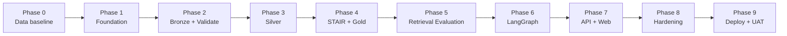
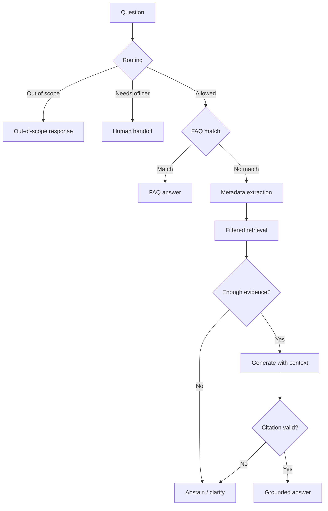

# Kế hoạch triển khai theo giai đoạn — UEL RAG Chatbot PoC

Tài liệu này dùng để theo dõi tiến độ triển khai theo từng giai đoạn độc lập. `PLAN.md` mô tả kiến trúc và kế hoạch tổng thể; tài liệu này chuyển kế hoạch đó thành các phase có checklist, đầu ra và điều kiện nghiệm thu rõ ràng.

## 1. Thông tin chung

| Thuộc tính | Giá trị |
|---|---|
| Phạm vi | PoC cho một phòng ban |
| Phòng ban | Phòng Bảo đảm chất lượng |
| `department_id` | `bao_dam_chat_luong` |
| Mô-đun PoC | Khảo khí |
| `module_code` | `khao_khi` |
| Thư mục dữ liệu PoC | `data/P.BDCL/` |
| Thời gian mục tiêu | 8 tuần, 40 ngày làm việc |
| Nhân sự | 1 người |
| API | FastAPI |
| Xác thực PoC | `X-API-Key` qua FastAPI dependency |
| LLM | Cloud API, provider-agnostic |
| Embedding | Local trên CPU |
| Hạ tầng | Ubuntu Server, Docker Compose |
| Trạng thái chung | Phase 0–7 đã hoàn thành; sẵn sàng bắt đầu Phase 8 |

## 2. Cách sử dụng tài liệu

### 2.1. Trạng thái phase

Mỗi phase chỉ sử dụng một trong các trạng thái:

| Trạng thái | Ý nghĩa |
|---|---|
| `NOT_STARTED` | Chưa bắt đầu |
| `IN_PROGRESS` | Đang thực hiện |
| `BLOCKED` | Không thể tiếp tục do thiếu quyết định, dữ liệu hoặc quyền truy cập |
| `READY_FOR_REVIEW` | Đã hoàn thành kỹ thuật, chờ kiểm tra |
| `ACCEPTED` | Đã đạt exit gate và được chấp nhận |

### 2.2. Quy tắc cập nhật

1. Chỉ đánh dấu `[x]` khi có bằng chứng kiểm tra được.
2. Ghi bằng chứng vào cột hoặc mục “Evidence”.
3. Không bắt đầu phase phụ thuộc nếu phase trước chưa đạt exit gate, trừ các công việc không phụ thuộc được ghi rõ.
4. Nếu phase bị `BLOCKED`, ghi nguyên nhân, người cần phản hồi và ngày kiểm tra lại.
5. Mọi thay đổi phạm vi phải được ghi vào Decision Log.
6. Không thay đổi dữ liệu XLSX nguồn bằng pipeline; mọi chuẩn hóa diễn ra trong Silver Layer.
7. KPI chỉ được chốt sau khi chạy benchmark trên dữ liệu PoC thật.

## 3. Master tracker

| Phase | Tên giai đoạn | Thời lượng dự kiến | Trạng thái | Phụ thuộc | Exit gate |
|---:|---|---:|---|---|---|
| 0 | Baseline, kiểm kê và khóa dữ liệu PoC | 2 ngày | `ACCEPTED` | Không | Đã khóa data contract và release policy |
| 1 | Nền tảng repository và hạ tầng local | 3 ngày | `ACCEPTED` | Phase 0 | Stack khởi động, health check đạt |
| 2 | Bronze ingestion và validation | 5 ngày | `ACCEPTED` | Phase 0–1 | Đọc đủ 3 workbook, có báo cáo validation |
| 3 | Silver Layer và đồng bộ idempotent | 5 ngày | `ACCEPTED` | Phase 2 | PostgreSQL phản ánh đúng dữ liệu nguồn |
| 4 | STAIR, embedding và Gold Layer | 5 ngày | `ACCEPTED` | Phase 3 | Qdrant truy xuất đúng với hard filter |
| 5 | Retrieval baseline và bộ đánh giá | 4 ngày | `ACCEPTED` | Phase 4 | Recall@5 sơ bộ đạt ngưỡng |
| 6 | LangGraph RAG agent | 6 ngày | `ACCEPTED` | Phase 3–5 | Luồng FAQ/RAG/handoff hoạt động end-to-end |
| 7 | FastAPI, API key và web chat | 4 ngày | `ACCEPTED` | Phase 6 | API và UI vượt smoke test |
| 8 | Hardening, kiểm thử và đánh giá | 4 ngày | `IN_PROGRESS` | Phase 7 | Không còn lỗi P0/P1, KPI đạt hoặc có ngoại lệ |
| 9 | Deploy, UAT và bàn giao PoC | 2 ngày | `NOT_STARTED` | Phase 8 | UAT được xác nhận, có runbook |

Tổng dự kiến: 40 ngày làm việc.



## 4. Baseline dữ liệu PoC đã nhận

### 4.1. File nguồn

| File | Vai trò | Trạng thái kiểm kê |
|---|---|---|
| `data/P.BDCL/1. Thông tin Mô-đun - Khảo khí.xlsx` | Phạm vi, routing và handoff | Đã kiểm kê cấu trúc |
| `data/P.BDCL/2. FAQ - Câu hỏi thường gặp.xlsx` | Câu hỏi và trả lời nhanh | Đã kiểm kê cấu trúc |
| `data/P.BDCL/3. Tài liệu nghiệp vụ.xlsx` | Quy định, thủ tục và tình huống | Đã kiểm kê cấu trúc |

### 4.2. Baseline routing

Workbook mô-đun có 17 dòng routing thực tế:

| Loại | Số dòng | Cách xử lý dự kiến |
|---|---:|---|
| Trong phạm vi, bot được trả lời | 8 | FAQ hoặc RAG |
| Trong phạm vi nhưng cần cán bộ | 5 | Chỉ hướng dẫn chung và handoff |
| Ngoài phạm vi | 4 | Chuyển đúng đơn vị, không dùng RAG của Phòng Bảo đảm chất lượng |
| Tổng | 17 |  |

Các nhóm handoff đáng chú ý:

- Kết quả hoặc phúc khảo của một người học cụ thể.
- Không có tên trong danh sách dự thi, điểm I hoặc bị cấm thi.
- Lỗi đề thi hoặc sự cố tổ chức thi cụ thể.
- Hồ sơ hoãn thi/điểm I cụ thể và trường hợp ngoại lệ.
- Tranh chấp hoặc khiếu nại kết quả cá nhân.

Các nhóm ngoài phạm vi:

- Đăng ký/hủy học phần và thời khóa biểu.
- Học phí, công nợ và tài chính.
- Hỗ trợ kỹ thuật hệ thống cụ thể.
- Quyết định kỷ luật cá nhân.

### 4.3. Baseline FAQ

| Chỉ số | Giá trị |
|---|---:|
| Tổng FAQ có nội dung | 71 |
| FAQ thiếu mã | 0 |
| FAQ thiếu câu hỏi | 0 |
| FAQ thiếu câu trả lời | 0 |
| Mã FAQ bị trùng | 0 |
| Phân mục cấp 1 | 3 |
| Phân mục chi tiết | 10 |
| FAQ chưa có văn bản căn cứ | 59 |
| FAQ chưa có đầu mối hỗ trợ riêng | 71 |
| FAQ chưa có thông tin liên hệ riêng | 71 |
| FAQ chưa có kênh trực tuyến riêng | 71 |

Phân bố:

| Phân mục | Số FAQ |
|---|---:|
| I. Quy định chung về khảo thí | 33 |
| II. Người học đại học | 18 |
| III. Người học sau đại học | 20 |

Việc thiếu đầu mối trên FAQ có thể chấp nhận nếu thống nhất quy tắc kế thừa từ mô-đun. Việc này chưa được tự động giả định cho tới khi Phase 0 được xác nhận.

### 4.4. Baseline tài liệu nghiệp vụ

| Mã | Chủ đề | Nội dung quy định | Điều kiện/ngoại lệ | Hồ sơ | Các bước |
|---|---|---:|---:|---:|---:|
| TL01 | Quy định về công tác khảo thí UEL | 8 | 10 | 0 | 0 |
| TL02 | Đăng ký phúc khảo điểm thi kết thúc học phần | 3 | 6 | 1 | 5 |
| TL03 | Xin hoãn thi, nhận điểm I | 2 | 6 | 2 | 4 |
| TL04 | Đăng ký trả điểm I, thi bổ sung | 2 | 4 | 1 | 4 |

TL01 là tài liệu quy định tổng hợp nên không có hồ sơ hoặc các bước thủ tục là hợp lý. TL02–TL04 là tài liệu thủ tục.

### 4.5. Các vấn đề đã có policy trong Phase 0

| ID | Vấn đề | Kết luận Phase 0 |
|---|---|---|
| DATA-01 | Tên mô-đun là “Khảo khí” | Đây là tên đúng; không tự sửa thành “Khảo thí” |
| DATA-02 | Tên phòng ban có nhiều kiểu viết | Chuẩn hóa hiển thị thành `Phòng Bảo đảm chất lượng` |
| DATA-03 | Routing rule chưa có mã ổn định | Dùng content-based source key; production nên thêm mã tại nguồn |
| DATA-04 | FAQ không có trạng thái và thời gian hiệu lực | Kế thừa trạng thái từ release manifest |
| DATA-05 | 59/71 FAQ chưa ghi văn bản căn cứ | Cho phép trong development với warning; cần business review trước UAT |
| DATA-06 | 71 FAQ không có contact riêng | Kế thừa contact module/department đã xác nhận |
| DATA-07 | TL02, TL03, TL04 có lệ phí chưa xác định | `fee_type=unknown`; cấm nêu số tiền, abstain/handoff |
| DATA-08 | Schema workbook PoC khác template gốc | Parser kiểm tra schema fingerprint |
| DATA-09 | Email, hotline và URL chưa được business-verify | Chuyển thành UAT release gate |
| DATA-10 | Workbook thiếu row-level approval | Release manifest là approval envelope |

## 5. Phase 0 — Baseline, kiểm kê và khóa dữ liệu PoC

**Trạng thái:** `ACCEPTED`
**Thời lượng:** 2 ngày  
**Mục tiêu:** Chuyển ba workbook thành một data contract có thể triển khai mà không suy đoán.

### 5.1. Checklist

- [x] P0.01 — Xác nhận đã có đủ 3 workbook PoC.
- [x] P0.02 — Kiểm kê workbook, sheet và vùng dữ liệu có nội dung.
- [x] P0.03 — Đếm 17 routing rules và phân loại theo hành vi.
- [x] P0.04 — Đếm 71 FAQ và kiểm tra mã trùng/ô bắt buộc trống.
- [x] P0.05 — Kiểm kê TL01–TL04 và các nhóm nội dung.
- [x] P0.06 — Xác nhận “Khảo khí” là tên đúng của mô-đun.
- [x] P0.07 — Chốt tên hiển thị `Phòng Bảo đảm chất lượng`.
- [x] P0.08 — Chốt `module_code=khao_khi`.
- [x] P0.09 — Chốt khóa ổn định cho routing rule.
- [x] P0.10 — Chốt cách xác định FAQ active/inactive qua release manifest.
- [x] P0.11 — Chốt quy tắc kế thừa contact từ module xuống FAQ/tài liệu.
- [x] P0.12 — Chốt chính sách đối với FAQ không có văn bản căn cứ.
- [x] P0.13 — Chốt xử lý ba giá trị lệ phí chưa xác định.
- [x] P0.14 — Ghi contact/URL verification thành UAT release gate.
- [x] P0.15 — Chốt cloud LLM ở mức thiết kế, không gửi PII; organizational approval là UAT gate.
- [x] P0.16 — Viết data dictionary và canonical enums.
- [x] P0.17 — Tạo schema fingerprint cho từng workbook.
- [x] P0.18 — Chốt release status và approval policy.

### 5.2. Đầu ra

- `docs/data-dictionary.md`.
- `docs/data-mapping.md`.
- `docs/decisions/` cho các quyết định dữ liệu.
- Danh sách enum chuẩn hóa.
- Schema fingerprint của 3 workbook.
- Danh sách blocker đã có người chịu trách nhiệm.

### 5.3. Exit gate

Phase 0 đã đạt `ACCEPTED` với các kết quả:

- “Khảo khí” được xác nhận là tên đúng của mô-đun.
- Có khóa ổn định cho FAQ, routing rule và tài liệu.
- Có quy tắc active/approved/effective.
- Có quy tắc xử lý dữ liệu thiếu hoặc “Chưa xác định”.
- Có giới hạn dữ liệu rõ ràng cho cloud LLM; phê duyệt tổ chức được kiểm tra lại trước UAT.

## 6. Phase 1 — Nền tảng repository và hạ tầng local

**Trạng thái:** `ACCEPTED`
**Thời lượng:** 3 ngày  
**Phụ thuộc:** Phase 0 đã khóa các quyết định ảnh hưởng schema.

### 6.1. Checklist

- [x] P1.01 — Khởi tạo package Python 3.12.
- [x] P1.02 — Tạo cấu trúc `app/`, `tests/`, `configs/`, `docs/`.
- [x] P1.03 — Cấu hình dependency management.
- [x] P1.04 — Cấu hình formatter, linter và type checker.
- [x] P1.05 — Tạo `.gitignore` và `.env.example`.
- [x] P1.06 — Tạo configuration model bằng Pydantic Settings.
- [x] P1.07 — Tạo `configs/departments.yaml`.
- [x] P1.08 — Cấu hình `department_id=bao_dam_chat_luong`.
- [x] P1.09 — Tạo Dockerfile cho API/worker.
- [x] P1.10 — Tạo Docker Compose cho PostgreSQL, Qdrant, MinIO và API.
- [x] P1.11 — Tạo named volumes và internal network.
- [x] P1.12 — Tạo health checks cho từng service.
- [x] P1.13 — Thiết lập structured logging và request ID.
- [x] P1.14 — Thiết lập Pytest và smoke test đầu tiên.
- [x] P1.15 — Kiểm tra secret không xuất hiện trong Git hoặc log.

### 6.2. Đầu ra

- Stack local khởi động được.
- Configuration validation hoạt động.
- Health checks có kết quả rõ ràng.
- Test foundation hoạt động.

### 6.3. Exit gate

Phase 1 đã đạt `ACCEPTED` (2026-11-09):

- `docker compose up` khởi động thành công.
- PostgreSQL, Qdrant và MinIO ở trạng thái healthy.
- Cấu hình thiếu biến bắt buộc phải fail-fast.
- Không có secret thật trong repository.
- Smoke test chạy thành công.

Bằng chứng: `reports/phases/phase-01.md`.

## 7. Phase 2 — Bronze ingestion và validation

**Trạng thái:** `ACCEPTED`
**Thời lượng:** 5 ngày  
**Phụ thuộc:** Phase 0 và Phase 1.

### 7.1. Checklist

- [x] P2.01 — Định nghĩa `SourceAdapter` chung.
- [x] P2.02 — Xây XLSX adapter cho dữ liệu PoC.
- [x] P2.03 — Chỉ đọc sheet dữ liệu, bỏ qua sheet hướng dẫn/ẩn khi phù hợp.
- [x] P2.04 — Nhận diện workbook bằng schema fingerprint, không chỉ bằng tên file.
- [x] P2.05 — Đọc thông tin mô-đun và routing rows.
- [x] P2.06 — Đọc 71 FAQ.
- [x] P2.07 — Đọc TL01–TL04 theo schema thực tế.
- [x] P2.08 — Giữ source location: file, sheet, row, column.
- [x] P2.09 — Tạo raw snapshot và checksum.
- [x] P2.10 — Upload snapshot vào MinIO Bronze bucket.
- [x] P2.11 — Tạo Pydantic models cho raw records.
- [x] P2.12 — Validate required fields.
- [x] P2.13 — Validate mã FAQ duy nhất.
- [x] P2.14 — Validate enum routing.
- [x] P2.15 — Validate email, hotline và URL theo format.
- [x] P2.16 — Validate nội dung “Chưa xác định”.
- [x] P2.17 — Phân loại lỗi `ERROR`, `WARNING`, `INFO`.
- [x] P2.18 — Xuất validation report dạng JSON và Markdown.
- [x] P2.19 — Xây `--dry-run`.
- [x] P2.20 — Viết unit tests bằng bản sao fixture tối thiểu.

### 7.2. Validation policy tối thiểu

| Tình huống | Mức |
|---|---|
| Thiếu mã/câu hỏi/câu trả lời FAQ | `ERROR` |
| Trùng mã FAQ | `ERROR` |
| Routing type không hợp lệ | `ERROR` |
| Tài liệu không có mã hoặc tên | `ERROR` |
| Tài liệu được duyệt nhưng không có nội dung | `ERROR` |
| Lệ phí “Chưa xác định” | `WARNING` và cấm trả lời số tiền |
| FAQ thiếu văn bản căn cứ | `WARNING` nếu policy cho phép |
| Contact kế thừa từ module | `INFO` |
| Tên module không khớp `Khảo khí`/`khao_khi` trong manifest | `ERROR` |
| URL sai định dạng | `ERROR` nếu URL bắt buộc, nếu không là `WARNING` |

### 7.3. Exit gate

Phase 2 đã đạt `ACCEPTED` (2026-11-10):

- Parser đọc đúng 17 routing rules, 71 FAQ, TL01–TL04 (15/26/4/13 section counts).
- Mọi issue record-level có source location.
- `python -m app.cli sync --dry-run` không ghi PostgreSQL/Qdrant/MinIO.
- Validation report JSON/Markdown phản ánh DATA-01 đến DATA-10.
- Checksum ba workbook nguồn không đổi sau dry-run.

Bằng chứng: `reports/phases/phase-02.md`.

## 8. Phase 3 — Silver Layer và đồng bộ idempotent

**Trạng thái:** `ACCEPTED`
**Thời lượng:** 5 ngày  
**Phụ thuộc:** Phase 2.

### 8.1. Checklist

- [x] P3.01 — Chốt ERD.
- [x] P3.02 — Tạo SQLAlchemy models.
- [x] P3.03 — Tạo Alembic migration.
- [x] P3.04 — Tạo bảng `departments`.
- [x] P3.05 — Tạo bảng `modules`.
- [x] P3.06 — Tạo bảng `routing_rules`.
- [x] P3.07 — Tạo bảng `faqs`.
- [x] P3.08 — Tạo bảng `documents`.
- [x] P3.09 — Tạo bảng `document_sections`.
- [x] P3.10 — Tạo bảng `procedures` hoặc cấu trúc tương đương.
- [x] P3.11 — Tạo bảng `attachments`.
- [x] P3.12 — Tạo bảng `sync_runs` và `source_records`.
- [x] P3.13 — Chuẩn hóa Unicode NFC và khoảng trắng.
- [x] P3.14 — Chuẩn hóa tên phòng ban và module theo decision.
- [x] P3.15 — Tính content hash.
- [x] P3.16 — Upsert bằng business key ổn định.
- [x] P3.17 — Thực hiện transaction theo sync run.
- [x] P3.18 — Xây soft-delete/deactivate.
- [x] P3.19 — Xây chính sách kế thừa contact.
- [x] P3.20 — Xây lệnh rollback/retry sync thất bại.
- [x] P3.21 — Chạy cùng input hai lần và so sánh kết quả.
- [x] P3.22 — Viết integration tests với PostgreSQL thật.

### 8.2. Exit gate

Phase 3 đã đạt `ACCEPTED` (2026-11-10):

- PostgreSQL: 1 department, 1 module, 17 routing, 71 FAQ, 4 documents, 15/26/4/13 sections.
- Sync lần 2: 0 insert, 0 update, 0 deactivate, 159 unchanged.
- Đổi một ô FAQ chỉ cập nhật record đó (integration test).
- Sync lỗi ghi `sync_runs.status=failed` và rollback dữ liệu Silver.

Bằng chứng: `reports/phases/phase-03.md`.

## 9. Phase 4 — STAIR, embedding và Gold Layer

**Trạng thái:** `ACCEPTED`
**Thời lượng:** 5 ngày  
**Phụ thuộc:** Phase 3.

### 9.1. Checklist

- [x] P4.01 — Định nghĩa format STAIR Markdown.
- [x] P4.02 — Serialize TL01 theo loại quy định.
- [x] P4.03 — Serialize TL02–TL04 theo loại thủ tục.
- [x] P4.04 — Gắn department, module, audience và nguồn vào mỗi chunk.
- [x] P4.05 — Không tách thời hạn, lệ phí hoặc ngoại lệ khỏi chủ đề.
- [x] P4.06 — Tạo deterministic chunk ID.
- [x] P4.07 — Benchmark `BAAI/bge-m3` trên CPU.
- [x] P4.08 — Không benchmark e5: đã khóa BGE-M3 dense+sparse (DR-P4-05).
- [x] P4.09 — Model: `BAAI/bge-m3`.
- [x] P4.10 — Tạo Qdrant collection với dimension phù hợp.
- [x] P4.11 — Tạo payload indexes.
- [x] P4.12 — Hard filter theo `department_id`.
- [x] P4.13 — Hard filter theo approval/status/effective date.
- [x] P4.14 — Upsert chỉ chunk thay đổi.
- [x] P4.15 — Xóa/deactivate vector của record ngưng dùng.
- [x] P4.16 — Xây lệnh rebuild toàn bộ Qdrant từ PostgreSQL.
- [x] P4.17 — Kiểm tra payload không chứa secret hoặc PII.

### 9.2. Exit gate

Phase 4 đã đạt `ACCEPTED` (2026-11-10):

- Qdrant `uel_knowledge`: 130 point (71 FAQ + 15/25/3/3/13).
- Incremental: 130 unchanged, 0 upsert; tenant leak 0; PII 0.
- Smoke 6 câu PoC khớp từ khóa; mọi hit có `department_id` đúng.
- BGE-M3 dense 1024 + sparse, query ~0.47s CPU sau load.

Bằng chứng: `reports/phases/phase-04.md`, `reports/phases/phase-04-evidence.json`.

## 10. Phase 5 — Retrieval baseline và bộ đánh giá

**Trạng thái:** `ACCEPTED`
**Thời lượng:** 4 ngày  
**Phụ thuộc:** Phase 4.  
**Evidence:** `reports/phases/phase-05.md`; `reports/phases/phase-05-baseline.json`.

### 10.1. Checklist

- [x] P5.01 — Tạo tập câu hỏi từ 71 FAQ.
- [x] P5.02 — Tạo paraphrase cho một phần FAQ nhưng không dùng để kiểm tra exact match.
- [x] P5.03 — Tạo câu hỏi retrieval cho TL01–TL04.
- [x] P5.04 — Tạo câu hỏi cần phân biệt ĐHCQ, SĐH và VB2/VLVH.
- [x] P5.05 — Tạo câu hỏi ngoài phạm vi.
- [x] P5.06 — Tạo câu hỏi cần handoff.
- [x] P5.07 — Tạo câu hỏi thiếu dữ liệu, gồm câu hỏi về lệ phí chưa xác định.
- [x] P5.08 — Tạo adversarial/prompt injection cases.
- [x] P5.09 — Chia calibration set và test set.
- [x] P5.10 — Đo Recall@1, Recall@5 và MRR.
- [x] P5.11 — So sánh dense-only với lexical+dense nếu cần.
- [x] P5.12 — Hiệu chỉnh `top_k` và score threshold trên calibration set.
- [x] P5.13 — Đóng băng test set trước khi tối ưu tiếp.
- [x] P5.14 — Ghi baseline report.

### 10.2. Tình huống bắt buộc trong evaluation

| Nhóm | Ví dụ kỳ vọng |
|---|---|
| Phúc khảo ĐHCQ | Lấy đúng thời hạn 2 ngày làm việc |
| Phúc khảo SĐH | Lấy đúng thời hạn 7 ngày làm việc |
| Nhận điểm I | Lấy TL03, thời hạn nộp 3 ngày làm việc |
| Trả điểm I | Lấy TL04, đăng ký trước 7 ngày của đợt thi bổ sung |
| Hiệu lực điểm I | Trả lời 1 năm và nêu hệ quả quá hạn |
| Điện thoại trong phòng thi | Lấy đúng ngoại lệ/vi phạm từ TL01 |
| Kết quả cá nhân | Handoff, không suy đoán |
| Học phí | Ngoài phạm vi, chuyển đúng đơn vị |
| Cách thức SEB chung | Có thể trả lời hướng dẫn nghiệp vụ chung |
| Không cài được SEB | Chuyển hỗ trợ kỹ thuật |
| Lệ phí phúc khảo | Từ chối nêu số tiền do chưa xác định |

### 10.3. Exit gate

- Có ít nhất 80 câu retrieval/evaluation ban đầu.
- Recall@5 sơ bộ ≥ 85%.
- Không có tenant leakage trong fixture giả lập.
- Các câu hỏi thời hạn theo hệ đào tạo lấy đúng tài liệu.
- Threshold được ghi nhận bằng số liệu, không chọn cảm tính.

## 11. Phase 6 — LangGraph RAG agent

**Trạng thái:** `ACCEPTED`
**Thời lượng:** 6 ngày  
**Phụ thuộc:** Phase 3–5.  
**Evidence:** `reports/phases/phase-06.md`; `docs/decisions/phase-06-decisions.md`.

### 11.1. Checklist

- [x] P6.01 — Định nghĩa graph state.
- [x] P6.02 — Xây `normalize_input`.
- [x] P6.03 — Xây routing node.
- [x] P6.04 — Xây normalized FAQ match.
- [x] P6.05 — Xây metadata extractor.
- [x] P6.06 — Giới hạn metadata extractor bằng enum cho phép.
- [x] P6.07 — Xây retrieval node với hard filter.
- [x] P6.08 — Xây evidence gate.
- [x] P6.09 — Xây LLM provider interface.
- [x] P6.10 — Xây system prompt tiếng Việt.
- [x] P6.11 — Cấm dùng kiến thức ngoài context để kết luận quy định UEL.
- [x] P6.12 — Xây generation node.
- [x] P6.13 — Xây citation verifier.
- [x] P6.14 — Xây `insufficient_evidence`.
- [x] P6.15 — Xây `human_handoff`.
- [x] P6.16 — Xây `out_of_scope`.
- [x] P6.17 — Xử lý timeout, retry giới hạn và provider error.
- [x] P6.18 — Ghi latency từng node.
- [x] P6.19 — Viết graph integration tests.
- [x] P6.20 — Chạy evaluation regression.

### 11.2. Nhánh bắt buộc



### 11.3. Exit gate

- FAQ match không gọi generation LLM.
- Out-of-scope không gọi Qdrant hoặc generation LLM.
- Handoff không trả lời dữ liệu cá nhân.
- Mọi câu RAG có citation hợp lệ.
- Câu hỏi lệ phí chưa xác định phải abstain.
- Provider timeout trả lỗi kiểm soát được.
- Regression set không giảm chất lượng ngoài ngưỡng cho phép.

## 12. Phase 7 — FastAPI, API key và web chat

**Trạng thái:** `ACCEPTED`
**Thời lượng:** 4 ngày  
**Phụ thuộc:** Phase 6.

### 12.1. Checklist

- [x] P7.01 — Tạo FastAPI app factory.
- [x] P7.02 — Tạo request/response schemas.
- [x] P7.03 — Tạo `X-API-Key` dependency.
- [x] P7.04 — So sánh API key bằng constant-time comparison.
- [x] P7.05 — Inject `department_id` cố định từ server config.
- [x] P7.06 — Không nhận tenant tùy ý từ client.
- [x] P7.07 — Tạo `POST /v1/chat`.
- [x] P7.08 — Tạo `/health/live` và `/health/ready`.
- [x] P7.09 — Tạo exception mapping.
- [x] P7.10 — Thêm request ID.
- [x] P7.11 — Thêm request size limit và timeout.
- [x] P7.12 — Cấu hình CORS cụ thể.
- [x] P7.13 — Tạo web chat tối thiểu.
- [x] P7.14 — Hiển thị answer status, citation và handoff.
- [x] P7.15 — Escape nội dung để chống XSS.
- [x] P7.16 — Viết OpenAPI examples.
- [x] P7.17 — Viết API integration tests.
- [x] P7.18 — Viết browser smoke test.

### 12.2. Exit gate

- Thiếu/sai API key trả HTTP 401.
- API key không xuất hiện trong log.
- Request không thể thay đổi tenant.
- Web chat hiển thị citation đúng.
- Nội dung LLM không được render như HTML tin cậy.
- Health readiness phát hiện dependency bị lỗi.

## 13. Phase 8 — Hardening, kiểm thử và đánh giá

**Trạng thái:** `IN_PROGRESS`
**Thời lượng:** 4 ngày  
**Phụ thuộc:** Phase 7.

### 13.1. Checklist

- [x] P8.01 — Mở rộng evaluation set lên ít nhất 120 câu.
- [x] P8.02 — Chạy retrieval metrics.
- [ ] P8.03 — Đánh giá answer correctness.
- [ ] P8.04 — Đánh giá groundedness.
- [ ] P8.05 — Đánh giá citation validity.
- [ ] P8.06 — Đánh giá correct abstention.
- [x] P8.07 — Test tenant leakage bằng department fixture thứ hai.
- [x] P8.08 — Test prompt injection.
- [x] P8.09 — Test dữ liệu hết hiệu lực/ngưng dùng.
- [x] P8.10 — Test provider timeout/quota.
- [x] P8.11 — Test input dài, rỗng và ký tự đặc biệt.
- [x] P8.12 — Test URL/citation độc hại.
- [x] P8.13 — Test API key leakage.
- [x] P8.14 — Load test 10 virtual users.
- [x] P8.15 — Kiểm tra backup/restore.
- [x] P8.16 — Phân loại defect P0/P1/P2.
- [x] P8.17 — Sửa toàn bộ P0/P1.
- [ ] P8.18 — Xuất evaluation report.

### 13.2. KPI mục tiêu

| KPI | Mục tiêu |
|---|---:|
| Retrieval Recall@5 | ≥ 90% |
| MRR | ≥ 0,80 |
| Answer correctness | ≥ 85% |
| Groundedness | ≥ 90% |
| Citation validity | ≥ 95% |
| Correct abstention | ≥ 95% |
| Tenant leakage | 0 |
| FAQ normalized match | ≥ 98% |
| Sync idempotency | 100% |
| API error rate ở 10 VU | < 1% |
| FAQ p95 | ≤ 1 giây |
| RAG p95 | ≤ 8 giây, không tính sự cố provider |

### 13.3. Exit gate

- Không còn defect P0/P1.
- Tenant leakage bằng 0.
- KPI đạt mục tiêu hoặc có biên bản chấp nhận ngoại lệ.
- Backup/restore đã được chạy thử.
- Không phát hiện secret hoặc dữ liệu nhạy cảm trong log.

## 14. Phase 9 — Deploy, UAT và bàn giao PoC

**Trạng thái:** `NOT_STARTED`  
**Thời lượng:** 2 ngày  
**Phụ thuộc:** Phase 8.

### 14.1. Checklist

- [ ] P9.01 — Chuẩn bị Ubuntu Server.
- [ ] P9.02 — Kiểm tra CPU, RAM, disk và port.
- [ ] P9.03 — Cấu hình production-like environment.
- [ ] P9.04 — Khởi động Docker Compose.
- [ ] P9.05 — Chạy migration.
- [ ] P9.06 — Chạy sync dữ liệu PoC đã duyệt.
- [ ] P9.07 — Chạy smoke test sau deploy.
- [ ] P9.08 — Chạy UAT với Phòng Bảo đảm chất lượng.
- [ ] P9.09 — Ghi defect và kết quả UAT.
- [ ] P9.10 — Viết runbook khởi động/dừng/restart.
- [ ] P9.11 — Viết hướng dẫn sync và đọc validation report.
- [ ] P9.12 — Viết hướng dẫn backup/restore.
- [ ] P9.13 — Viết troubleshooting.
- [ ] P9.14 — Ghi giới hạn PoC.
- [ ] P9.15 — Lập backlog sau PoC.
- [ ] P9.16 — Chốt quyết định go/no-go.

### 14.2. Exit gate

- Hệ thống được dựng lại từ repository và cấu hình mẫu.
- Dữ liệu PoC sync thành công mà không sửa trực tiếp database.
- Chuyên viên kiểm tra được các luồng FAQ, RAG, handoff và out-of-scope.
- UAT được xác nhận hoặc có danh sách ngoại lệ được chấp nhận.
- Có runbook và backup/restore guide.

## 15. Definition of Done chung

Một task kỹ thuật chỉ được đánh dấu hoàn thành khi:

- Code đã được format và lint.
- Type check không có lỗi nghiêm trọng.
- Có test tương ứng.
- Test liên quan chạy thành công.
- Không chứa secret.
- Có error handling và logging phù hợp.
- Thay đổi cấu hình được cập nhật vào `.env.example`.
- Thay đổi database có migration.
- Thay đổi data contract có cập nhật tài liệu.
- Thay đổi retrieval hoặc prompt có evaluation regression.
- Không sửa trực tiếp workbook PoC bằng mã nguồn.

## 16. Blocker log

| ID | Blocker | Phase ảnh hưởng | Owner | Trạng thái | Ngày kiểm tra lại |
|---|---|---|---|---|---|
| BLK-01 | Xác nhận “Khảo khí/Khảo thí” | 0–2 | Người phụ trách PoC | Resolved | 2026-11-09 |
| BLK-02 | Xác nhận approval/status/effective policy | 0–4 | Dự án | Resolved | 2026-11-09 |
| BLK-03 | Business-confirm lệ phí TL02–TL04 | 9 | Phòng Bảo đảm chất lượng | UAT gate | Trước UAT |
| BLK-04 | Business-verify email, hotline và URL | 9 | Phòng Bảo đảm chất lượng | UAT gate | Trước UAT |
| BLK-05 | Organizational approval cho cloud LLM/provider | 9 | UEL/IT | UAT gate | Trước UAT |
| BLK-06 | Cấp Ubuntu Server và secret triển khai | 9 | UEL/IT | Open | TBD |

## 17. Decision log

| ID | Quyết định | Trạng thái | Ngày | Ghi chú |
|---|---|---|---|---|
| DEC-01 | PoC triển khai Phòng Bảo đảm chất lượng / Mô-đun Khảo khí | Accepted | 2026-11-09 | Một phòng có nhiều mô-đun; PoC chọn một |
| DEC-02 | Department và module cố định từ server config | Accepted | 2026-11-09 | Client không truyền context để đổi phạm vi |
| DEC-03 | Xác thực bằng API key dependency | Accepted | 2026-11-09 | Không xây SSO trong PoC |
| DEC-04 | Cloud LLM, local embedding CPU | Accepted | 2026-11-09 | Provider/model cụ thể chưa chốt |
| DEC-05 | XLSX là nguồn phát triển PoC | Accepted | 2026-11-09 | Google Sheets là bước tích hợp sau |
| DEC-06 | Tên chuẩn của mô-đun là `Khảo khí` | Accepted | 2026-11-09 | `module_code=khao_khi` |
| DEC-07 | Approval/status/effective policy | Accepted | 2026-11-09 | Dùng release manifest |
| DEC-08 | Chính sách FAQ thiếu căn cứ | Accepted | 2026-11-09 | Warning dev, business review trước UAT |
| DEC-09 | Chính sách kế thừa contact | Accepted | 2026-11-09 | Record → module → department → null |
| DEC-10 | Lệ phí TL02–TL04 | Accepted | 2026-11-09 | Unknown; abstain/handoff |

## 18. Progress log

Ghi cập nhật ngắn theo mẫu:

```text
YYYY-MM-DD
- Phase:
- Hoàn thành:
- Đang làm:
- Blocked:
- Evidence:
- Bước tiếp theo:
```

### 2026-11-09

- Phase: 0.
- Hoàn thành: Kiểm kê dữ liệu, khóa data contract, mapping, enum, approval policy và schema fingerprints.
- Đang làm: Không.
- Blocked: Không có blocker ngăn Phase 1; còn các UAT release gate.
- Evidence: `reports/phases/phase-00.md`.
- Bước tiếp theo: Bắt đầu Phase 1 — nền tảng repository và hạ tầng local.

### 2026-11-09 (Phase 1)

- Phase: 1.
- Hoàn thành: Package Python 3.12, FastAPI shell, Settings, Compose stack, health liveness/readiness, pytest/ruff/mypy.
- Đang làm: Không.
- Blocked: Không.
- Evidence: `reports/phases/phase-01.md`; `docker compose ps` (4/4 healthy); readiness JSON `postgres/qdrant/minio=ok`.
- Bước tiếp theo: Bắt đầu Phase 2 — Bronze ingestion và validation.

### 2026-11-10 (Phase 2)

- Phase: 2.
- Hoàn thành: SourceAdapter + XLSX parser, schema fingerprint, validation ERROR/WARNING/INFO, CLI `--dry-run`, Bronze snapshot/MinIO upload, báo cáo JSON/Markdown.
- Đang làm: Không.
- Blocked: Không.
- Evidence: `reports/phases/phase-02.md`; dry-run 17/71/4, 0 ERROR, 62 WARNING; pytest 20 passed.
- Bước tiếp theo: Bắt đầu Phase 3 — Silver Layer và đồng bộ idempotent.

### 2026-11-10 (Phase 3)

- Phase: 3.
- Hoàn thành: ERD, SQLAlchemy/Alembic, upsert idempotent, soft-delete, contact inheritance, sync_runs audit, integration PostgreSQL.
- Đang làm: Không.
- Blocked: Không.
- Evidence: `reports/phases/phase-03.md`; CLI sync `completed` 17/71/4; lần 2 unchanged=159; pytest 27 passed.
- Bước tiếp theo: Bắt đầu Phase 4 — STAIR, embedding và Gold Layer.

### 2026-11-10 (Phase 4)

- Phase: 4.
- Hoàn thành: STAIR, BGE-M3 dense+sparse, Qdrant 130 point, incremental, gold-verify, ẩn email STAIR.
- Đang làm: Không.
- Blocked: Không.
- Evidence: `reports/phases/phase-04.md`; `phase-04-evidence.json` (130 unchanged, PII 0, smoke 6/6).
- Bước tiếp theo: Bắt đầu Phase 5 — Retrieval baseline và bộ đánh giá.

### 2026-11-10 (Phase 5)

- Phase: 5.
- Hoàn thành: Bộ 115 câu (97 retrieval), hybrid Recall@5 test = 100%, dense-only 94.9%, tenant leak 0, đóng băng `dataset_sha256`.
- Đang làm: Không.
- Blocked: Không.
- Evidence: `reports/phases/phase-05.md`; `phase-05-baseline.json` (R@5 test 1.000, R@1 test 0.872, threshold 0.4167).
- Bước tiếp theo: Bắt đầu Phase 6 — LangGraph RAG agent.

### 2026-11-10 (Phase 6)

- Phase: 6.
- Hoàn thành: LangGraph agent, FAQ exact, routing keyword+LLM, Groq (live) + Gemini interface, FakeLLM tests, CLI chat, MemorySaver.
- Đang làm: Không.
- Blocked: Không.
- Evidence: `reports/phases/phase-06.md`; pytest unit 58 passed.
- Bước tiếp theo: Bắt đầu Phase 7 — FastAPI, API key và web chat.

### 2026-11-11 (Phase 7)

- Phase 7: `ACCEPTED`; evidence: `reports/phases/phase-07.md`.
- Next: Phase 8.

## 19. Go/No-Go checklist

### Go vào phát triển

- [x] Phase 0 được `ACCEPTED`.
- [x] Cloud LLM được chốt cho development với giới hạn không gửi PII.
- [x] Có data approval policy.
- [x] Không còn lỗi định danh nguồn.

### Go vào UAT

- [ ] Phase 1–8 được `ACCEPTED`.
- [ ] Không còn P0/P1.
- [ ] Dữ liệu UAT đã được duyệt.
- [ ] Contact và URL đã được xác nhận.
- [ ] KPI đạt hoặc có ngoại lệ được duyệt.

### Go mở rộng sau PoC

- [ ] UAT PoC được chấp nhận.
- [ ] Tenant isolation test bằng 0 leakage.
- [ ] Đã đánh giá chi phí LLM.
- [ ] Đã có authentication phù hợp hơn API key đơn.
- [ ] Đã chuẩn hóa template dùng chung.
- [ ] Đã onboarding thành công phòng ban thứ hai.
