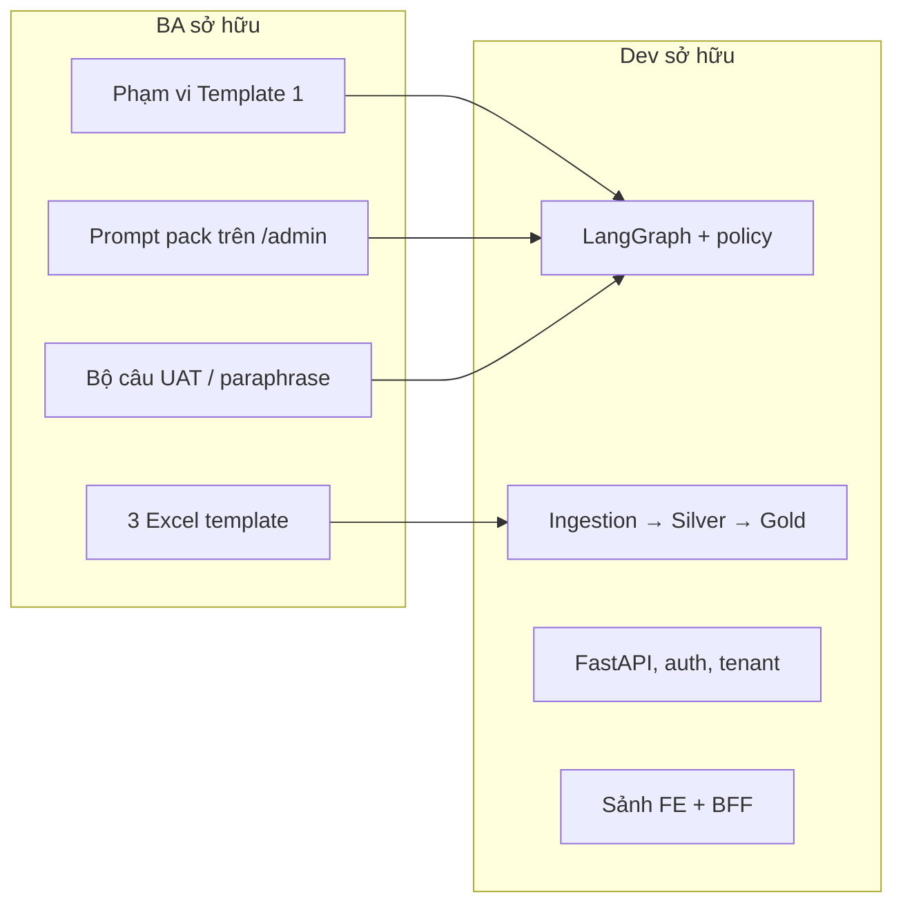
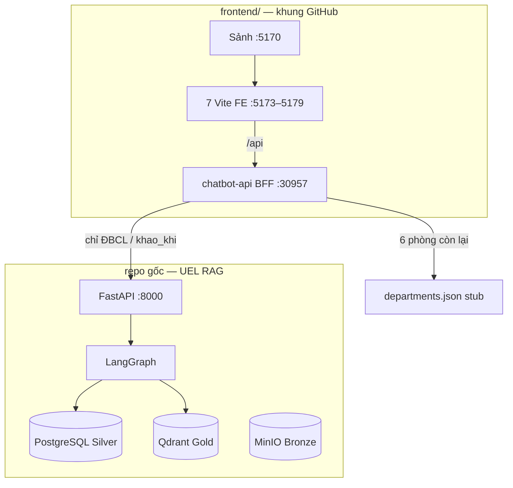
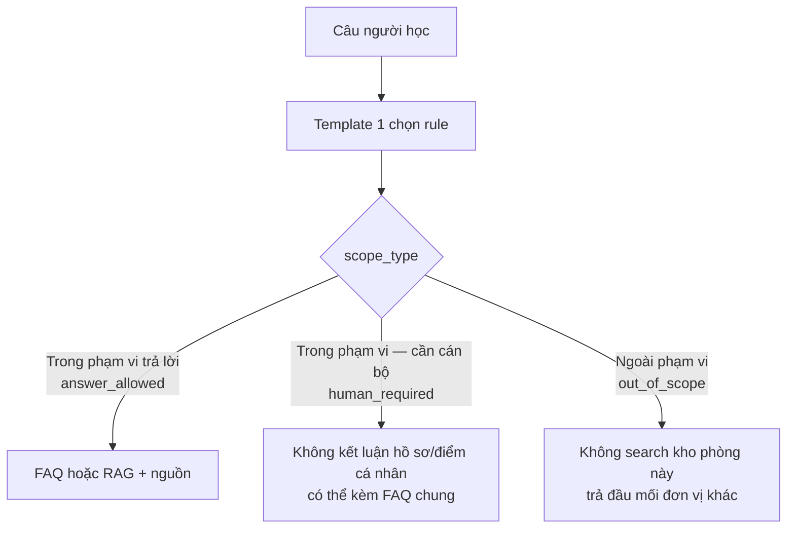
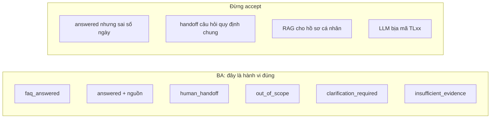
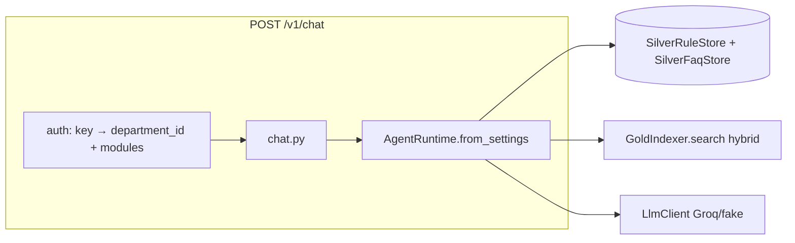
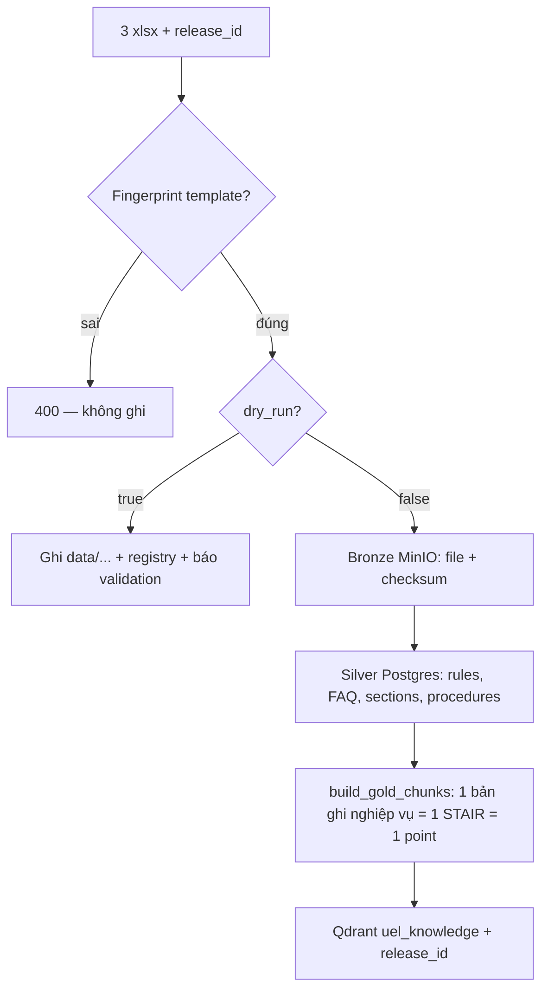
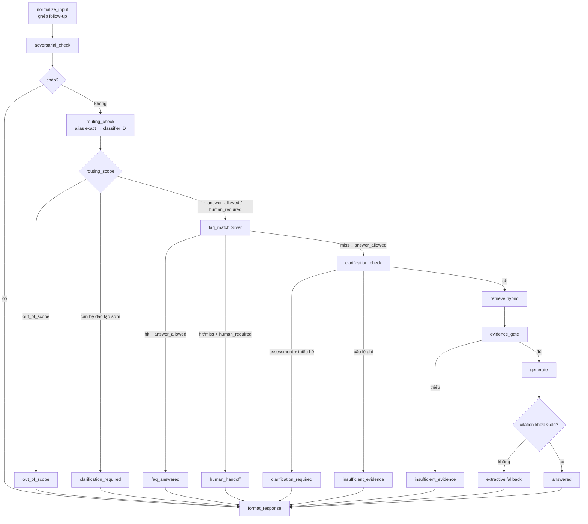
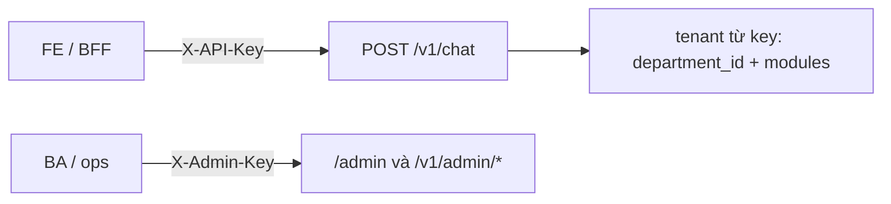
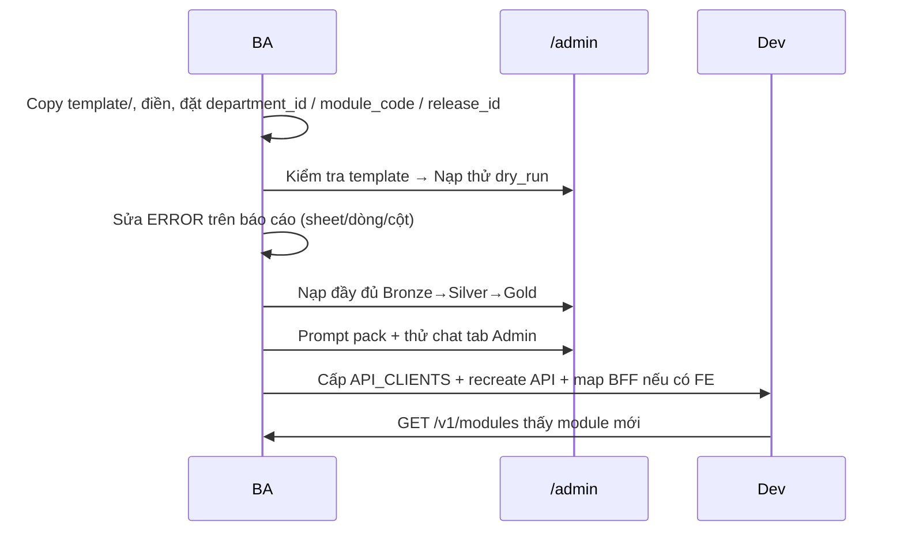
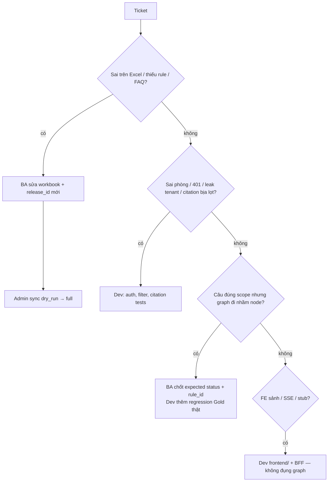

# UEL RAG — Walkthrough nội bộ (Dev + BA)

> Không phải slide BGH. File này để **team hiểu hệ thống đang chạy**, ai sở hữu phần nào, và chỗ nào được phép sửa.
>
> Đối tượng: **Dev** (sửa code, pipeline, graph, API) và **BA** (Excel template, phạm vi bot, UAT, prompt pack).
>
> PoC: `bao_dam_chat_luong` / `khao_khi` (Khảo khí — ĐBCL). Sáu phòng trên sảnh FE là stub. **Chưa production-ready.**

---

## 0. Ai đọc mục nào

| Vai | Đọc trước | Có thể lướt |
|---|---|---|
| **BA** | 1, 2, 3, 6, 8 | 4–5 (biết lớp dữ liệu là đủ), 7 (biết 2 loại key) |
| **Dev** | 1, 4, 5, 7, 9, 10 | 2–3 (thuộc 3 scope + `status`) |
| Cả hai | 11 — phân việc | |

Quy tắc làm việc chung:

> Bot **không đoán quy định**. Câu trả lời chỉ từ dữ liệu đã duyệt + nguồn, hoặc chuyển cán bộ. Bug “bot trả sai số ngày” thường là **dữ liệu / routing**, không phải “LLM chưa đủ thông minh”.



---

## 1. Hệ thống đang làm gì

Hai runtime, **hai package Python cùng tên `app`** — không `pip install` chéo.



| Cổng | Thành phần | Ai quan tâm |
|---:|---|---|
| 5170 | Sảnh chọn phòng | Demo |
| 5173 | FE ĐBCL | Dev FE, BA UAT Khảo khí |
| 5174–5179 | FE stub | Dev FE — **không** có dữ liệu nghiệp vụ |
| 30957 | BFF | Dev — map `X-Department-ID` → RAG |
| 8000 | RAG + `/admin` + `/docs` | Cả team |

PoC dữ liệu thật: 17 routing · 71 FAQ · 4 tài liệu (TL01–TL04) · 130 point Gold.

---

## 2. Hợp đồng nghiệp vụ (BA đọc kỹ)

Cán bộ phòng **không viết code**. Họ điền 3 workbook. Schema fingerprint sai → API từ chối, không ghi kho.

| File | Tên trong code | BA điền | Runtime dùng để |
|---|---|---|---|
| Template 1 | `module_and_routing` | Chủ đề, cách bot xử lý, đầu mối | Routing: được trả / chuyển người / ngoài phạm vi |
| Template 2 | `faq` | Mã câu hỏi, Q, A, căn cứ | Khớp chuỗi đã normalize — **không embedding** |
| Template 3 | `business_documents` | Sheet `TLxx`: điều khoản, điều kiện, hồ sơ, bước, hiệu lực | RAG (Gold) |

Mẫu trống: `template/`. Dữ liệu PoC Khảo khí: `data/P.BDCL/` — **không sửa file đang chạy** khi thử phòng mới.

### 2.1. Ba scope — đây là DSL nghiệp vụ thật

Excel viết tiếng Việt; pipeline map sang enum (`app/ingestion/enums.py`).



| Excel (Template 1) | Canonical | Kỳ vọng khi UAT |
|---|---|---|
| Trong phạm vi trả lời | `answer_allowed` | Được FAQ/RAG |
| Trong phạm vi — bot không tự trả lời, cần cán bộ | `human_required` | `human_handoff`; không generate quy định cho case cá nhân |
| Ngoài phạm vi trả lời | `out_of_scope` | Không đụng Qdrant Khảo khí |

Classifier LLM **chỉ được chọn `rule_id` đã có trong release**. ID bịa / conflict alias / không có rule → hỏi rõ hoặc handoff, **không retrieve**.

`bot_behavior` trên Excel hiện là **mô tả cho classifier**, chưa phải workflow (không thu thập biến nhiều bước).

### 2.2. Trạng thái dữ liệu — BA đừng nhầm “có trong Excel” = “bot được dùng”

| Khái niệm | Giá trị | Bot có index / trả không |
|---|---|---|
| Tài liệu | `Nháp` | Không |
| Tài liệu | `Đã duyệt` | Có, nếu còn hiệu lực |
| Tài liệu | `Ngưng dùng` | Không retrieve; giữ Silver để audit |
| Release module | `approved_for_dev` | PoC hiện tại — **không** nghĩa UAT nghiệp vụ |
| Release module | `approved_for_uat` | Mới được coi là chuyên viên chấp nhận |

FAQ PoC: 71 câu. Nhiều FAQ **chưa có** căn cứ / đầu mối riêng → kế thừa contact mô-đun. Khi viết UAT, BA ghi rõ “kỳ vọng kế thừa ĐBCL” hay “phải có căn cứ trên dòng FAQ”.

### 2.3. Case mẫu Khảo khí — dùng khi giải thích với Dev

| Người hỏi | Scope đúng | `status` kỳ vọng | Ghi chú |
|---|---|---|---|
| Thời hạn phúc khảo ĐHCQ | `answer_allowed` | `faq_answered` hoặc `answered` | Có nguồn; giữ nhãn ĐHCQ |
| “…còn SĐH?” (follow-up) | `answer_allowed` | `answered` | Tách mục ĐHCQ / SĐH, **không gộp hạn** |
| Điểm của em bị sai / khiếu nại cá nhân | `human_required` | `human_handoff` | Không search để “xử hộ” |
| Học phí / TKB / quên mật khẩu | `out_of_scope` | `out_of_scope` | Đào tạo / tài chính / kỹ thuật |
| Lệ phí phúc khảo là bao nhiêu | `answer_allowed` nhưng fee chưa xác định | `insufficient_evidence` | **Cấm bịa số tiền** |
| Phúc khảo (chưa nói hệ) | `answer_allowed` | `clarification_required` | Hỏi ĐHCQ / SĐH / VB2 trước khi retrieve |

Profile `assessment` (chỉ Khảo khí) thêm: hệ đào tạo, topic (`phuc_khao`, `diem_i_*`, …), câu lệ phí. Phòng mới: `profile=generic` — **không** copy logic ĐHCQ trừ khi BA + Dev thống nhất extension.

---

## 3. `status` API — ngôn ngữ chung BA ↔ Dev

Response chat: `ChatResult` (`app/agent/models.py`). BA viết test case theo `status`, không theo “câu bot nghe hay”.

| `status` | Retrieve? | LLM generate? | BA chấp nhận khi |
|---|---|---|---|
| `greeting` | không | không | Đúng câu pack YAML |
| `faq_answered` | không | không | Đúng nguyên FAQ Silver, đúng `question_code` |
| `answered` | có | có, hoặc extractive fallback | Số ngày / nhãn hệ / đầu mối khớp Gold; có `Nguồn:` |
| `human_handoff` | không (FAQ miss) | không | Không kết luận hồ sơ cá nhân; có contact |
| `out_of_scope` | không | không | Không trích TL Khảo khí |
| `clarification_required` | không | không | Hỏi đúng thứ còn thiếu (thường là hệ đào tạo) |
| `insufficient_evidence` | lệ phí: không; thiếu hit: có rồi loại | không | Không bịa; có hướng dẫn liên hệ |
| `error` | không | không | Adversarial / lỗi hệ thống — không lộ prompt |

Cờ Dev đọc thêm: `search_called`, `generate_called`, `routing_scope`, `rule_id`, `faq_question_code`, `citations[]`.



Phân loại ticket:

| Hiện tượng | Thường thuộc | Làm gì |
|---|---|---|
| Sai hạn / sai hệ / thiếu nguồn | Dữ liệu Template 2/3 hoặc chưa sync release mới | BA sửa Excel → Dev/ops sync |
| Câu chung bị handoff / câu cá nhân bị trả | Template 1 (topic, alias, `rule_id`) | BA chỉnh rule; Dev chỉ sửa keyword khi đã có regression |
| Phòng A trả nội dung phòng B | Bug **P0** tenant | Dev |
| Bot bịa citation | Runtime phải extractive fallback | Dev nếu vẫn lọt; BA không “sửa prompt cho LLM nhớ mã” |
| 6 phòng sảnh trả `[Phản hồi mô phỏng]` | Đúng thiết kế stub | Không file bug RAG |

---

## 4. Bản đồ repo (Dev)

```text
app/                    RAG backend (package app)
  api/routes/           chat.py, admin.py, health.py
  agent/                LangGraph: graph, policy, citation, assessment
  ingestion/            Excel → validate → Bronze/Silver
  gold/                 STAIR, BGE-M3, Qdrant
  models/ + repositories/  Silver ORM
  web/admin.html        Trang /admin
configs/departments.yaml    Registry tenant/module (không chứa secret)
template/               3 Excel trống
data/P.BDCL/            Nguồn PoC Khảo khí
frontend/               Sảnh + 7 FE + BFF (package app KHÁC)
tests/                  unit / integration / e2e / evaluation
reports/phases/         Nghiệm thu — đừng tuyên bố KPI ngoài file này
```

Hai chỗ **không đụng** khi nối FE:

- Graph / Qdrant chỉ để “cho giống GitHub chatbot”.
- `pip install` BFF vào `.venv` RAG.

Chỗ Dev hay phải mở:

| Việc | File |
|---|---|
| Thứ tự node | `app/agent/graph.py` (`build_graph`) |
| Rule Template 1 runtime | `app/agent/policy.py` |
| FAQ + retrieve | `app/agent/knowledge.py`, `app/gold/indexer.py` |
| Citation / extractive | `app/agent/citation.py` |
| Logic Khảo khí | `app/agent/assessment.py`, `app/agent/metadata.py` |
| Câu trả cứng | `app/agent/templates.py` |
| Parse Excel | `app/ingestion/xlsx_adapter.py`, `validation.py` |
| Chunk Gold | `app/gold/builder.py`, `stair.py` |
| Tenant key | `app/api/auth.py`, `app/core/config.py` |
| Onboarding API | `app/api/routes/admin.py` |
| BFF bridge RAG | `frontend/chatbot-api/app/services/rag.py` |



`legacy_mode=True` chỉ cho test cũ. HTTP/runtime production: `AgentRuntime.from_settings` → policy từ Silver, **không** keyword khảo thí làm quyền mặc định.

---

## 5. Pipeline dữ liệu (Dev sâu, BA biết lớp)

Chat **không đọc xlsx** lúc hỏi.



Tính chất pipeline (Dev phải giữ):

- Idempotent: chạy lại cùng nguồn → `inserted/updated/deactivated = 0`.
- Không publish nếu validation `ERROR`.
- Re-embed chỉ khi content/metadata ảnh hưởng retrieval đổi.
- Postgres là nguồn chân lý; Qdrant rebuild được (`rebuild-gold`).
- Vector thiếu `release_id` khớp rule → runtime **không** dùng (thiếu evidence, không fallback dữ liệu cũ).

CLI Dev:

```text
python -m app.cli sync --department … --module … --source xlsx [--dry-run] [--skip-gold]
python -m app.cli rebuild-gold / gold-verify / eval-retrieval / chat
```

Admin tương đương: `POST /v1/admin/packages/inspect-upload` → `releases/upload` → `sync`.

Chunk **không** sliding window. Entity Gold: `faq` | `regulation` | `condition` | `procedure` | `dossier` | `step`. Chi tiết: `docs/co-che-pipeline-gold.md`.

---

## 6. Graph — cùng một hình cho BA lẫn Dev



Nhánh **cấm** gọi Qdrant: chào, adversarial, ngoài phạm vi, hỏi hệ đào tạo, lệ phí, FAQ hit, handoff.

Generate xong mà mã nguồn không khớp evidence → **không hiện câu LLM**. Trả đoạn STAIR đã duyệt. `generate_called=true` + fallback **không** tính generation thành công khi chấm KPI.

---

## 7. Auth, tenant, API (Dev; BA biết đủ để không nhét key vào Excel)



| Header | Env | Việc |
|---|---|---|
| `X-API-Key` | `API_CLIENTS[].api_key` hoặc `APP_API_KEY` | Chat, `GET /v1/modules` |
| `X-Admin-Key` | `APP_ADMIN_API_KEY` | Inspect Excel, sync, registry, thử bot |

Body chat **không** có `department_id`. `module_code` chỉ chọn nếu key đã được cấp module đó. Sai → 401/403.

Khi `API_CLIENTS` không rỗng, `APP_API_KEY` **không** còn dùng cho chat. Secret **không** nằm trong `configs/departments.yaml`. Sửa YAML phòng không cần đổi khóa; sửa `.env` phải recreate API.

Checkpoint hội thoại: **in-process**. Restart / nhiều worker → mất context follow-up. Public UI phải qua BFF, không nhét service key lên browser production.

Endpoint Dev nhớ:

| Method | Path | Ghi chú |
|---|---|---|
| POST | `/v1/chat`, `/v1/chat/stream` | SSE phía BFF |
| GET | `/v1/modules` | Module đúng key |
| GET | `/health/live`, `/health/ready` | PG + Qdrant + MinIO |
| GET/PUT | `/v1/admin/registry` | ETag, `If-Match` |
| POST | `/v1/admin/packages/inspect[-upload]` | Không ghi kho |
| POST | `/v1/admin/releases[/upload]`, `/sync` | `dry_run` mặc định an toàn |

---

## 8. Thêm phòng / đổi nội dung — checklist BA rồi mới gọi Dev

Phòng mới **cùng 3 template + `profile=generic`** không cần PR Python. Exception: thuật toán nghiệp vụ mới (kiểu điểm I / hệ đào tạo) → Dev viết extension + test, giống `assessment`.



BA điền form:

- `department_id`, `module_code`: `a-z0_9_`
- `release_id` mới mỗi lần cập nhật — **không ghi đè** thư mục cũ
- Tên mô-đun trong Template 1 **khớp** `module_name` API
- `rule_id` ổn định trên cột Template 1 nếu muốn sửa topic mà không đổi ID

Prompt pack (`HDSD_QUAN_LY_BOT.md`): vai trò, ràng buộc, glossary, câu chào / ngoài phạm vi. Pack **không** tắt lớp cứng: evidence, tenant, không bịa.

Sau sync, chat lấy policy/FAQ/vector mới **không** sửa graph.

---

## 9. Chất lượng đã đo — số để BA/Dev không tranh luận miệng

Nguồn: `reports/phases/phase-08.md`, `standardization.md`. Phase 8 **IN_PROGRESS**. Không lấy HTTP 200 hay extractive làm “generate OK”.

| Hạng mục | Kết quả | Ý nghĩa cho team |
|---|---|---|
| Hybrid Recall@5 | 100% (100 câu / test 42) | Retrieve ổn trên tập đóng băng |
| MRR | 0,957 / 0,933 | Hit thường top 1–2 |
| FAQ normalize | 71/71 | Lookup Silver, chưa phải full graph |
| Tenant leak | 0 (mẫu retrieve) | Filter bắt buộc |
| Policy/abstention | 17/17 | insufficient, handoff, OOS, adversarial |
| FAQ p95 / RAG p95 | 0,83s / 4,72s @ 10 VU | RAG p95 lẫn fallback Groq 429 |
| Restore PG / Qdrant / MinIO | Hash khớp | Backup PoC |
| Unit + health | ~85–94 pass | + onboarding tenant Finance giả |

Chưa chốt KPI correctness/groundedness toàn tập — review thủ công hẹp. BA cần bộ đáp án độc lập trước Phase 9.

Test Dev hay chạy:

```text
pytest --cov=app
pytest tests/smoke/test_browser_chat.py   # mock, cần playwright
# frontend/chatbot-api: venv riêng
```

Eval retrieval: `python -m app.cli eval-retrieval`. Bộ câu: `evaluation/cases.yaml`.

Ngưỡng retrieval hiện tại: `score_threshold=0.4167`, `top_k=5`, hybrid BGE-M3 dense+sparse, RRF. Không BM25 riêng, không rerank cross-encoder.

---

## 10. Nợ và giới hạn — đừng hứa trong standup

| Hạng | Chi tiết |
|---|---|
| Registry | YAML + ETag + history file; chưa DB registry, chưa job queue |
| Rollback | Rollback config ≠ rollback nguyên tử Silver+Gold+MinIO |
| Auth end-user | Service key; chưa SSO. Nhiều SV chung key thì lẫn hội thoại |
| Checkpoint | Memory in-process |
| `bot_behavior` | Chưa DSL workflow |
| FE 6 phòng | Stub catalog GitHub |
| LLM | Groq free 429 đã chấp nhận cho PoC; fail-closed / extractive |
| Cold RAG | ~19s lần đầu load model |
| Dữ liệu | `approved_for_dev`, chưa UAT chuyên viên |
| MinIO image | Pin checksum PoC, không dùng Community Hub |

P1 Phase 8 (hiệu lực ngày, lệ phí, FlagEmbedding, citation fallback, lock embedder, VB2 điểm I) **đã sửa**. Quota LLM **không** coi là đã fix.

---

## 11. Phân việc khi có ticket



| Việc | BA | Dev |
|---|---|---|
| Nội dung FAQ / TL / hiệu lực | Chủ | Chỉ pipeline/validate |
| Phạm vi Template 1, alias, `rule_id` | Chủ | Classifier/runtime |
| Prompt pack, câu chào | Chủ | Schema pack, không “prompt thần thánh” |
| UAT paraphrase, expected `status` | Chủ | Harness eval |
| Ingestion, Gold, graph, auth | Review hành vi | Chủ |
| Thêm FE phòng mới nối RAG | Cung cấp tenant/module | BFF route + key |
| Extension kiểu `assessment` | Spec biến (hệ, phí, ngoại lệ) | Code + test |

Chạy demo local: `docs` trong `README.md` / `frontend/README.md`. Chi tiết retrieve: `docs/co-che-retrieve.md`. Onboarding: `HUONG_DAN_ONBOARDING.md`. Key: `HDSD_KHOA.md`.
