# UEL Virtual Assistant — Pitching Deck

> Trợ lý ảo tra cứu quy định cho Trường Đại học Kinh tế – Luật.
> **Một file này đủ để pitch:** vấn đề → giải pháp → kiến trúc → demo → số liệu → bước tiếp.
>
> PoC đang chạy thật với mô-đun **Khảo khí / Phòng Bảo đảm chất lượng**. Sáu phòng còn lại đã có sảnh giao diện (stub). Chưa production-ready.

---

## 0. Cách dùng file này (2–8 phút)

| Thời lượng | Đọc mục | Nói gì |
|---|---|---|
| 2 phút | 1 → 3 | Vấn đề, sản phẩm, khác biệt |
| 5 phút | + 4, 5, 8 | Kiến trúc, luồng trả lời, số liệu |
| 8 phút | + 6, 7, 9, 10 | Dữ liệu, an toàn, mở rộng, roadmap |

Câu chốt nên nhớ:

> Chatbot **không đoán quy định**. Chỉ trả lời từ dữ liệu đã duyệt, kèm nguồn — hoặc chuyển cán bộ.

---

## 1. Vấn đề

Sinh viên và cán bộ UEL hỏi đi hỏi lại cùng một loại câu:

- Thời hạn phúc khảo ĐHCQ / SĐH là bao nhiêu ngày?
- Điểm I xin như thế nào? Trả điểm I nộp ở đâu?
- Hồ sơ hoãn thi gồm gì?

Thông tin nằm rải trong Excel, PDF, cổng thông tin, và **trong đầu chuyên viên**. Hệ quả:

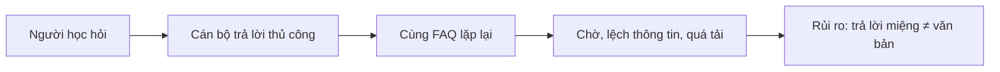

Ba điểm đau cho nhà trường:

1. **Tải vận hành** — chuyên viên trả FAQ thay vì xử lý hồ sơ.
2. **Rủi ro pháp lý** — chatbot “thông minh” dễ bịa số ngày, lệ phí, đầu mối.
3. **Không nhân rộng** — mỗi phòng một Excel riêng, không có pipeline chung.

---

## 2. Sản phẩm trong một câu

**UEL Virtual Assistant** là chatbot RAG (Retrieval-Augmented Generation) đọc **ba biểu mẫu chuẩn** của từng phòng, rồi trả lời người học / cán bộ **chỉ khi có bằng chứng đã duyệt**.

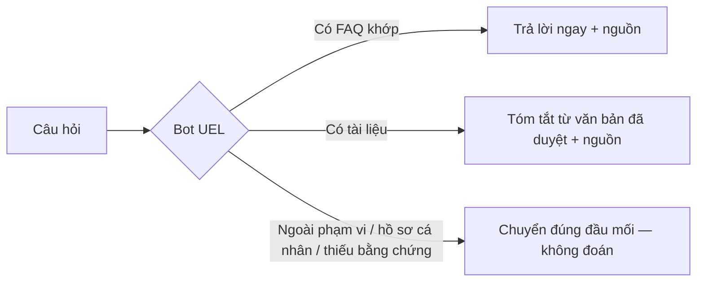

PoC hiện tại:

| | |
|---|---|
| Trường | Đại học Kinh tế – Luật (UEL) |
| Phòng | Bảo đảm chất lượng |
| Mô-đun | Khảo khí (`bao_dam_chat_luong` / `khao_khi`) |
| Đối tượng | Người học |
| Thời gian làm | 8 tuần, 1 người |
| Kênh demo | Sảnh 7 phòng + chat web + REST API |

---

## 3. Vì sao không phải “chat GPT dán quy chế”

| Chat GPT thông thường | Bot UEL |
|---|---|
| Học từ internet, dễ bịa | Chỉ dùng Excel/tài liệu **đã duyệt** |
| Không biết phòng nào phụ trách | Template 1 khóa phạm vi từng chủ đề |
| Trả lời hồ sơ cá nhân | Bắt buộc **handoff** cán bộ |
| Không có nguồn | Mỗi câu RAG có **citation** (`TL02`, mã FAQ…) |
| Một prompt cho cả trường | Mỗi phòng = 1 tenant, mỗi mô-đun = 1 knowledge pack |
| Sửa nội dung = sửa code | Sửa Excel → sync. Phòng mới **không sửa Python** |

Ba hành vi runtime (không hơn, không kém):

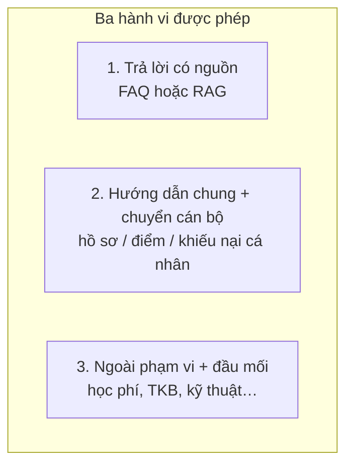

LLM **không được** bổ sung quy định UEL từ kiến thức chung.

---

## 4. Kiến trúc — nhìn từ trên xuống

Người dùng không nói chuyện thẳng với LLM. Có **sảnh phòng → BFF → RAG agent → kho đã duyệt**.

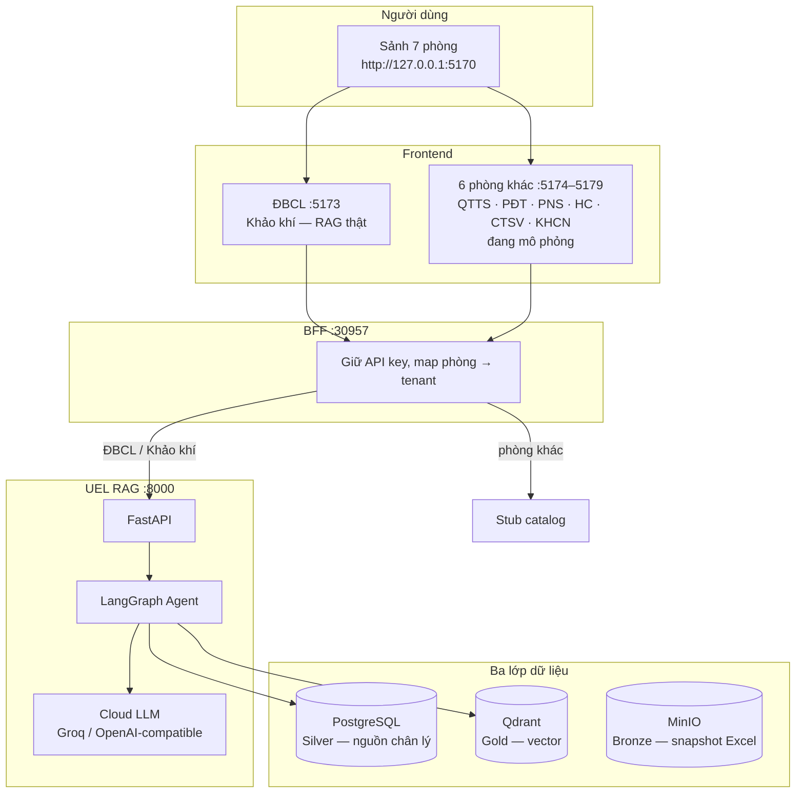

Stack gọn:

| Lớp | Công nghệ |
|---|---|
| API + agent | Python 3.12, FastAPI, LangGraph |
| CSDL | PostgreSQL (Silver), Qdrant (Gold), MinIO (Bronze) |
| Embedding | `BAAI/bge-m3` local CPU — dense 1024 + sparse |
| LLM | Cloud, đổi được nhà cung cấp |
| FE | Vite (sảnh + 7 phòng), HTML admin `/admin` |
| Chạy | Docker Compose, Ubuntu / Windows + Docker Desktop |

**PostgreSQL là nguồn đúng.** Qdrant chỉ là index có thể rebuild. Sai lệch → rebuild Gold từ Silver, không tin vector mồ côi.

---

## 5. Một câu hỏi đi qua bot như thế nào

Đây là slide “wow” nên vẽ ra màn hình.

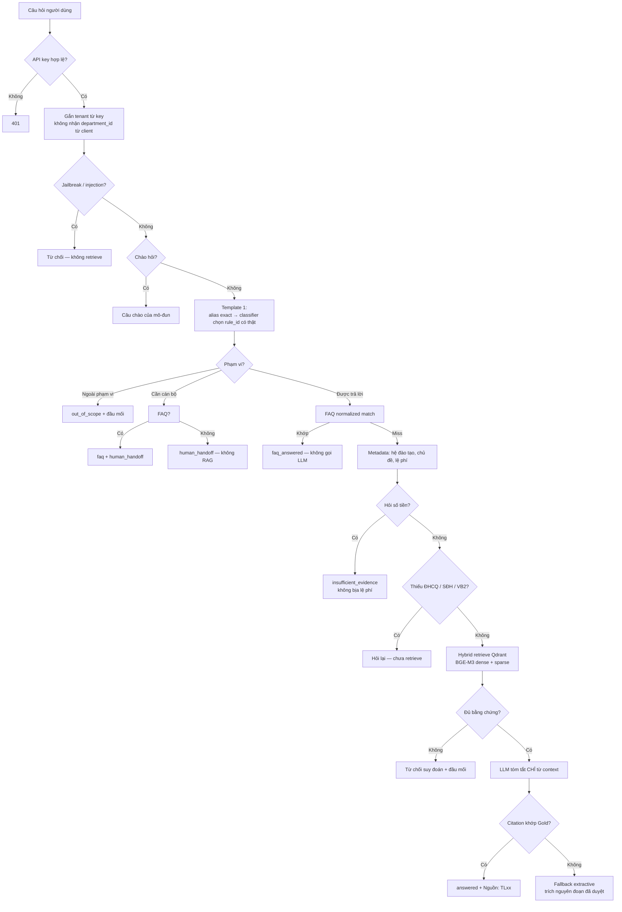

Thứ tự ưu tiên (nói đúng thứ này khi bị hỏi “bot có bịa không?”):

1. Khóa API → tenant từ server.
2. Chặn adversarial.
3. Routing Template 1 — không có rule thì **không** RAG.
4. FAQ khớp chuỗi đã chuẩn hóa → trả ngay, **không tốn LLM**.
5. Lọc metadata (hệ đào tạo, hiệu lực, đối tượng).
6. Hybrid search + ngưỡng điểm.
7. Generate có citation; citation bịa → **bỏ câu LLM**, lấy đoạn Gold.

Các `status` người nghe cần thuộc:

| Status | Ý nghĩa pitch |
|---|---|
| `faq_answered` | Câu đã soạn sẵn, nhanh, đúng 100% theo Excel |
| `answered` | RAG có nguồn |
| `out_of_scope` | Sai phòng — chỉ đường đúng đơn vị |
| `human_handoff` | Việc của cán bộ, bot không kết luận hồ sơ cá nhân |
| `insufficient_evidence` | Không đủ căn cứ — thà im còn hơn bịa |
| `clarification_required` | Thiếu hệ đào tạo thì hỏi lại, chưa search |

---

## 6. Dữ liệu: cán bộ điền Excel, không viết code

Ba template là **hợp đồng dữ liệu** của toàn trường.

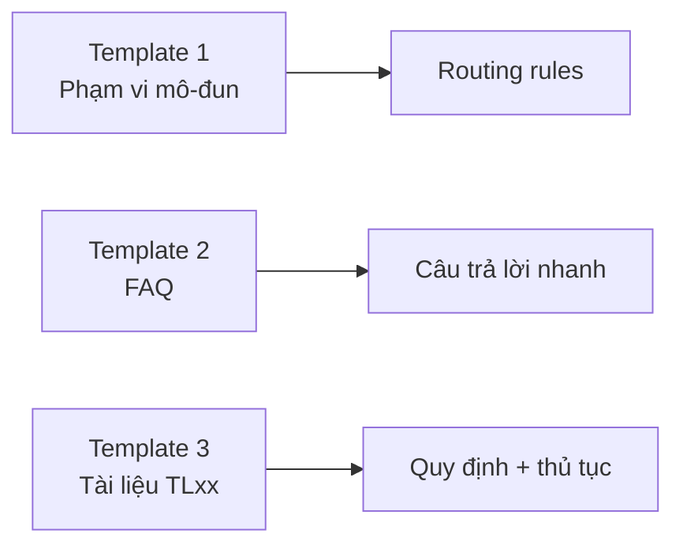

| Template | Cán bộ điền | Hệ thống hiểu |
|---|---|---|
| **01 — Mô-đun** | Chủ đề, bot được trả / phải chuyển người / ngoài phạm vi, đầu mối | 17 rule Khảo khí |
| **02 — FAQ** | Mã câu hỏi, câu hỏi, câu trả lời, căn cứ | 71 FAQ |
| **03 — Tài liệu** | Điều khoản, điều kiện, hồ sơ, các bước, hiệu lực, trạng thái | TL01–TL04 |

Trạng thái tài liệu (rất quan trọng với BGH / pháp chế):

| Trạng thái | Chatbot |
|---|---|
| Nháp | Không đưa vào bot |
| Đã duyệt | Được sync và retrieve |
| Ngưng dùng | Giữ lịch sử, **loại khỏi** kết quả |

Pipeline Medallion — chat **không đọc Excel lúc hỏi**:

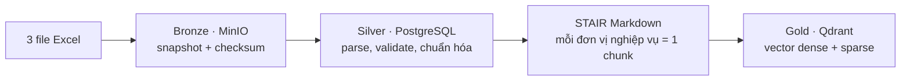

STAIR = mỗi chunk tự mang ngữ cảnh (phòng, mô-đun, đối tượng, hiệu lực, nguồn). Không cắt sliding-window kiểu “500 ký tự trượt” — tránh chunk mất nghĩa.

PoC Khảo khí sau sync:

| Chỉ số | Số |
|---:|---:|
| Routing rules | 17 |
| FAQ | 71 |
| Tài liệu | 4 (TL01 quy định + TL02–TL04 thủ tục) |
| Điểm Gold | 130 |
| Tenant leak khi retrieve | **0** |

Onboarding phòng mới (không deploy code):

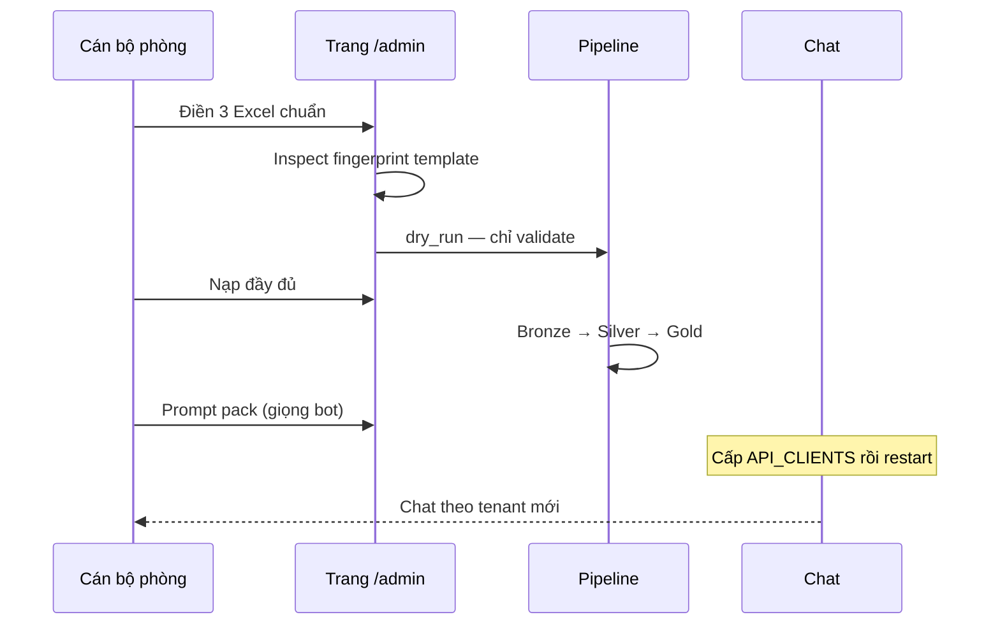

---

## 7. An toàn — slide cho lãnh đạo

Không pitch “AI thông minh”. Pitch **AI bị ràng buộc**.

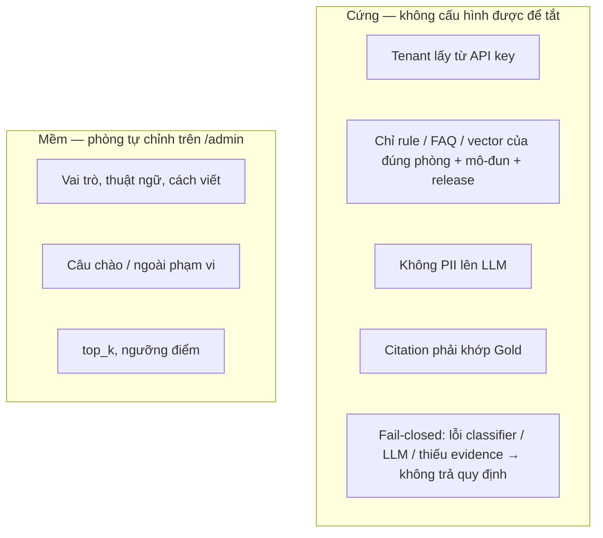

Các cam kết PoC:

- Client **không** gửi `department_id` để đổi phòng.
- Hội thoại namespace theo tenant + module + client — không lẫn kiến thức phòng khác.
- Không index tài liệu hết hiệu lực / chưa duyệt.
- Secret không nằm trong YAML hay Git; log không in API key.
- Fallback extractive: nếu LLM bịa mã `TL99` → người dùng thấy đoạn đã duyệt, không thấy câu bịa.

Giới hạn nói thẳng (tạo tin):

- API key là **định danh dịch vụ**, chưa phải SSO sinh viên.
- Quota LLM miễn phí có thể 429 — bot chuyển extractive, **không bịa cho đủ câu**.
- YAML registry, chưa hàng đợi job / rollback nguyên tử nhiều kho.
- Sáu phòng trên sảnh vẫn là **giao diện mô phỏng**, chưa nạp dữ liệu nghiệp vụ.

---

## 8. Số liệu nghiệm thu (nói được trên slide)

Phase 0–7 **xong**. Phase 8 đang đánh giá. Số dưới đây có báo cáo trong `reports/phases/`.

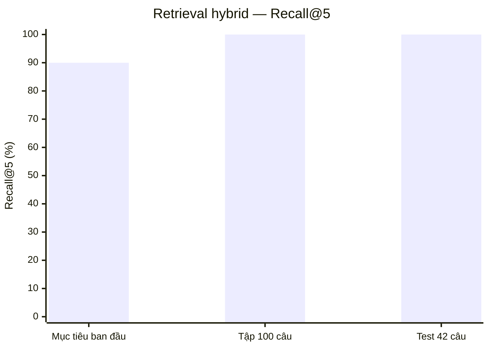

| Hạng mục | Kết quả | Ghi chú pitch |
|---|---|---|
| Hybrid Recall@5 | **100%** (100 câu / 42 câu test) | Mục tiêu ban đầu ≥ 90% |
| MRR | 0,957 / 0,933 | Tài liệu đúng thường đứng hạng 1–2 |
| FAQ match | **71/71** | Không cần LLM |
| Tenant leak | **0** | Phòng A không đọc kho phòng B |
| Policy / abstention | **17/17** | insufficient, handoff, ngoài phạm vi, adversarial |
| FAQ p95 | **0,83 giây** | 10 người dùng đồng thời |
| RAG p95 | **4,72 giây** | Nhiều lượt là fallback khi Groq 429 |
| Restore Postgres / Qdrant / MinIO | Hash khớp | Có sao lưu – khôi phục PoC |
| Unit + health | 85–94 test pass | Tùy mốc standardization |

KPI chất lượng câu sinh (correctness / groundedness toàn tập) **chưa chốt** — mẫu review còn nhỏ, Groq miễn phí hay fallback. Nên nói: *truy hồi và chính sách đã đo được; chất lượng văn phong LLM cần UAT chuyên viên*.

Mục tiêu thiết kế (chưa tuyên bố đạt hết):

| KPI | Mục tiêu |
|---|---:|
| Tenant leakage | 0 |
| Recall@5 | ≥ 90% |
| Câu RAG có citation hợp lệ | ≥ 95% |
| Groundedness | ≥ 90% |
| Từ chối đúng khi thiếu bằng chứng | ≥ 95% |
| FAQ match | ≥ 98% |
| p95 FAQ / RAG | ≤ 1s / ≤ 8s |

---

## 9. Mở rộng 7 phòng — mô hình kinh doanh nội bộ

Kiến trúc **một trường, nhiều tenant**. PoC chứng minh 1 phòng; sảnh đã vẽ đủ 7 nút.

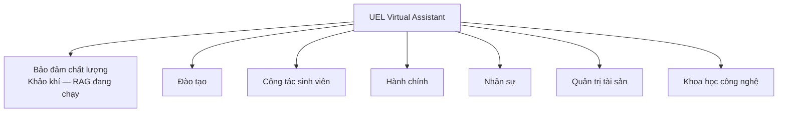

Mỗi phòng:

- 1 `department_id` + nhiều `module_code` (ví dụ ĐBCL có thể thêm “Khảo sát & Đánh giá” sau Khảo khí).
- 3 Excel + 1 prompt pack.
- 1 service API key.
- Profile `generic` mặc định. Chỉ Khảo khí dùng `assessment` (ĐHCQ/SĐH, lệ phí, điểm I).

Điều kiện nhân rộng **không phải GPU**, mà là:

1. Phòng chịu **duyệt** FAQ và tài liệu.
2. Template 1 viết rõ chủ đề bot **không** được trả.
3. UAT paraphrase do chuyên viên — không chỉ team kỹ thuật.

---

## 10. Roadmap & đề xuất bước tiếp

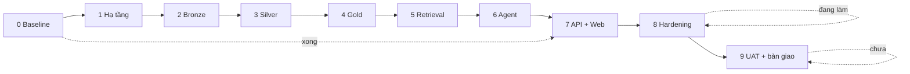

| Phase | Việc | Trạng thái |
|---:|---|---|
| 0–7 | Data contract → Docker → Excel pipeline → Qdrant → LangGraph → API/web | Hoàn thành |
| 8 | KPI, load, backup, sửa P1 | Đang làm |
| 9 | Deploy UAT, runbook, xác nhận chuyên viên | Chưa |

**Ask gợi ý khi pitch:**

1. Chốt **phòng thứ hai** (ví dụ PĐT hoặc CTSV) dùng đúng 3 template — chứng minh “không sửa code”.
2. UAT Khảo khí với chuyên viên ĐBCL trên bộ câu thật (paraphrase + case cá nhân).
3. LLM có quota ổn định (không gói miễn phí) trước khi demo lãnh đạo.
4. Sau UAT: SSO / cổng sinh viên, không mở chat công khai bằng chung một API key.

---

## 11. Demo 90 giây (khi có máy)

1. Mở sảnh [http://127.0.0.1:5170](http://127.0.0.1:5170) — 7 phòng.
2. Vào **ĐBCL** — hỏi: *“Thời hạn phúc khảo đại học chính quy?”* → FAQ hoặc RAG + nguồn TL.
3. Hỏi follow-up: *“còn sau đại học?”* → bot ghép ngữ cảnh, **tách ĐHCQ / SĐH**, không gộp hạn.
4. Hỏi: *“điểm của em bị sai”* → `human_handoff`, không kết luận hồ sơ.
5. Hỏi: *“học phí kỳ này bao nhiêu?”* → `out_of_scope`, chỉ đường Tài chính.
6. (Tuỳ chọn) `/admin` — kéo 3 Excel phòng mới, dry-run, không đụng code.

Lệnh gợi ý:

```powershell
docker compose up -d
curl.exe -fsS http://127.0.0.1:8000/health/ready
cd frontend
.\run-cluster.ps1
```

---

## 12. Một hình để chốt pitch

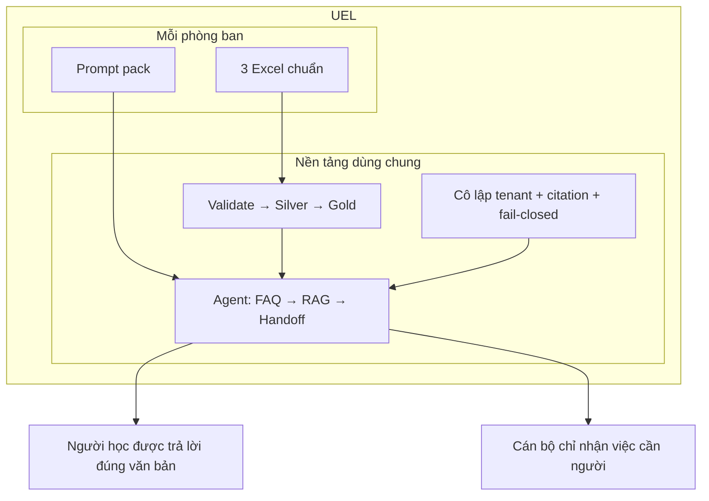

**Không thay quyết định chính thức của chuyên viên.**  
**Có giảm tải FAQ, thống nhất căn cứ, và nhân rộng theo từng phòng khi dữ liệu sẵn sàng.**

---

## Phụ lục A — Thuật ngữ 30 giây

| Từ | Nghĩa ngắn |
|---|---|
| RAG | Tìm đoạn đã duyệt rồi mới nhờ LLM viết |
| Tenant | Một phòng ban; không đọc kho phòng khác |
| Template 1/2/3 | Phạm vi / FAQ / tài liệu |
| STAIR | Chunk markdown tự mang metadata nghiệp vụ |
| Bronze / Silver / Gold | File gốc / bảng đã parse / vector |
| Fail-closed | Không chắc thì không trả quy định |
| Extractive fallback | Bỏ câu LLM bịa nguồn, lấy nguyên đoạn Gold |
| Profile `assessment` | Logic riêng Khảo khí (hệ đào tạo, lệ phí, điểm I) |

## Phụ lục B — File gốc nếu bị hỏi sâu

| Câu hỏi | Mở file |
|---|---|
| Phạm vi PoC, stack | `README.md` |
| Vận hành nhiều phòng | `docs/operations-multi-tenant.md` |
| Retrieve chi tiết | `docs/co-che-retrieve.md` |
| Pipeline Excel → vector | `docs/co-che-pipeline-gold.md` |
| Số liệu Phase 8 | `reports/phases/phase-08.md` |
| Thêm phòng | `HUONG_DAN_ONBOARDING.md` |
| Giọng bot /admin | `HDSD_QUAN_LY_BOT.md` |
| Sảnh 7 phòng | `frontend/README.md` |
