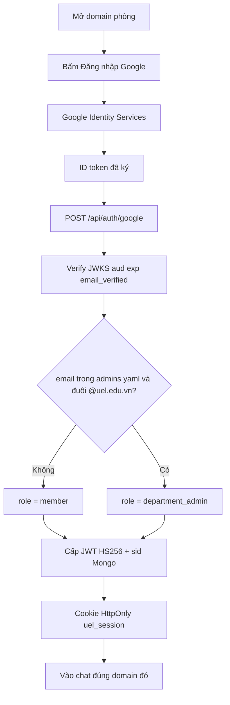
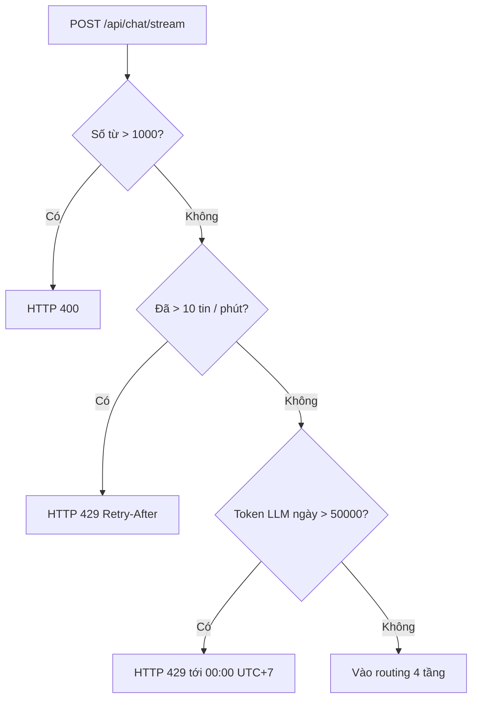
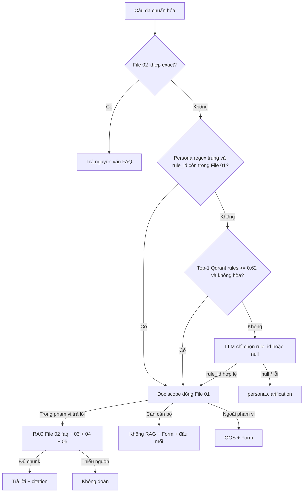

# Plan: 8 chatbot phòng (bản cụ thể)

Mỗi phòng một máy, một bản code (được sửa), một Mongo, một Qdrant, một container app, một domain. Cả 8 phòng cùng quy trình: **5 Excel template 3.0**, Google login, routing 4 tầng.

Vẫn chạy Docker. **Không chốt một image chung** rồi đắp lên 8 phòng. Mỗi phòng `docker compose build` từ Dockerfile trong thư mục của mình. Không ticket. Không Postgres. Không MinIO bắt buộc.

Mẫu trống: `template/` (bản 3.0). Copy nguyên bộ 5 file vào `chatbot-data/` của phòng khi điền. Không sửa sheet `_DS`. Cấu trúc repo lấy từ đề xuất `cautruc8duan.md`, chỉnh cho khớp 5 Excel và một container app.

---

## 1. Đã khóa

| Mục | Quyết định |
|---|---|
| Cắt chạy | Mỗi phòng 1 container app + 1 Mongo riêng + 1 Qdrant riêng + 1 domain |
| Code | Có `starter/` chuẩn. Copy cho từng phòng **sau P6**. Dev phòng được sửa code trong copy đó; **không** phải sửa starter-bugs lúc clone mới chạy được |
| Docker | Compose mẫu **chạy được trong `starter/`** (P6). Mỗi phòng copy rồi `compose build` tại chỗ. Không khóa tag image chung (`uel-app:1.0`) |
| Clone phòng | Chỉ khi P6 `ACCEPTED`. Clone = copy nguyên `starter/` + điền `.env` / `department.yaml` / Excel. `docker compose up -d --build` phải lên ngay |
| Chất lượng trước clone | P6 đo trên starter: pytest, compose healthy, BGE-M3 trong image, bộ câu vàng, độ trễ. P7 không phải pha vá chất lượng |
| File gốc | `chatbot-data/` trên disk phòng. Cả 8 phòng điền **cùng 5 Excel** (`template/` 3.0) |
| Handoff | Không ticket. Bot hiện **Google Form của phòng** (`handoff_form_url` trong yaml) **và** đầu mối trên dòng File 01 nếu có |
| Auth | Google OAuth 2.0. BE nhận ID token, cấp JWT hệ thống (`role` + `department_id`) |
| Ai hỏi | Giai đoạn này: mọi Gmail (đã Google xác thực) hỏi được chatbot trên đúng domain đang mở |
| Ai cấu hình | Chỉ `@uel.edu.vn` **và** có tên trong `admins` của `department.yaml` |
| Hạn mức | Số lần hỏi / phút **và** token LLM / ngày |
| Regex | Trong persona (admin sửa trên UI), **không ghi Excel** |
| Admin phòng | (1) nạp 5 Excel theo **từng mô-đun** (2) persona / cách bot trả lời |
| Git | **Một repo**, đủ `starter/` + **8 thư mục đơn vị** (copy đầy đủ) ngay bản xuất bản |
| Nhiều mô-đun | Mỗi mô-đun **một bộ 5 file**. UI chọn `module_code` rồi upload. Không nhét nhiều mô-đun vào một File 01 |
| File 04 / 05 trống | Vẫn **upload đủ 5 file** đúng schema. 04/05 được 0 dòng dữ liệu (chỉ header) |
| Đối tượng Excel | Lưu metadata / citation. **Không lọc** FAQ hay RAG theo đối tượng (chưa biết user là ĐHCQ/SĐH) |
| `rule_id` | **Không thêm cột Excel.** Nội bộ = `{module_code}.{slug(chủ đề)}`. UI regex **chọn chủ đề**, không gõ mã. Đổi tên chủ đề → regex cũ báo gãy, admin chọn lại |
| LLM / embed | LLM **API**; BGE-M3 **trong container app (CPU)** |
| Google OAuth | **Mỗi phòng một Client ID** (`.env` phòng đó). Origin = domain phòng + localhost dev |
| Profile | Cả 8 phòng **generic**. Không nhánh `assessment` / Khảo khí đặc biệt |
| Parser | Một schema 3.0 cho mọi phòng, mọi mô-đun |

Làm sau, không nằm trong plan này: khóa đuôi `@st.uel.edu.vn` / `@uel.edu.vn` lúc hỏi; SSO trường; ticket; lọc theo đối tượng người hỏi; sảnh (trang link 8 domain — tùy chọn, không chặn xuất bản).

---

## 2. Tám phòng

| Mã | Đơn vị | Domain | Thư mục chạy | Nhóm phân công |
|---|---|---|---|---|
| `hc` | Phòng Hành chính | `hc.chat.uel.edu.vn` | `phong-hanh-chinh/` | 1 |
| `ctsv` | Phòng Tuyển sinh & Công tác sinh viên | `ctsv.chat.uel.edu.vn` | `phong-tuyen-sinh-cong-tac-sinh-vien/` | 1 |
| `pdt` | Phòng Đào tạo | `pdt.chat.uel.edu.vn` | `phong-dao-tao/` | 2 |
| `qtts` | Phòng Quản trị tài sản | `qtts.chat.uel.edu.vn` | `phong-quan-tri-tai-san/` | 2 |
| `vqt` | Viện Quốc tế | `vqt.chat.uel.edu.vn` | `vien-quoc-te/` | 2 |
| `pns` | Phòng Nhân sự | `pns.chat.uel.edu.vn` | `phong-nhan-su/` | 3 |
| `khcn` | Phòng Khoa học công nghệ | `khcn.chat.uel.edu.vn` | `phong-khoa-hoc-cong-nghe/` | 3 |
| `dbcl` | Phòng Bảo đảm chất lượng | `dbcl.chat.uel.edu.vn` | `phong-bao-dam-chat-luong/` | 3 |

Ba nhóm chỉ để chia việc. Cây repo chia **theo từng đơn vị**; mỗi đơn vị phát triển, cấu hình, `compose build` độc lập.

`DEPARTMENT_ID` lấy từ `.env` của process phòng đó. Client không gửi mã phòng để đổi tenant.

Sảnh (nếu có) chỉ là trang link 8 domain, không phải chatbot.

---

## 3. Tech stack

| Lớp | Công nghệ | Ghi chú |
|---|---|---|
| UI | React 18, Vite 5, Redux Toolkit + Thunk, react-router 6, CSS | Dev: `npm run dev` trong `chatbot-web/`. Production: build xong FastAPI phục vụ `chatbot-web/dist` |
| App | Một process Python: FastAPI + LangGraph + BGE-M3 (CPU trong app) | Chat, ingest 5 Excel/mô-đun, persona, routing 4 tầng. LLM gọi API |
| DB | MongoDB trên máy phòng | Instance riêng |
| Vector | Qdrant trên máy phòng | Instance riêng |
| File | `chatbot-data/` trong thư mục phòng | 5 Excel 3.0 + release theo module |
| Auth | Google Identity Services → ID token → JWT HS256 | Cookie HttpOnly `uel_session` |
| Chạy | Docker Compose trong thư mục phòng | 1 app (build tại chỗ) + 1 mongo + 1 qdrant |

Bỏ so với PoC: login mật khẩu, ticket/inbox, 7 FE copy, Postgres, MinIO bắt buộc, nhiều container trên một compose gốc, `/admin` bằng API key.

---

## 4. Bộ template 3.0 — 5 file, dùng chung 8 phòng

Thư mục gốc: `template/`. Parser **một bộ** cho cả 8 phòng. Đổi tên file được; **không đổi tên sheet bắt buộc, không sửa `_DS`**.

| # | File trong `template/` | Vai trò runtime | Lưu sau khi nạp |
|---|---|---|---|
| 01 | `1. Thông tin Mô-đun.xlsx` | Chọn **làm gì** (trả lời / cần cán bộ / ngoài phạm vi) | Mongo `routing_rules` + Qdrant collection `rules` |
| 02 | `2. FAQ - Câu hỏi thường gặp.xlsx` | (1) Nút sidebar: trả **nguyên văn**. (2) RAG: chunk Qdrant `docs` `source=faq`, boost 1.5 | Mongo `faqs` + Qdrant `docs` (`source=faq`) |
| 03 | `3. Tài liệu nghiệp vụ.xlsx` | RAG khi File 01 cho phép trả lời: quy định, thủ tục, hồ sơ, bước | Qdrant `docs` (`source=business`) |
| 04 | `4. Mốc thời gian.xlsx` | RAG / tra mốc: hạn, lịch, sự kiện, định kỳ | Mongo `milestones` + Qdrant `docs` (`source=milestone`) |
| 05 | `5. Tài liệu giới thiệu.xlsx` | RAG bài mô tả dài (không phải quy định/thủ tục) | Qdrant `docs` (`source=intro`) |

Sheet `_DS` (mọi file): danh sách dropdown bản 3.0. Parser **bỏ qua**. Không ingest.

Hướng dẫn điền nằm ở sheet `0. Hướng dẫn` hoặc `Hướng dẫn`. Parser bỏ qua.

### 4.1 File 01 — Thông tin mô-đun (routing)

Sheet bắt buộc: `1. Phạm vi trả lời`.

**Khối header (hàng 1–9), giá trị ở cột C (merge C:E):**

| Ô nhãn | Trường ingest | Bắt buộc |
|---|---|---|
| Tên Mô-đun | `module_name` | Có. Phải khớp `modules[].name` trong `department.yaml` |
| Phòng ban phụ trách | `department_name` | Có |
| Mô tả Mô-đun (1 tới 3 câu) | `module_description` | Có. Dùng làm câu giới thiệu bot nếu persona chưa ghi đè |
| Đối tượng phục vụ chính | `primary_audience` | Có, chọn từ `_DS!Đối tượng` |
| Đầu mối chung | `default_contact_name` | Không |
| Thông tin liên hệ chung | `default_contact_info` | Không |
| Ngày tạo / Ngày cập nhật | metadata release | Không |

**Bảng từ hàng 12:** mỗi dòng một chủ đề. Parser bỏ dòng trống (cột C trống).

| Cột | Header | Trường | Bắt buộc |
|---|---|---|---|
| A | STT | số thứ tự | Có nếu dòng có dữ liệu |
| B | Phạm vi mô-đun | `scope` | Có. **Đúng một** trong 3 giá trị `_DS!Phạm vi` (xem bảng dưới) |
| C | Chủ đề/Tình huống | `topic` | Có |
| D | Cách chatbot xử lý | `bot_behavior` | Có |
| E | Đối tượng áp dụng | `audience` | Có, từ `_DS!Đối tượng` |
| F | Đầu mối hỗ trợ | `contact_name` | Bắt buộc nếu scope ≠ trả lời |
| G | Thông tin liên hệ | `contact_info` | Ít nhất một trong F/G/H nếu scope ≠ trả lời |
| H | Kênh trực tuyến | `channel` | tùy chọn; giá trị kênh lấy `_DS!Kênh` nếu điền |

Ba nhãn `scope` **khớp nguyên văn** dropdown (không tự rút gọn):

| Giá trị Excel | Mã nội bộ | Bot làm khi chọn đúng dòng này |
|---|---|---|
| `Trong phạm vi trả lời` | `answer_allowed` | RAG File 03 + 04 + 05 (04/05 có thể rỗng). Đủ nguồn → trả + citation. Thiếu → không đoán, clarify hoặc handoff theo `bot_behavior`. Không lọc `audience` |
| `Trong phạm vi - bot không tự trả lời & cần cán bộ hỗ trợ` | `human_handoff` | Không RAG. Nói theo cột D + đầu mối F/G/H + nút Google Form |
| `Ngoài phạm vi trả lời` | `out_of_scope` | Không RAG. Câu ngoài phạm vi (persona hoặc cột D) + chuyển cho ai (F/G/H) + Form nếu yaml có link |

`rule_id` **không có cột trên Excel** (template 3.0 đã gửi phòng, không đổi). Ingest tự sinh:

```text
{module_code}.{slug(Chủ đề/Tình huống)}
ví dụ: khao_khi.han-phuc-khao
```

`slug`: NFC, lower, bỏ dấu, khoảng trắng → `-`. Hai dòng cùng slug trong một mô-đun = `ERROR` lúc nạp. Đổi chữ chủ đề → mã mới; regex cũ `rule_id` không còn trong release → UI persona báo đỏ, admin chọn lại chủ đề (dropdown từ File 01), không gõ mã tay.

Regex **không** đọc File 01. Cột Đối tượng **không** tham gia routing.

Embed Qdrant `rules` (mỗi dòng):

```text
{topic}
{bot_behavior}
{scope tiếng Việt}
{audience}
```

### 4.2 File 02 — FAQ (tầng exact)

Sheet bắt buộc: `1. FAQ`. Header hàng 2, dữ liệu từ hàng 3. Bỏ dòng `CÂU HỎI` trống.

| Cột | Header | Trường | Bắt buộc |
|---|---|---|---|
| A | STT | | Có nếu có dữ liệu |
| B | MÃ CÂU HỎI | `question_code` | Có, **không trùng** trong file |
| C | PHÂN MỤC | `section` | Có |
| D | PHÂN MỤC CHI TIẾT | `subsection` | Không |
| E | ĐỐI TƯỢNG ÁP DỤNG | `audience` | Có, `_DS!Đối tượng` |
| F | CÂU HỎI | `question` | Có |
| G | CÂU TRẢ LỜI | `answer` | Có |
| H | VĂN BẢN CĂN CỨ | `legal_basis` | Không |
| I–K | Đầu mối / liên hệ / kênh | metadata | Không |

Gợi ý mã: `<phân mục>.<số>`, ví dụ `I.001`, `II.1.015`.

Hai việc:

1. **Nút FAQ** (sidebar `GET /api/qa`): click → hiện `question` + `answer` nguyên văn Mongo, không gọi LLM / không trừ hạn mức chat.
2. **RAG**: mỗi dòng FAQ = 1 point Qdrant `docs`, `source=faq`. Embed `{question}\n{answer}`. Payload `retrieve_boost=1.5`. P4 nhân cosine với boost rồi xếp lại — FAQ đứng trên chunk 03/04/05 cùng điểm thô. Tầng 1 exact vẫn: chuẩn hóa câu → lookup Mongo; khớp đúng 1 dòng → trả nguyên văn, `routing_source=faq_exact`, **dừng**.

Hai dòng cùng câu đã chuẩn hóa lúc nạp = `ERROR`, không publish.

Câu trả lời dài / nhiều bước: hướng dẫn phòng đưa sang File 03, không nhồi FAQ.

### 4.3 File 03 — Tài liệu nghiệp vụ (RAG quy định/thủ tục)

Sheet `Hướng dẫn` bỏ qua. Mỗi chủ đề = một sheet tên `Tài liệu 1`, `Tài liệu 2`, … (sao chép mẫu, đổi số dòng tiêu đề `TÀI LIỆU NGHIỆP VỤ 01` cho khớp). Parser lấy mọi sheet không phải `Hướng dẫn` / `_DS`.

**A. Thông tin chung**

| Nhãn | Trường |
|---|---|
| Tên nghiệp vụ | `title` (bắt buộc) |
| Loại | Tùy chọn. **Không** chặn nạp, **không** lọc RAG. Parser quét hết B–F; `doc_type` suy từ chunk có mặt |
| Tóm tắt (3 tới 5 dòng) | `summary` (bắt buộc, dùng lúc retrieve) |
| Tên gọi khác/từ khóa | `aliases` |
| Áp dụng cho / Không áp dụng cho | `audience` / `audience_excluded` |
| Văn bản căn cứ | `legal_basis` |
| Đầu mối hỗ trợ | `contact` |
| Hiệu lực từ / đến | `effective_from` / `effective_to` (lọc lúc retrieve; hết hiệu lực thì không đưa vào context) |

Pipeline File 03 (một schema 8 phòng): có `Tên nghiệp vụ` thì **quét hết** mục B→F, không phụ thuộc dropdown Loại. Ô trống bỏ dòng. Thiếu tóm tắt / không có dòng B–F = WARNING, không 422.

| Mục | `kind` | 1 chunk = | `text` embed |
|---|---|---|---|
| A tóm tắt | `doc_summary` | cả sheet | `{title}\n{summary}\n{aliases}` |
| B | `regulation` | 1 dòng | `{title}\n{phân mục}\n{chi tiết}\n{nội dung}\n{tình huống}\n{xử lý}` |
| C | `condition` | 1 dòng | `{title}\n{tình huống}\n{xử lý}\n{loại}` |
| D | `procedure_meta` | cả khối | `{title}` + các `Nhãn: giá trị` |
| E | `dossier` | 1 hồ sơ | `{title}\nHồ sơ\n{thành phần}\n{biểu mẫu}\n{quy cách}\n{bắt buộc}` |
| F | `step` | 1 bước | `{title}\n{làm gì}\n{link}\n{đơn vị}\n{thời gian}\n{kênh}` |

`doc_type` / `doc_type_code` **suy từ chunk**: có B → regulation; có D/E/F → procedure; có cả hai → mixed. Dropdown Loại chỉ lưu `doc_type_excel` nếu nhận được.

**B.** Mỗi dòng một chunk `regulation`: Phân mục, chi tiết, Nội dung, Tình huống, Cách xử lý.

**C.** Mỗi dòng một chunk `condition`: Tình huống, Cách xử lý, Loại (`Điều kiện` / `Ngoại lệ` / `Lỗi thường gặp` / `Lưu ý`).

**D.** Một chunk `procedure_meta`: kết quả, thời hạn (`Trong ngày` / `N ngày làm việc` / `Tùy trường hợp`), số ngày chỉ khi chọn `N ngày làm việc`, địa điểm, link, lịch, lệ phí (`Không thu phí` / `Có thu phí cố định` / `Tùy trường hợp`), số tiền chỉ khi thu phí cố định.

**E.** Mỗi thành phần hồ sơ một chunk `dossier`.

**F.** Mỗi bước một chunk `step` (Người học làm gì, link, đơn vị, thời gian, kênh).

Mọi chunk File 03 gắn `source=business`, `sheet`, `title`, `doc_type`, `effective_*`, `release_id`.

### 4.4 File 04 — Mốc thời gian (RAG lịch/hạn)

Sheet `1. Mốc thời gian`. Header hàng 2. Bỏ dòng `TÊN MỐC` trống.

| Cột | Header | Trường | Bắt buộc |
|---|---|---|---|
| B | MÃ MỐC | `milestone_id` | Có, không trùng (gợi ý `M001`) |
| C | NHÓM | `group` | Có (cùng chữ cho cùng nhóm: Phúc khảo, Nhập học, …) |
| D | TÊN MỐC/SỰ KIỆN | `name` | Có |
| E | LOẠI MỐC | `kind` | Có: `Hạn chót` / `Bắt đầu - kết thúc` / `Sự kiện` / `Định kỳ` |
| F–G | BẮT ĐẦU / KẾT THÚC | `start` / `end` | `dd/mm/yyyy`. Hạn chót: điền Kết thúc (hoặc cả hai cùng ngày). Khoảng: cả hai. Sự kiện: một ngày. Định kỳ: có thể trống, ghi quy tắc ở cột J |
| H | ĐỐI TƯỢNG ÁP DỤNG | `audience` | Có |
| I | NĂM HỌC/ HỌC KỲ | `academic_term` | Có (ví dụ `2026-2027`, `Học kỳ 1 2026-2027`) |
| J | NỘI DUNG ĐẦY ĐỦ | `full_text` | Có — đúng câu bot sẽ nói, **có năm** |
| K–L | Văn bản / ghi chú | | Không |

Mỗi dòng → 1 document Mongo `milestones` + 1 vector `source=milestone`. Embed: `{name}\n{group}\n{full_text}\n{academic_term}`. Metadata ngày để lọc mốc đã qua nếu phòng muốn (mặc định vẫn retrieve, bot nói theo `full_text`).

Sang năm học mới: phòng **cập nhật cả sheet** rồi nạp lại — không có “tự +1 năm”.

### 4.5 File 05 — Tài liệu giới thiệu (RAG mô tả)

Mỗi bài một sheet `Tài liệu giới thiệu 1`, `Tài liệu giới thiệu 2`, … Parser bỏ `0. Hướng dẫn` / `_DS`.

Header:

| Nhãn | Trường |
|---|---|
| Tên bài | `title` bắt buộc |
| Tóm tắt (3 tới 5 dòng) | `summary` bắt buộc — dùng để quyết định có mở bài không |
| Tên gọi khác/từ khóa | `aliases` |
| Đối tượng áp dụng | `audience` |
| Nguồn | `source_url` |
| Ngày cập nhật | `updated_on` |

Bảng từ hàng 10: mỗi dòng một mục (`heading` + `body`). Nội dung bảng trong bài: viết một dòng, cột cách nhau `|`.

Chunk: (1) summary+aliases của cả bài, (2) từng mục. `source=intro`.

### 4.6 Quy tắc nạp (cả bộ 5 file)

Admin chọn **một** `module_code` rồi upload **đủ 5 file** của mô-đun đó. Thiếu 1 file = không nạp. Phòng nhiều mô-đun → nạp lần lượt từng bộ; release theo từng module, không đè mô-đun khác.

File 04 / 05: workbook đúng sheet + header, **0 dòng dữ liệu vẫn OK** (WARNING trên UI). File 01 phải có ≥ 1 dòng chủ đề. File 02 được 0 FAQ (WARNING). File 03: không có sheet tài liệu (chỉ `Hướng dẫn` / `_DS`) hoặc sheet không đủ `title` = WARNING. Parser luôn quét B–F; Loại không bắt D/E/F.

Kiểm tra trước khi ghi:

1. Đúng sheet + header (so khớp chữ, Unicode NFC).
2. `scope` / `audience` / `kind` / `kênh` / `lệ phí` / `thời hạn` / `loại điều kiện` phải nằm trong `_DS` (so khớp sau trim). File 03 `doc_type` không bắt dropdown.
3. `question_code`, `milestone_id` không trùng trong file.
4. FAQ: không trùng câu đã chuẩn hóa.
5. File 01: tên mô-đun = yaml; mọi dòng có `scope` hợp lệ; handoff/OOS phải có ít nhất một ô F/G/H hoặc header đầu mối chung.
6. File 03: thiếu tóm tắt hoặc không có dòng B–F = `WARNING`. Không ERROR theo Loại.
7. File 04: loại mốc vs ngày (khoảng thiếu một đầu = `ERROR`; định kỳ được thiếu ngày).

Có `ERROR` → HTTP 422, **không** đổi release đang chạy. `WARNING` (ô tùy chọn trống, ngày cập nhật trống) vẫn cho nạp, hiện trên UI.

Hợp lệ:

1. Ghi 5 file vào `chatbot-data/modules/<ma-module>/releases/<release_id>/source/`.
2. Mongo: `routing_rules`, `faqs`, `milestones`, `releases` (checksum từng file).
3. Qdrant: xóa point `release_id` cũ sau khi collection mới sẵn sàng; ghi `rules` + `docs`.
4. Chat cắt sang `release_id` mới **atomic**. Lỗi giữa chừng: giữ bản cũ.

Mọi mô-đun `profile: generic`. Parser schema **không** tách nhánh theo phòng. Persona khác nhau từng phòng/mô-đun trên UI, không khác parser.

---

## 5. Cấu trúc repo (đề xuất 8 dự án)

Nguồn: `cautruc8duan.md`. Mỗi đơn vị một thư mục, bên trong bốn phần: `chatbot-web`, `chatbot-api`, `chatbot-data`, `docker-compose.yml`.

`starter/` là bộ chạy được **cùng hình này**. Copy nguyên thư mục ra tên phòng, rồi dev phòng được sửa code trong copy đó. Bug chung vá ở `starter/`, từng phòng tự merge.

**Khác `cautruc8duan.md` cho khớp phần đã khóa:** 5 Excel 3.0 (không còn 3 file); không MinIO bắt buộc; production **một** container `app` (build `chatbot-web` rồi FastAPI phục vụ `dist` + API + RAG) + mongo + qdrant — không tách 3 container FE/API/RAG; Mongo và Qdrant **không** dùng chung cụm nhiều phòng.

### 5.0 Cây tổng thể

```text
uel-innovation/
│
├── template/                            # 5 Excel trống 3.0 — nguồn sự thật schema
│   ├── 1. Thông tin Mô-đun.xlsx
│   ├── 2. FAQ - Câu hỏi thường gặp.xlsx
│   ├── 3. Tài liệu nghiệp vụ.xlsx
│   ├── 4. Mốc thời gian.xlsx
│   └── 5. Tài liệu giới thiệu.xlsx
│
├── starter/                             # điểm copy — cùng layout một đơn vị
│   ├── chatbot-web/
│   ├── chatbot-api/
│   ├── chatbot-data/
│   ├── Dockerfile                       # build app (UI dist + API)
│   ├── docker-compose.yml
│   └── README.md
│
├── phong-hanh-chinh/                    # copy starter — dev HC sửa ở đây
│   ├── chatbot-web/
│   ├── chatbot-api/
│   ├── chatbot-data/
│   ├── Dockerfile
│   ├── docker-compose.yml
│   └── README.md
│
├── phong-tuyen-sinh-cong-tac-sinh-vien/
├── phong-dao-tao/
├── phong-quan-tri-tai-san/
├── vien-quoc-te/
├── phong-nhan-su/
├── phong-khoa-hoc-cong-nghe/
├── phong-bao-dam-chat-luong/
│
├── docs/                                # kiến trúc, schema Excel, quy ước chung
└── README.md
```

Mở phòng mới: copy `starter/` → đổi tên thư mục → sửa `chatbot-api/configs/department.yaml` + `.env` → copy 5 file `template/` vào `chatbot-data/templates/` rồi điền vào `modules/` → chạy mục 6.

Frontend chỉ hiện module của đúng đơn vị đó. Danh sách module đang chạy lấy từ backend. `chatbot-web/src/config/` chỉ nhận diện giao diện, **không** chứa secret, khóa LLM, hay quyền.

### 5.1 Frontend — `chatbot-web`

React–Vite, Redux Toolkit + Thunk. FE không kết nối trực tiếp MongoDB hay Qdrant.

```text
chatbot-web/
├── public/
│   ├── images/
│   └── favicon.ico
├── src/
│   ├── api/
│   │   ├── client.js            # HTTP, base URL, cookie
│   │   ├── authApi.js           # Google ID token → /api/auth/google, logout, me
│   │   ├── chatApi.js           # POST /api/chat/stream (SSE)
│   │   └── conversationApi.js
│   ├── components/
│   │   ├── common/
│   │   ├── chat/                # khung chat, citation, nút Google Form
│   │   └── navigation/
│   ├── pages/
│   │   ├── LoginPage.jsx
│   │   ├── ChatPage.jsx
│   │   ├── admin/
│   │   │   ├── IngestPage.jsx   # nạp 5 Excel
│   │   │   └── PersonaPage.jsx
│   │   └── NotFoundPage.jsx
│   ├── layouts/
│   │   └── MainLayout.jsx
│   ├── routes/
│   │   ├── AppRoutes.jsx
│   │   └── ProtectedRoute.jsx   # member vs department_admin
│   ├── store/
│   │   ├── store.js
│   │   └── slices/
│   │       ├── authSlice.js
│   │       ├── chatSlice.js
│   │       ├── moduleSlice.js
│   │       └── conversationSlice.js
│   ├── config/
│   │   ├── department.js        # tên đơn vị, màu, logo — không phải DEPARTMENT_ID runtime
│   │   └── navigation.js
│   ├── hooks/
│   ├── utils/                   # SSE parser, markdown
│   ├── styles/
│   ├── App.jsx
│   └── main.jsx
├── tests/
├── .env.example                 # chỉ VITE_API_BASE; không nhét JWT_SECRET / LLM key
├── package.json
├── vite.config.js
├── index.html
├── Dockerfile                   # optional: nginx, khi dev tách FE
├── nginx.conf
└── README.md
```

Production theo plan này **không** chạy nginx FE riêng: `Dockerfile` gốc phòng build `chatbot-web` → copy `dist` vào image `chatbot-api`.

### 5.2 Backend — `chatbot-api`

Một FastAPI: HTTP + RAG + ingest. Phân lớp `routes → services → repositories`.

```text
chatbot-api/
├── app/
│   ├── main.py
│   ├── factory.py
│   ├── api/
│   │   ├── router.py
│   │   ├── dependencies.py      # JWT cookie, role, department_id từ env
│   │   └── routes/
│   │       ├── auth.py
│   │       ├── chat.py
│   │       ├── conversations.py
│   │       ├── modules.py
│   │       ├── admin.py          # nạp 5 Excel, persona, thử chat
│   │       └── health.py
│   ├── core/
│   │   ├── config.py
│   │   ├── security.py          # verify Google ID token, JWT HS256
│   │   ├── logging.py
│   │   ├── middleware.py
│   │   └── exceptions.py
│   ├── schemas/
│   ├── models/                  # Mongo: user, session, faq, routing_rule, milestone, persona, release
│   ├── db/
│   │   ├── mongodb.py
│   │   └── indexes.py
│   ├── repositories/
│   ├── services/
│   │   ├── auth_service.py
│   │   ├── chat_service.py
│   │   ├── rate_limit_service.py
│   │   ├── ingest_service.py
│   │   └── persona_service.py
│   ├── rag/
│   │   ├── pipeline.py          # LangGraph 4 tầng
│   │   ├── routing.py           # FAQ exact → regex → cosine File 01 → LLM
│   │   ├── policy.py            # scope File 01
│   │   ├── retrieval.py         # Qdrant docs 03/04/05
│   │   ├── generation.py
│   │   └── citations.py
│   ├── ingestion/
│   │   ├── loaders/             # 5 parser Excel 3.0
│   │   ├── validation.py
│   │   ├── normalization.py
│   │   ├── chunking.py
│   │   └── pipeline.py
│   ├── integrations/
│   │   ├── llm.py
│   │   ├── embeddings.py        # BGE-M3
│   │   └── qdrant.py            # không MinIO trong plan này
│   └── cli.py
├── configs/
│   ├── department.yaml
│   ├── persona.yaml             # seed; runtime sau ingest/sửa UI nằm Mongo
│   └── modules.yaml             # optional bootstrap
├── scripts/
├── tests/
│   ├── unit/
│   ├── integration/
│   └── smoke/
├── pyproject.toml
├── .env.example                 # DEPARTMENT_ID, JWT_SECRET, GOOGLE_CLIENT_ID, LLM_API_KEY, MONGO, QDRANT
├── Dockerfile
└── README.md
```

| Lớp | Trách nhiệm |
|---|---|
| `api/routes` | Request, validate, response |
| `schemas` | Hợp đồng với FE |
| `services` | Nghiệp vụ |
| `repositories` | Mongo |
| `rag` | 4 tầng + generate |
| `ingestion` | Đọc / kiểm / nạp 5 Excel |
| `integrations` | LLM, embedding, Qdrant |

`configs/*.yaml` là bootstrap. Persona đã sửa trên UI lưu Mongo; không giữ hai nguồn runtime cạnh tranh.

### 5.3 Dữ liệu — `chatbot-data`

Tài liệu theo **module + `release_id`**. Copy file vào đây chưa tạo index — phải ingest thành công mới công bố.

```text
chatbot-data/
├── README.md
├── templates/                          # bản trống copy từ repo template/
│   ├── 1. Thông tin Mô-đun.xlsx
│   ├── 2. FAQ - Câu hỏi thường gặp.xlsx
│   ├── 3. Tài liệu nghiệp vụ.xlsx
│   ├── 4. Mốc thời gian.xlsx
│   └── 5. Tài liệu giới thiệu.xlsx
├── modules/
│   └── <ma-module>/                    # mã nghiệp vụ, ví dụ khao_khi (gạch dưới)
│       ├── README.md
│       └── releases/
│           └── <release_id>/
│               ├── source/             # 5 Excel đã điền của phiên bản này
│               │   ├── 1. Thong tin Mo-dun.xlsx
│               │   ├── 2. FAQ.xlsx
│               │   ├── 3. Tai lieu nghiep vu.xlsx
│               │   ├── 4. Moc thoi gian.xlsx
│               │   └── 5. Tai lieu gioi thieu.xlsx
│               ├── attachments/        # tùy chọn; plan này không bắt MinIO
│               └── manifest.yaml       # checksum 5 file, module_name, counts
├── staging/                            # upload chưa công bố
└── reports/                            # validation / ingest
```

Ví dụ ĐBCL:

```text
phong-bao-dam-chat-luong/chatbot-data/modules/khao_khi/releases/<release_id>/
```

Tên thư mục đơn vị dùng gạch ngang; mã backend (`khao_khi`, `DEPARTMENT_ID=dbcl`) **không** suy ra từ tên thư mục — lấy yaml / `.env`.

| Nơi lưu | Nội dung |
|---|---|
| `chatbot-data` | Excel nguồn, manifest, báo cáo |
| MongoDB | FAQ, rule, mốc, persona, user, session, hội thoại, hạn mức |
| Qdrant | Vector `rules` + `docs` |

Số module mỗi phòng theo nghiệp vụ thật; không bắt buộc bốn module.

### 5.4 Luồng nạp / chat (cùng cấu trúc này)

```text
Admin /quan-ly upload 5 Excel
  → staging
  → inspect schema (mục 4.6)
  → ERROR: 422, giữ release cũ
  → OK: source/ + manifest.yaml + Mongo + Qdrant → cắt release mới
```

```text
User → chatbot-web → POST /api/chat/stream
  → JWT cookie, hạn mức
  → routing 4 tầng (mục 9)
  → SSE câu trả lời + citation
  → lưu hội thoại Mongo
```

### 5.5 `department.yaml`

Nằm tại `chatbot-api/configs/department.yaml`. Compose mount readonly vào app.

```yaml
id: dbcl
name: Phòng Bảo đảm chất lượng
domain: dbcl.chat.uel.edu.vn
handoff_form_url: https://docs.google.com/forms/d/e/..../viewform
admins:
  - phongbdcl@uel.edu.vn
  - nguyenvana@uel.edu.vn
rate_limit:
  chats_per_minute: 10
  llm_tokens_per_day: 50000
modules:
  - code: khao_khi
    name: Khảo khí          # phải = ô Tên Mô-đun File 01
    profile: generic
```

`admins`: chỉ nhận email kết thúc `@uel.edu.vn`. Dòng khác bị bỏ, ghi log.

Nút Form trên chat **luôn** lấy `handoff_form_url`. Cột đầu mối File 01 / FAQ chỉ để **nói** (tên, email, kênh), không thay Form.

### 5.6 `persona.yaml`

Nằm tại `chatbot-api/configs/persona.yaml`. Seed lúc chạy lần đầu; admin sửa trên UI thì lưu Mongo. Regex trên UI: chọn chủ đề File 01 (hiện `rule_id` slug), không bắt gõ mã.

```yaml
greeting: |
  Xin chào. Tôi là trợ lý ...
out_of_scope: |
  Câu này ngoài phạm vi của phòng này...
clarification: |
  Bạn đang hỏi ... vui lòng nói rõ ...
role: Trợ lý quy định ...
constraints: |
  Không bịa số ngày. Không trả dữ liệu cá nhân.
  Mốc thời gian chỉ nói theo File 04 đã nạp.
glossary:
  ĐHCQ: đại học chính quy
answer_style: |
  Trả lời ngắn; nếu nhiều hệ thì từng hệ một mục.
routing_regex:
  - pattern: "(?i)thời hạn.{0,20}phúc khảo"
    rule_id: khao_khi.han-phuc-khao
  - pattern: "(?i)học phí|công nợ"
    rule_id: khao_khi.hoc-phi          # dòng OOS trên File 01, slug chủ đề
cosine_threshold: 0.62
top_k: 6
```

Regex chỉ chọn `rule_id`. Hành vi lấy từ dòng File 01 đã nạp. `rule_id` không có trong release đang chạy → bỏ pattern, thử cái tiếp. Regex lỗi compile → bỏ, không sập chat. Thứ tự trên UI: cái đứng trước thắng.

---

## 6. Chạy mỗi phòng — Docker, tự build

Nguồn sự thật để clone là **`starter/`**. P6 bắt buộc:

```bash
cd starter
docker compose up -d --build
```

ba service healthy, login Google → nạp 5 Excel → chat, **và** cửa ra chất lượng (mục 6.1, `GIAI_DOAN.md` P6) đạt. Chưa đạt P6 thì **không** copy sang thư mục phòng.

P7 copy nguyên `starter/` vào thư mục đơn vị. Phòng chỉ điền `.env`, `department.yaml` (`id` / `name` / `domain` / `admins` / `handoff_form_url`), Excel 3.0 — rồi:

```bash
cd phong-dao-tao
docker compose up -d --build
```

phải lên. Không lấy `phong-bao-dam-chat-luong/` làm image gốc. Không registry chung.

Một phòng = một máy (hoặc VM) + Compose **trong thư mục phòng** (sau khi đã copy starter đã P6).

```text
Máy ĐBCL                                         Máy PĐT
phong-bao-dam-chat-luong/docker-compose.yml      phong-dao-tao/docker-compose.yml
  mongo                                          mongo
  qdrant                                         qdrant
  app  ← build ./Dockerfile ĐBCL                 app  ← build ./Dockerfile PĐT
dbcl.chat.uel.edu.vn                             pdt.chat.uel.edu.vn
```

Không registry image chung. PĐT sửa `phong-dao-tao/chatbot-api/` hoặc `chatbot-web/` rồi:

```bash
cd phong-dao-tao
cp chatbot-api/.env.example .env   # DEPARTMENT_ID, JWT_SECRET, GOOGLE_CLIENT_ID, LLM_API_KEY
docker compose up -d --build
```

`--build` lấy `Dockerfile` **ngay trong** `phong-dao-tao/`. Image local kiểu `phong-dao-tao-app`.

`docker-compose.yml` mẫu:

```yaml
services:
  mongo:
    image: mongo:7
    volumes: [mongo_data:/data/db]
  qdrant:
    image: qdrant/qdrant:v1.12.6
    volumes: [qdrant_data:/qdrant/storage]
  app:
    build: .                    # Dockerfile gốc phòng: build chatbot-web rồi chatbot-api
    env_file: .env
    volumes:
      - ./chatbot-data:/app/chatbot-data
      - ./chatbot-api/configs/department.yaml:/app/configs/department.yaml:ro
    depends_on: [mongo, qdrant]
    labels:
      - traefik.http.routers.pdt.rule=Host(`pdt.chat.uel.edu.vn`)
volumes:
  mongo_data:
  qdrant_data:
```

Một container **app** (UI đã build + API + RAG). Mongo và Qdrant là container **của phòng đó**.

Sửa code PĐT: `docker compose up -d --build` — không rebuild ĐBCL. Lên domain thì `--build` lại container app.

Google Cloud: **8 Client ID** (mỗi phòng một project hoặc một OAuth client). Mỗi `.env` phòng: `GOOGLE_CLIENT_ID` (+ secret nếu dùng). Origin Authorized JavaScript: `https://<mã>.chat.uel.edu.vn` và origin localhost dev của phòng đó. n2nai: mỗi phòng một host / một compose. Không một file compose gốc bật cả 8.

### 6.1 Cửa chất lượng trên starter (P6, trước clone)

Đo trên `starter/` với dữ liệu Khảo thí (hoặc mảng đã nạp đủ 5 file). Ghi số liệu vào `bao-cao-giai-doan/P6.md`. Thiếu một dòng = chưa clone.

| Nhóm | Cửa ra |
|---|---|
| Code | `pytest` trong `starter/chatbot-api` pass. Image build từ `starter/Dockerfile`. `EMBED_BACKEND` production = `bge-m3` (hash chỉ test) |
| Chạy | `compose` app + mongo + qdrant healthy. Login Google → `/quan-ly` nạp 5 file → người hỏi chat được |
| Câu trả lời | Bộ câu vàng ≥ 20 (`starter/chatbot-api/tests/gold_chat.yaml`): FAQ exact = nguyên văn; handoff/OOS không RAG; cosine thấp / hòa = clarify, không đoán quy định; `routing_source` đúng nhãn. **Đạt ≥ 80%** số câu |
| Độ trễ (p95, sau warmup BGE, localhost) | FAQ exact ≤ 2s. Handoff / OOS / clarify (không RAG) ≤ 3s. RAG + LLM ≤ 15s. Embed một câu (tầng cosine) ≤ 2s |
| Clone-ready | README starter: copy thư mục → điền `.env` / yaml / Excel → `compose up --build`. Không bước “sửa code rồi mới chạy” |

Đổi model embed khác BGE-M3: quyết định mới + re-ingest trên starter + chạy lại bảng này, rồi mới P7.

Starter chỉ là **điểm copy** sau P6. Sau khi copy, Dockerfile và code phòng là nguồn sự thật của phòng đó.

Dev nhanh trên máy: `chatbot-web` (`npm run dev`) gọi `chatbot-api` (`uvicorn --reload`); Compose chỉ giữ mongo + qdrant. Cổng dev mỗi phòng khác nhau nếu chạy song song. Secret chỉ trong `.env` backend, không đưa vào `VITE_*`.

README mỗi đơn vị ghi: cài dependency, chạy FE/BE, `.env`, Google OAuth origin, nạp 5 Excel, thử chat, backup volume mongo/qdrant.

---

## 7. Auth — Google rồi JWT hệ thống

Giai đoạn này **không** lọc đuôi `@uel` / `@st.uel` lúc hỏi. Mọi Gmail Google xác thực đều `member`.

```text
User mở domain phòng
  → nút Đăng nhập Google (GIS)
  → FE nhận ID token
  → POST /api/auth/google  { "id_token": "..." }
  → API verify chữ ký Google (JWKS, aud, exp, email_verified)
  → đọc email, gán role
  → JWT hệ thống + session Mongo
  → cookie HttpOnly uel_session
```

Không login mật khẩu. Không gửi Google ID token ở request sau. Không tin `role` / `department_id` từ FE.

| Điều kiện | role | Được làm |
|---|---|---|
| Google thành công, email bất kỳ | `member` | Hỏi chatbot trên đúng domain đang mở |
| `@uel.edu.vn` **và** có trong `admins` yaml phòng này | `department_admin` | Chat + `/quan-ly` (nạp 5 Excel + persona) |

JWT (HS256, secret trong `.env` phòng):

```json
{
  "sub": "google-sub-id",
  "email": "sv@gmail.com",
  "role": "member",
  "department_id": "pdt",
  "sid": "session-uuid",
  "exp": 1737028800
}
```

- `department_id` = env process, không lấy từ client.
- TTL 8 giờ. Logout: xóa cookie + vô hiệu `sid` trên Mongo.
- `GET /api/auth/me` để FE hiện/ẩn menu admin.
- Cùng người vào domain phòng khác: login Google lại; không có trong `admins` phòng kia thì chỉ `member`.

FE: chưa login thì không hỏi. `member` chat; handoff/OOS thì nút Google Form. `department_admin` thêm **Nạp tri thức** và **Cách bot nói**.



---

## 8. Hạn mức người hỏi

Áp dụng `POST /api/chat/stream` cho `member`.

| Cửa | Đơn vị | Khi vượt |
|---|---|---|
| Độ dài tin | Số từ sau tách khoảng trắng > 1000 | HTTP 400 |
| Theo phút | Mỗi tin nhắn user = 1 lượt | HTTP 429, `Retry-After` |
| Theo ngày | Token LLM (input + output), cộng dồn, ngày **UTC+7** | HTTP 429, reset 00:00 |

Số lấy từ `department.yaml`. Mặc định: **10 lần/phút**, **50 000 token/ngày**.

FAQ exact / regex / cosine không gọi LLM → không trừ token ngày; vẫn tính 1 lượt/phút. Token lấy từ `usage` SDK sau mỗi lần gọi LLM (tầng 4 + generate RAG).

Lưu Mongo phòng đó: `rate_windows`, `token_daily`. Cộng token sau khi LLM trả; lượt làm vượt ngày vẫn trả lời, lượt sau bị chặn.

Admin nạp file / lưu persona / thử chat không ăn hạn mức người hỏi. Thử chat có trần riêng (20 lần/phút).



---

## 9. Intent route — 4 tầng

Cả 8 phòng cùng thứ tự. **File 01 quyết định làm gì.** Các tầng 1–4 chỉ **chọn dòng File 01** (hoặc trả FAQ rồi dừng). File 03/04/05 **không** chọn phạm vi.

Chuẩn hóa câu trước: Unicode NFC, lower, bỏ dấu câu đầu/cuối, gộp khoảng trắng.

```text
câu hỏi
  → [1] Exact FAQ (File 02)     trả nguyên văn. Dừng. Không LLM.
  → [2] Regex (persona)         lấy rule_id → hành vi File 01. Dừng.
  → [3] Cosine vs File 01       max ≥ ngưỡng → hành vi dòng đó. Dừng.
  → [4] LLM                     chỉ được trả rule_id có trong list hoặc null.
                                null / giả / timeout → clarification. Không RAG. Không mặc định trả lời.
```

LLM không tự gắn nhãn phạm vi. Không bịa quy định / không bịa ngày ở tầng 4.

### 9.1 Exact FAQ

Mongo `faqs`: câu đã chuẩn hóa, `is_active`, `release_id` đang chạy.

### 9.2 Regex

Danh sách `routing_regex` trên persona. Không đọc keyword từ File 01.

### 9.3 Cosine với File 01

Hỏi: embed câu → top-1 cosine collection `rules`.

- `score >= cosine_threshold` (mặc định 0.62) → chọn dòng đó.
- Thấp hơn, hoặc hai dòng **điểm bằng nhau** → tầng 4. Không bốc thăm. Không gọi LLM ở tầng này.

### 9.4 LLM chọn rule

Chỉ khi 1–3 thất bại. Model chỉ được trả `rule_id` có trong list hoặc `null`.

- ID hợp lệ → xử lý dòng đó (9.5).
- `null` / ID giả / timeout → `clarification_required`, câu `persona.clarification`. Không RAG. Không `answer_allowed`.

Token tầng 4 cộng hạn mức ngày.

### 9.5 Có dòng File 01

| `scope` | Bot làm |
|---|---|
| `answer_allowed` | RAG Qdrant `docs` (File 02 `faq` + 03 + 04 + 05), `top_k` từ persona, cùng `release_id`. Cosine × `retrieve_boost` (FAQ 1.5, khác = 1). Ưu tiên chunk `source=milestone` nếu câu có dấu hiệu ngày/hạn/lịch (từ khóa: hạn, lịch, ngày, khi nào, deadline, học kỳ). Lọc `effective_to` File 03. Đủ nguồn → generate + citation (`source`, `title`/`milestone_id`/`question_code`, mục). Thiếu → không đoán |
| `human_handoff` | Không RAG. Câu theo cột D + F/G/H + nút Form |
| `out_of_scope` | Câu OOS (persona hoặc cột D) + Form nếu yaml có link. Không RAG |

Nút Form hiện khi `status` là `human_handoff` hoặc `out_of_scope`.



---

## 10. Admin phòng — 2 chức năng

Chỉ `department_admin`. Đường `/quan-ly`.

### 10.1 Nạp tri thức

1. Upload đủ 5 Excel (File 01 … 05).
2. Inspect schema + ràng buộc mục 4.6. Có `ERROR` thì không nạp.
3. Hợp lệ: `chatbot-data/modules/<ma>/releases/<release_id>/` + Mongo + Qdrant như 4.6.
4. Chat chuyển release mới khi xong. Lỗi giữa chừng: giữ bản cũ.

UI hiện: tên 5 file, checksum, số dòng FAQ / rule / mốc / số sheet File 03 / số bài File 05, danh sách WARNING.

Không dry-run 2 bước kiểu PoC Postgres/MinIO. Một nút: kiểm tra xong thì nạp, hoặc trả 422.

### 10.2 Persona

| Trường | Dùng lúc |
|---|---|
| Vai trò, ràng buộc, glossary, cách viết | Generate (chỉ nhánh `answer_allowed`) |
| Chào / ngoài phạm vi / làm rõ | Greeting, OOS, tầng 4 |
| `routing_regex` + `rule_id` | Tầng 2 |
| `cosine_threshold` | Tầng 3 |
| `top_k` | RAG |

Không cho dán system prompt đè lớp an toàn.

Thử chat: cùng 4 tầng; hiện `routing_source` = `faq_exact` | `regex` | `cosine` | `llm_clarify`. Không trừ hạn mức người hỏi.

---

## 11. Mongo và Qdrant trên máy phòng

Mỗi phòng một Mongo. Collection:

| Collection | Việc |
|---|---|
| `users` | Google `sub`, email |
| `sessions` | `sid`, hết hạn, thu hồi |
| `conversations` / `messages` | Lịch sử chat |
| `faqs` | File 02 |
| `routing_rules` | File 01 |
| `milestones` | File 04 |
| `persona` | Cách bot nói + regex |
| `releases` | `release_id`, checksum 5 file, trạng thái |
| `rate_windows` / `token_daily` | Hạn mức |
| `audit` | nạp file, đổi persona — không lưu full chat |

Qdrant cùng máy:

| Collection | Payload chính |
|---|---|
| `rules` | File 01, một điểm / dòng chủ đề |
| `docs` | File 02 + 03 + 04 + 05; lọc `source` ∈ `faq` \| `business` \| `milestone` \| `intro`, `release_id`; FAQ có `retrieve_boost` |

Không gắn `department_id` trong filter để tách phòng — instance đã riêng.

---

## 12. Màn hình FE

Người hỏi: Google → chat (SSE) → nút Form khi cần cán bộ / ngoài phạm vi.

Admin: nạp **5 Excel**; persona + regex + ngưỡng + thử chat.

Gỡ khỏi FE hiện tại: ticket, inbox, Holland/MBTI/BSKT, 7 app copy.

---

## 13. Pha triển khai

Thứ tự làm và cửa ra: `GIAI_DOAN.md`. Báo cáo từng pha: `bao-cao-giai-doan/`. File này chỉ là đặc tả.

| Pha | Việc |
|---|---|
| P0 | Gộp 1 UI trong `starter/chatbot-web`. Xóa FE trùng. Gỡ tuyển sinh + ticket. Bỏ `RAG_ROUTES` hard-code. Layout đúng mục 5. Tạo đủ 8 thư mục copy từ starter |
| P1 | Google ID token + JWT cookie. `admins` yaml. Tắt login mật khẩu |
| P2 | Hạn mức: 1000 từ, 10 lượt/phút, 50k token/ngày trên Mongo phòng |
| P3 | Parser + ingest **5 Excel 3.0** → `chatbot-data/` + Mongo + Qdrant. Không Postgres. ĐBCL dùng dữ liệu Khảo khí map vào 5 file |
| P4 | Routing 4 tầng. RAG 03/04/05 chỉ khi File 01 `answer_allowed`. Handoff/OOS = Form + đầu mối Excel |
| P5 | Hai màn admin: upload 5 file; persona |
| P6 | **Chốt `starter/`**: Docker compose + BGE-M3 trong image + đo câu trả lời / độ trễ / pytest. Chưa đạt thì không clone |
| P7 | Copy `starter/` (đã P6) ra 8 thư mục đơn vị; mỗi phòng điền `.env`/yaml/Excel rồi `compose up --build` chạy ngay |

---

## 14. Không làm

- Một image chốt (`uel-app:1.0`) bắt 8 phòng pull giống nhau
- 3 container FE/API/RAG trên production; 8 phòng chung một compose gốc (repo vẫn tách `chatbot-web` / `chatbot-api` để dev)
- Mongo hoặc Qdrant dùng chung nhiều phòng
- Cấm dev phòng sửa code / Dockerfile của phòng mình
- Ticket / inbox
- Postgres / MinIO cho tri thức
- Tin role / phòng từ trình duyệt
- Lọc đuôi mail lúc hỏi (giai đoạn này) — diagram cũ “403 nếu không @uel” **bỏ**
- LLM tự gắn phạm vi hoặc trả quy định khi cosine thấp
- Regex trên File 01
- Tám schema Excel khác nhau (vẫn 5 template chung 3.0, **không sửa file đã gửi phòng**)
- Nhánh code `profile=assessment`
- Lọc FAQ/RAG theo đối tượng lúc hỏi
- Một Google Client ID dùng chung 8 phòng
- Sửa sheet `_DS`
- Nạp thiếu file (bắt buộc đủ 5)
- LLM tầng 4 được phép RAG hoặc bịa ngày

---

## 15. Số mặc định

Đổi bằng yaml / persona của phòng, không cần sửa starter trừ khi đổi hành vi chung.

| Tham số | Giá trị |
|---|---|
| JWT TTL | 8 giờ |
| Chat / phút | 10 |
| Token LLM / ngày | 50 000 |
| Độ dài tin | 1000 từ |
| Cosine File 01 | 0.62 |
| RAG `top_k` | 6 |
| Mã Viện Quốc tế | `vqt` |
| Bản template | 3.0 — 5 file trong `template/` — không đổi cột |
| `rule_id` | `{module_code}.{slug(topic)}` |
| Embedding | BGE-M3 trong container, CPU. Production không dùng hash |
| LLM | API (key từng phòng) |
| Gold trước clone | ≥ 20 câu trên starter, đạt ≥ 80% |
| Độ trễ p95 (starter, warmup) | FAQ ≤ 2s; không-RAG ≤ 3s; RAG+LLM ≤ 15s |
