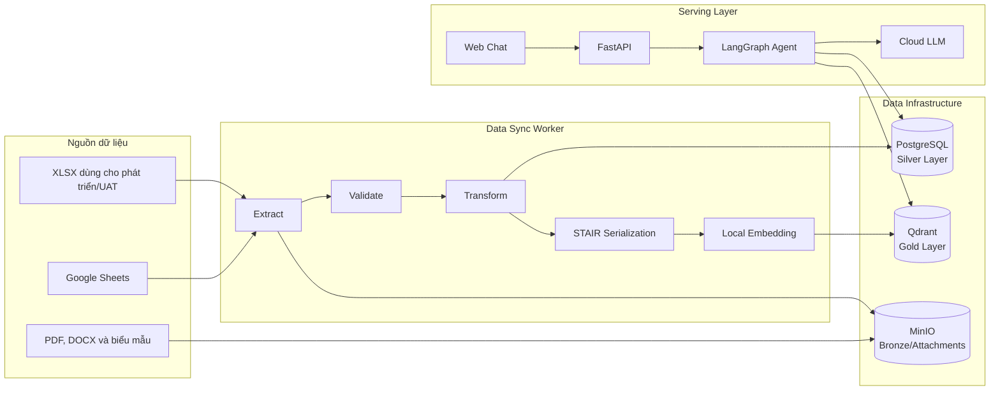
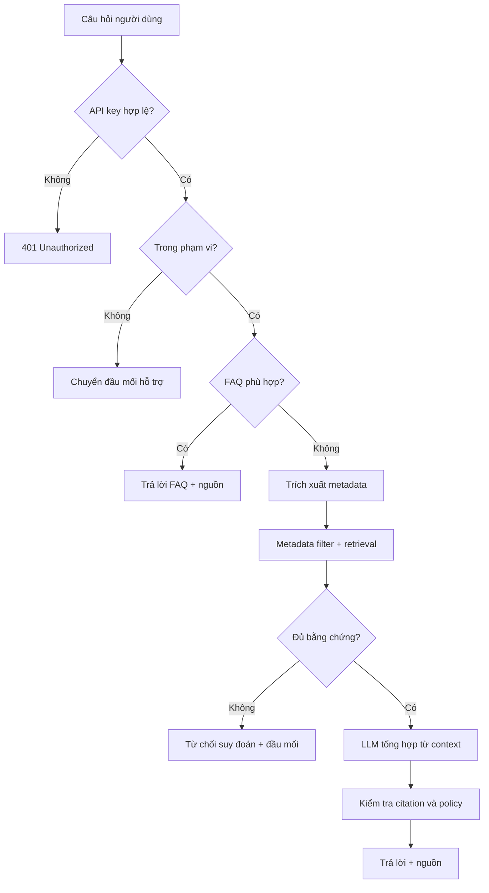

# UEL Virtual Assistant — RAG Chatbot PoC

Hệ thống chatbot trợ lý ảo sử dụng Retrieval-Augmented Generation (RAG), phục vụ tra cứu quy định, chính sách và thủ tục tại Trường Đại học Kinh tế - Luật (UEL).

## Trạng thái dự án

> Trạng thái: Phase 0–7 đã hoàn thành (`reports/phases/phase-07.md`). Phase 8 đánh giá còn IN_PROGRESS (`reports/phases/phase-08.md`). Routing Template 1 đa tenant đang vận hành bằng YAML registry và API quản trị trên PoC; chưa production-ready. Vận hành: `docs/operations-multi-tenant.md`. Kết quả lượt chuẩn hóa: `reports/phases/standardization.md`.

PoC được triển khai cho:

| Thuộc tính | Giá trị |
|---|---|
| Phòng ban | Phòng Bảo đảm chất lượng |
| `department_id` | `bao_dam_chat_luong` |
| Mô-đun PoC | Khảo khí |
| `module_code` | `khao_khi` |
| Đối tượng sử dụng | Người học |
| Thời gian dự kiến | 8 tuần |
| Nhân sự phát triển | 1 người |
| Kênh sử dụng | REST API, web chat tối thiểu, sảnh 7 phòng (`frontend/`, ĐBCL nối RAG) |
| Cơ chế xác thực | API key qua FastAPI dependency injection |
| Hạ tầng | Ubuntu Server, Docker Compose, CPU-only |
| LLM | Cloud API, cấu hình được nhà cung cấp |
| Embedding | Chạy local trên CPU |

## Chạy demo chatbot (sảnh + 7 phòng)

Đây là cách mở giao diện đang dùng. Chi tiết cổng, biến môi trường và sự cố: `frontend/README.md`. **Chưa production-ready.** Chỉ ĐBCL / Khảo khí gọi RAG; sáu phòng còn lại là FE + BFF mô phỏng.

```powershell
cd D:\ITAC\UEL-Innovation
docker compose up -d
curl.exe -fsS http://127.0.0.1:8000/health/ready

cd frontend
.\run-cluster.ps1
```

Mở http://127.0.0.1:5170 — chọn phòng.

| Cổng | Thành phần |
|---:|---|
| 5170 | Sảnh (nút từng phòng) |
| 5173 | ĐBCL / Khảo khí → RAG `:8000` |
| 5174–5179 | QTTS, PĐT, PNS, HC, CTSV, KHCN → BFF stub |
| 30957 | BFF GitHub |
| 8000 | FastAPI RAG |

Chỉ ĐBCL: `frontend\run-bff.ps1` rồi `frontend\run-fe.ps1`. Admin RAG: http://127.0.0.1:8000/admin (`X-Admin-Key`).

## 1. Mục tiêu

PoC nhằm kiểm chứng khả năng:

1. Đồng bộ dữ liệu nghiệp vụ từ các biểu mẫu chuẩn hóa.
2. Phân loại câu hỏi trong hoặc ngoài phạm vi chatbot.
3. Trả lời FAQ mà không gọi LLM khi có kết quả phù hợp.
4. Truy xuất đúng tài liệu theo đối tượng, trạng thái và hiệu lực.
5. Sinh câu trả lời dựa trên bằng chứng và kèm nguồn tham chiếu.
6. Từ chối trả lời hoặc chuyển sang đầu mối hỗ trợ khi thiếu bằng chứng.
7. Chứng minh kiến trúc có thể mở rộng thành hệ thống đa phòng ban.

PoC không cam kết “không ảo giác 100%”. Thay vào đó, hệ thống áp dụng:

- Chỉ trả lời từ dữ liệu đã duyệt.
- Lọc metadata trước khi truy xuất.
- Ngưỡng độ tin cậy được hiệu chỉnh bằng bộ kiểm thử.
- Dẫn nguồn cho các câu trả lời RAG.
- Không suy đoán khi không đủ bằng chứng.
- Chuyển người dùng tới đầu mối hỗ trợ khi cần.

## 2. Phạm vi PoC

### Trong phạm vi

- Phòng Bảo đảm chất lượng.
- Mô-đun Khảo khí.
- Một `department_id` và `module_code` cố định.
- Ba biểu mẫu dữ liệu chuẩn của dự án.
- Đồng bộ dữ liệu theo yêu cầu.
- PostgreSQL, Qdrant và MinIO.
- LangGraph RAG agent.
- FastAPI REST API.
- Web chat tối thiểu.
- API key trong HTTP header.
- Cloud LLM và local embedding.
- Trích dẫn nguồn.
- Logging, health check và bộ kiểm thử đánh giá chất lượng.
- Triển khai bằng Docker Compose trên một Ubuntu Server.

### Ngoài phạm vi

- Vận hành production cho đủ 7 phòng ban.
- SSO, OAuth, LDAP hoặc SAML.
- Zalo OA và các nền tảng nhắn tin khác.
- Giao diện quản trị dữ liệu.
- Đồng bộ tự động theo lịch.
- High availability và autoscaling.
- Cam kết SLA production.
- Fine-tuning LLM.
- OCR tài liệu scan.
- Xử lý dữ liệu cá nhân hoặc hồ sơ riêng của sinh viên.
- Thay thế quyết định chính thức của chuyên viên UEL.

## 3. Định hướng mở rộng

Kiến trúc được thiết kế để có thể mở rộng cho:

| `department_id` đề xuất | Phòng ban | Đối tượng |
|---|---|---|
| `hanh_chinh` | Phòng Hành Chính | Công nhân viên chức |
| `cong_tac_sinh_vien` | Phòng Công tác sinh viên | Người học |
| `dao_tao` | Phòng Đào Tạo | Người học |
| `quan_tri_tai_san` | Phòng Quản Trị Tài Sản | Công nhân viên chức |
| `nhan_su` | Phòng Nhân Sự | Công nhân viên chức |
| `khoa_hoc_cong_nghe` | Phòng Khoa Học Công Nghệ | Công nhân viên chức |
| `bao_dam_chat_luong` | Phòng Bảo đảm chất lượng | Người học |

Các mã trên cần được xác nhận trước khi mở rộng production.

Một phòng ban có thể có nhiều mô-đun độc lập, ví dụ Khảo khí, Khảo sát & Đánh giá. Routing rule, FAQ, tài liệu và vector luôn được phân vùng theo cả `department_id` và `module_code`. PoC hiện chỉ kích hoạt `bao_dam_chat_luong/khao_khi`.

## 4. Kiến trúc tổng quan



## 5. Công nghệ dự kiến

| Thành phần | Công nghệ |
|---|---|
| Ngôn ngữ | Python 3.12 |
| API | FastAPI, Uvicorn |
| Agent orchestration | LangGraph |
| Validation | Pydantic |
| ORM và migration | SQLAlchemy, Alembic |
| Xử lý bảng tính | Pandas, OpenPyXL, Google Sheets API |
| CSDL quan hệ | PostgreSQL |
| Vector database | Qdrant |
| Object storage | MinIO |
| Embedding | SentenceTransformers |
| LLM adapter | Provider-agnostic/OpenAI-compatible |
| Web UI | HTML, CSS và JavaScript tối thiểu |
| Kiểm thử | Pytest |
| Load test | Locust hoặc k6 |
| Triển khai | Docker Compose, Ubuntu Server |

Mô hình embedding cuối cùng sẽ được chọn bằng benchmark. Ứng viên ban đầu:

- `BAAI/bge-m3`;
- `intfloat/multilingual-e5-base`.

## 6. Cấu trúc dữ liệu đầu vào

### 6.1. Biểu mẫu 01 — Thông tin mô-đun

Biểu mẫu mô tả phạm vi chatbot:

- Tên mô-đun.
- Ngày tạo.
- Ngày cập nhật.
- Phạm vi mô-đun.
- Chủ đề hoặc tình huống.
- Cách chatbot xử lý.
- Đầu mối hỗ trợ.
- Thông tin liên hệ.
- Kênh trực tuyến.

Mỗi dòng được ánh xạ thành một routing rule.

Các loại xử lý dự kiến:

- Trong phạm vi trả lời.
- Ngoài phạm vi — chuyển sang mô-đun khác.
- Ngoài phạm vi — chuyển người phụ trách.
- Bắt buộc chuyển người, chatbot không tự trả lời.

### 6.2. Biểu mẫu 02 — FAQ

Các trường hiện có:

- STT.
- Mã câu hỏi.
- Phân mục.
- Phân mục chi tiết.
- Câu hỏi.
- Câu trả lời.
- Văn bản căn cứ.
- Đầu mối hỗ trợ.
- Thông tin liên hệ.
- Kênh trực tuyến.

FAQ được chuẩn hóa Unicode, khoảng trắng, dấu câu và chữ hoa/thường trước khi so khớp.

### 6.3. Biểu mẫu 03 — Tài liệu nghiệp vụ

Mỗi sheet `TLxx` đại diện cho một chủ đề nghiệp vụ.

Các nhóm dữ liệu:

1. Thông tin chung:
   - Tên chủ đề.
   - Loại tài liệu.
   - Tóm tắt.
   - Tên gọi khác hoặc từ khóa.
   - Đối tượng áp dụng.
   - Khóa, ngành hoặc hệ.
   - Đối tượng không áp dụng.
   - Văn bản căn cứ.
   - Đầu mối hỗ trợ.
   - Thời gian hiệu lực.
   - Trạng thái.
2. Nội dung quy định:
   - Tiêu đề mục.
   - Nội dung từng mục.
3. Điều kiện, ngoại lệ và lỗi thường gặp.
4. Thông tin thực hiện thủ tục:
   - Kết quả.
   - Thời hạn xử lý.
   - Địa điểm hoặc link.
   - Lịch tiếp nhận.
   - Lệ phí.
5. Hồ sơ cần chuẩn bị.
6. Các bước thực hiện.

Trạng thái hỗ trợ:

- `Nháp`: không đưa vào chatbot.
- `Đã duyệt`: được phép đồng bộ và truy xuất.
- `Ngưng dùng`: loại khỏi kết quả truy xuất nhưng vẫn giữ lịch sử.

## 7. Khoảng trống trong template cần xử lý

Trước khi khóa data contract cần giải quyết:

1. Biểu mẫu phạm vi chưa có mã ổn định cho từng routing rule.
2. Biểu mẫu phạm vi chưa có trạng thái riêng cho từng dòng.
3. FAQ chưa có trạng thái, đối tượng áp dụng và ngày hiệu lực.
4. Hướng dẫn biểu mẫu mô-đun có nhắc tới xác nhận duyệt nhưng trường duyệt chưa thể hiện rõ trong sheet dữ liệu.
5. Không được dùng STT làm khóa nghiệp vụ.
6. Việc chèn hoặc di chuyển dòng có thể làm thay đổi định danh nếu sử dụng số dòng.

Đề xuất bổ sung ở cuối sheet:

- `MÃ PHẠM VI`, `TRẠNG THÁI` cho biểu mẫu 01.
- `TRẠNG THÁI`, `ÁP DỤNG CHO`, `HIỆU LỰC TỪ`, `HIỆU LỰC ĐẾN`, `NGÀY CẬP NHẬT` cho FAQ.

## 8. Medallion Architecture

### Bronze

- Bản snapshot dữ liệu nguồn.
- Metadata của lần đồng bộ.
- Tệp đính kèm.
- Checksum và thời điểm lấy dữ liệu.
- Lưu trên MinIO để phục vụ truy vết và chạy lại pipeline.

### Silver

PostgreSQL là nguồn dữ liệu có cấu trúc đã được kiểm tra:

- Departments.
- Modules.
- Routing rules.
- FAQs.
- Documents.
- Document sections.
- Procedures.
- Attachments.
- Sync runs.
- Source records.

### Gold

Qdrant lưu:

- Dense vector.
- Có thể bổ sung sparse vector nếu benchmark chứng minh cần thiết.
- Nội dung STAIR Markdown.
- `department_id`.
- `module_code`.
- `document_id`.
- `section_id`.
- Đối tượng áp dụng.
- Loại tài liệu.
- Trạng thái.
- Thời gian hiệu lực.
- Phiên bản dữ liệu.
- URL nguồn hoặc tệp đính kèm.

## 9. STAIR Serialization

Mỗi đoạn được tạo thành một đơn vị có thể đọc độc lập:

```markdown
# [Tên chủ đề]

- Phòng ban: Phòng Bảo đảm chất lượng
- Mô-đun: Khảo khí
- Đối tượng áp dụng: [...]
- Không áp dụng cho: [...]
- Khóa/Ngành/Hệ: [...]
- Hiệu lực: [...]
- Văn bản căn cứ: [...]

## [Tên phần]

[Nội dung cụ thể]

## Điều kiện và ngoại lệ

[...]

Nguồn: [Mã tài liệu hoặc URL]
```

Không tạo chunk chỉ chứa một con số, mức phí hoặc thời hạn mà không có ngữ cảnh.

## 10. Luồng xử lý câu hỏi



### Thứ tự ưu tiên

1. Kiểm tra API key.
2. Gắn `department_id=bao_dam_chat_luong` và `module_code=khao_khi` từ cấu hình server.
3. Kiểm tra routing rule.
4. FAQ normalized match.
5. Trích xuất metadata.
6. Lọc metadata.
7. Tìm kiếm lexical/vector.
8. Kiểm tra ngưỡng bằng chứng.
9. Sinh câu trả lời.
10. Kiểm tra nguồn và trả kết quả.

Client không được quyền truyền `department_id` hoặc `module_code` để thay đổi phạm vi PoC.

## 11. API dự kiến

### Gửi câu hỏi

```http
POST /v1/chat
X-API-Key: <secret>
Content-Type: application/json
```

```json
{
  "message": "Điều kiện tham gia khảo sát chất lượng là gì?",
  "conversation_id": "optional-uuid"
}
```

Phản hồi:

```json
{
  "request_id": "uuid",
  "status": "answered",
  "answer": "...",
  "citations": [
    {
      "document_id": "TL01",
      "title": "...",
      "section": "...",
      "url": "..."
    }
  ],
  "support_contact": null
}
```

Các trạng thái:

- `answered`;
- `faq_answered`;
- `out_of_scope`;
- `insufficient_evidence`;
- `human_handoff`.

### Endpoint vận hành

| Endpoint | Mục đích |
|---|---|
| `GET /health/live` | Kiểm tra process API |
| `GET /health/ready` | Kiểm tra PostgreSQL, Qdrant và cấu hình |
| `POST /v1/chat` | Gửi câu hỏi |
| `GET /v1/sources/{id}` | Lấy metadata nguồn nếu được phép |

## 12. Xác thực

PoC sử dụng API key:

```text
X-API-Key: <secret>
```

FastAPI dependency chịu trách nhiệm:

1. Đọc header.
2. So sánh API key bằng phương pháp constant-time.
3. Từ chối với HTTP 401 nếu không hợp lệ.
4. Inject request context chứa `department_id` và `module_code` cố định.
5. Không ghi API key vào log.

Đây không phải cơ chế xác thực phù hợp cho production nhiều người dùng.

## 13. Cấu hình môi trường dự kiến

```dotenv
APP_ENV=development
APP_API_KEY=change-me
APP_DEPARTMENT_ID=bao_dam_chat_luong
APP_MODULE_CODE=khao_khi

POSTGRES_HOST=postgres
POSTGRES_PORT=5432
POSTGRES_DB=uel_rag
POSTGRES_USER=uel
POSTGRES_PASSWORD=change-me

QDRANT_URL=http://qdrant:6333
QDRANT_COLLECTION=uel_knowledge

MINIO_ENDPOINT=minio:9000
MINIO_ACCESS_KEY=change-me
MINIO_SECRET_KEY=change-me
MINIO_BUCKET_BRONZE=bronze
MINIO_BUCKET_ATTACHMENTS=attachments

LLM_PROVIDER=groq
LLM_MODEL=openai/gpt-oss-20b
LLM_API_KEY=<groq-key>

EMBEDDING_MODEL=BAAI/bge-m3
EMBEDDING_DEVICE=cpu

RAG_TOP_K=5
RAG_SCORE_THRESHOLD=0.4167
```

Không commit `.env` hoặc secret vào Git.

## 14. Đồng bộ dữ liệu

Quy trình dự kiến:

```bash
python -m app.cli sync \
  --department bao_dam_chat_luong \
  --module khao_khi \
  --source xlsx \
  --dry-run
```

Sau khi báo cáo validation hợp lệ:

```bash
python -m app.cli sync \
  --department bao_dam_chat_luong \
  --module khao_khi \
  --source xlsx
```

Khi chuyển sang Google Sheets:

```bash
python -m app.cli sync \
  --department bao_dam_chat_luong \
  --module khao_khi \
  --source google-sheets
```

Pipeline phải:

- Có tính idempotent.
- Không tạo bản ghi trùng khi chạy lại.
- Ghi nhận `sync_run_id`.
- Báo lỗi theo workbook, sheet, dòng và cột.
- Không publish dữ liệu khi validation nghiêm trọng thất bại.
- Soft-delete bản ghi đã chuyển sang `Ngưng dùng`.
- Re-embed chỉ khi nội dung hoặc metadata ảnh hưởng retrieval thay đổi.
- Lưu snapshot và checksum của dữ liệu nguồn.

## 15. Cấu trúc repository mục tiêu

```text
.
├── app/
│   ├── api/
│   ├── agent/
│   ├── auth/
│   ├── core/
│   ├── ingestion/
│   ├── models/
│   ├── repositories/
│   ├── schemas/
│   ├── services/
│   ├── web/
│   └── cli.py
├── alembic/
├── configs/
│   └── departments.yaml
├── data/
│   └── P.BDCL/
├── docs/
│   ├── decisions/
│   ├── data-dictionary.md
│   ├── data-mapping.md
│   ├── data-approval-policy.md
│   └── erd.md
├── reports/
│   └── phases/
├── template/
├── tests/
│   ├── unit/
│   ├── integration/
│   ├── e2e/
│   ├── evaluation/
│   └── fixtures/
├── scripts/
├── docker-compose.yml
├── Dockerfile
├── .env.example
├── Proposal.md
├── PLAN.md
├── PHASE_PLAN.md
└── README.md
```

Phase 2 đã bổ sung `app/ingestion/` và `app/cli.py`. Phase 3 đã bổ sung `app/models/`, `app/db/`, `app/repositories/silver.py` và Alembic. Phase 4 đã bổ sung `app/gold/` (STAIR, BGE-M3, Qdrant).

## 16. Khởi chạy Phase 1

### 16.1. Kiểm tra mã nguồn

```powershell
python -m venv .venv
.\.venv\Scripts\python.exe -m pip install -e ".[dev]"
.\.venv\Scripts\ruff.exe check .
.\.venv\Scripts\ruff.exe format --check .
.\.venv\Scripts\mypy.exe app tests
.\.venv\Scripts\pytest.exe --cov=app
```

### 16.2. Khởi động hạ tầng

Sao chép `.env.example` thành `.env` và thay toàn bộ giá trị `replace-with-*` trước khi dùng ngoài kiểm thử local.

```powershell
Copy-Item .env.example .env
docker compose up -d --build
```

MinIO Community không còn cung cấp public container image vào thời điểm triển khai. Compose build image PoC đã pin checksum từ binary release `RELEASE.2025-09-07T16-13-09Z` trong `infra/minio/Dockerfile`. Image này chỉ phù hợp PoC; cần đánh giá object storage còn được bảo trì trước production.

### 16.3. Kiểm tra trạng thái

```bash
curl http://localhost:8000/health/live
curl http://localhost:8000/health/ready
docker compose ps
```

Kết quả readiness mong đợi:

```json
{
  "status": "ready",
  "dependencies": {
    "postgres": "ok",
    "qdrant": "ok",
    "minio": "ok"
  }
}
```

Dừng dịch vụ nhưng giữ dữ liệu:

```bash
docker compose down
```

### 16.4. Phase 2 — Bronze dry-run

```powershell
.\.venv\Scripts\python.exe -m app.cli sync `
  --department bao_dam_chat_luong `
  --module khao_khi `
  --source xlsx `
  --dry-run
```

Kỳ vọng: 17 routing rules, 71 FAQ, 4 documents, 0 ERROR. Báo cáo ghi vào `reports/validation/<release_id>/`. Dry-run không ghi PostgreSQL, Qdrant hay MinIO và không sửa file trong `data/P.BDCL/`.

### 16.5. Phase 3 — Schema Silver và sync PostgreSQL

Từ máy host (Compose đang chạy), trỏ Postgres/MinIO về `localhost`:

```powershell
$env:POSTGRES_HOST = "localhost"
$env:MINIO_URL = "http://localhost:9000"
.\.venv\Scripts\python.exe -m alembic upgrade head
.\.venv\Scripts\python.exe -m app.cli sync `
  --department bao_dam_chat_luong `
  --module khao_khi `
  --source xlsx
```

Kỳ vọng lần đầu: `status=completed`, 17 routing, 71 FAQ, 4 documents. Chạy lại cùng nguồn: `silver_inserted=0`, `silver_updated=0`, `silver_deactivated=0`. ERD: `docs/erd.md`. Không bỏ `--dry-run` nếu chỉ muốn validate — dry-run không ghi Silver.

Sync không `--dry-run` cũng index Gold (Qdrant) trừ khi thêm `--skip-gold`. Quyết định Phase 4: `docs/decisions/phase-04-decisions.md`.

### 16.6. Phase 4 — Gold / Qdrant

```powershell
$env:POSTGRES_HOST = "localhost"
$env:QDRANT_URL = "http://localhost:6333"
$env:MINIO_URL = "http://localhost:9000"
.\.venv\Scripts\python.exe -m pip install -e ".[gold]"
.\.venv\Scripts\python.exe -m app.cli rebuild-gold `
  --department bao_dam_chat_luong `
  --module khao_khi
.\.venv\Scripts\python.exe -m app.cli gold-verify `
  --department bao_dam_chat_luong `
  --module khao_khi
```

Kỳ vọng: 130 point, `pii_hits=0`, `tenant_leak_hits=0`, incremental `unchanged=130`. Model `BAAI/bge-m3` dense 1024 + sparse. STAIR: `reports/gold/` (gitignored). Dashboard: http://localhost:6333/dashboard

### 16.7. Phase 5 — Retrieval baseline

```powershell
$env:POSTGRES_HOST = "localhost"
$env:QDRANT_URL = "http://localhost:6333"
$env:MINIO_URL = "http://localhost:9000"
.\.venv\Scripts\python.exe -m app.cli eval-retrieval `
  --department bao_dam_chat_luong `
  --module khao_khi
```

Kỳ vọng: ≥ 80 câu retrieval, hybrid Recall@5 test ≥ 85%, `tenant_leak_failures=0`. Baseline: `reports/phases/phase-05-baseline.json`. Test set đóng băng theo `dataset_sha256`. Thêm `--skip-dense` nếu không cần so dense-only.

### 16.8. Phase 6 — LangGraph chat

```powershell
$env:POSTGRES_HOST = "localhost"
$env:QDRANT_URL = "http://localhost:6333"
$env:MINIO_URL = "http://localhost:9000"
$env:LLM_PROVIDER = "groq"
$env:LLM_MODEL = "openai/gpt-oss-20b"
$env:LLM_API_KEY = "<groq-key>"
.\.venv\Scripts\python.exe -m pip install -e ".[gold]"
.\.venv\Scripts\python.exe -m app.cli chat `
  --department bao_dam_chat_luong `
  --module khao_khi
```

Một câu: thêm `--message "Thời hạn phúc khảo đại học chính quy?"`. REPL dùng `--conversation-id` để giữ clarification. `LLM_PROVIDER=fake` để chạy graph không gọi Groq. Quyết định: `docs/decisions/phase-06-decisions.md`. Key: https://console.groq.com/keys

## 17. Tiêu chí chất lượng PoC

Các ngưỡng ban đầu sẽ được hiệu chỉnh bằng benchmark:

| Chỉ số | Mục tiêu ban đầu |
|---|---:|
| Tenant leakage trong test | 0 |
| Retrieval Recall@5 | ≥ 90% |
| Câu trả lời có citation hợp lệ | ≥ 95% |
| Groundedness | ≥ 90% |
| Độ chính xác trên bộ câu hỏi đã duyệt | ≥ 85% |
| Từ chối đúng khi thiếu bằng chứng | ≥ 95% |
| FAQ normalized match | ≥ 98% |
| Lỗi đồng bộ không được báo cáo | 0 |
| Tỷ lệ lỗi API ở 10 người dùng đồng thời | < 1% |
| p95 FAQ response | ≤ 1 giây |
| p95 RAG response | ≤ 8 giây, không tính sự cố provider |

Không được tối ưu ngưỡng chỉ trên bộ dữ liệu dùng để phát triển.

## 18. Bảo mật và quản trị dữ liệu

- Không gửi dữ liệu cá nhân lên cloud LLM.
- Chỉ gửi các đoạn tài liệu cần thiết cho việc trả lời.
- Không lưu toàn bộ nội dung chat mặc định.
- Mask API key và secret trong log.
- Không nhận `department_id` hoặc `module_code` tùy ý từ client.
- Chỉ index tài liệu `Đã duyệt` và còn hiệu lực.
- File MinIO không public mặc định.
- URL tải file nên là presigned URL có thời hạn.
- Tách quyền truy cập PostgreSQL, Qdrant và MinIO.
- Sao lưu volume trước khi thay đổi schema hoặc nâng cấp dịch vụ.
- Có timeout, retry giới hạn và circuit breaker cho cloud LLM.

## 19. Observability

Mỗi request cần có:

- `request_id`.
- Thời gian xử lý từng node.
- Kết quả routing.
- FAQ match hoặc retrieval score.
- Số lượng chunk được sử dụng.
- LLM provider/model.
- Số token nếu provider hỗ trợ.
- Trạng thái trả lời hoặc từ chối.
- Mã lỗi đã chuẩn hóa.

Không log:

- API key.
- Secret.
- Toàn bộ prompt chứa dữ liệu nhạy cảm.
- Nội dung cá nhân không cần thiết.

## 20. Hạn chế của PoC

- YAML registry là nguồn cấu hình hiện tại; chưa có database registry, job queue hay rollback nguyên tử nhiều kho.
- API key là service identity, không thay thế xác thực người học.
- `bot_behavior` của Template 1 là mô tả cho classifier, chưa phải DSL workflow.
- Chất lượng phụ thuộc trực tiếp vào dữ liệu được duyệt.
- Cloud LLM có thể bị giới hạn quota hoặc tăng độ trễ.
- Local embedding trên CPU làm thời gian đồng bộ dài hơn.
- Câu hỏi mơ hồ vẫn có thể cần người dùng bổ sung thông tin.
- Các KPI chỉ có ý nghĩa sau khi có bộ dữ liệu đánh giá được chuyên viên xác nhận.

## 21. Tài liệu liên quan

- `HUONG_DAN_ONBOARDING.md`: dữ liệu template lưu ở đâu, upload file trên `/docs`, thêm phòng/mô-đun (template → API → Qdrant).
- `HDSD_QUAN_LY_BOT.md`: prompt pack, trang `/admin`, routing vs config, thử chat.
- `Proposal.md`: đề xuất ban đầu.
- `PLAN.md`: kế hoạch thực hiện PoC.
- `PHASE_PLAN.md`: checklist triển khai và theo dõi tiến độ theo từng phase.
- `reports/phases/`: báo cáo nghiệm thu sau mỗi phase.
- `docs/`: data contract, mapping, enum, ERD (`docs/erd.md`), decision records, kế hoạch routing (`docs/plan-multi-tenant-routing.md`) và vận hành tenant (`docs/operations-multi-tenant.md`).
- `evaluation/cases.yaml`: bộ câu paraphrase / TL / policy / adversarial Phase 5.
- `data/P.BDCL/`: dữ liệu thực tế dùng cho PoC Phòng Bảo đảm chất lượng.
- `template/`: ba biểu mẫu dữ liệu chuẩn.
- `danh_sach_phong_ban.txt`: danh sách phòng ban định hướng mở rộng.
- `frontend/README.md`: sảnh 7 phòng, BFF, cổng, lệnh chạy và sự cố.


### Web chat và API (Phase 7)

Chạy `python -m uvicorn app.main:app --host 127.0.0.1 --port 8000`, mở `http://127.0.0.1:8000/` và nhập API key dịch vụ. Nút **Tải mô-đun** gọi `GET /v1/modules`; client chỉ chọn module đã được cấp. `POST /v1/chat` yêu cầu header `X-API-Key`; body gồm `message`, `module_code` khi key có nhiều module, và `conversation_id` tùy chọn. Tenant do server suy ra từ key, không nhận `department_id` từ client. Lưu `conversation_id` từ response để tiếp tục hội thoại. Tài liệu API ở `/docs` (Authorize: `X-API-Key` / `X-Admin-Key`). Nạp phòng mới: ba file `template/` → `POST /v1/admin/packages/inspect` → `POST /v1/admin/releases` (`dry_run=false` ghi MinIO, PostgreSQL, Qdrant). Đổi key hoặc module sẽ reset hội thoại trên web. Key trên browser là service identity; giao diện công khai cần BFF. Sảnh 7 phòng: `frontend/README.md` (lounge `:5170`; ĐBCL `:5173` → BFF `:30957` → RAG `:8000`; phòng khác stub). Vận hành RAG: `docs/operations-multi-tenant.md`.

Cấu hình tùy chọn: `CORS_ORIGINS` là JSON array các origin được phép (mặc định rỗng), `REQUEST_MAX_BYTES` (mặc định 16384), `CHAT_TIMEOUT_SECONDS` (mặc định 90). Bộ nhớ hội thoại nằm trong tiến trình; restart hoặc chạy nhiều worker sẽ không chia sẻ lịch sử. Khi timeout, xử lý trong thread có thể vẫn tiếp tục chạy.

Browser smoke test: cài `pip install -e ".[browser]"` và `python -m playwright install chromium`, rồi chạy `python -m pytest tests/smoke/test_browser_chat.py -q`. Có thể đặt `BROWSER_EXECUTABLE` trỏ tới Chrome/Chromium trên máy. Test sử dụng response giả, không gọi agent thật.