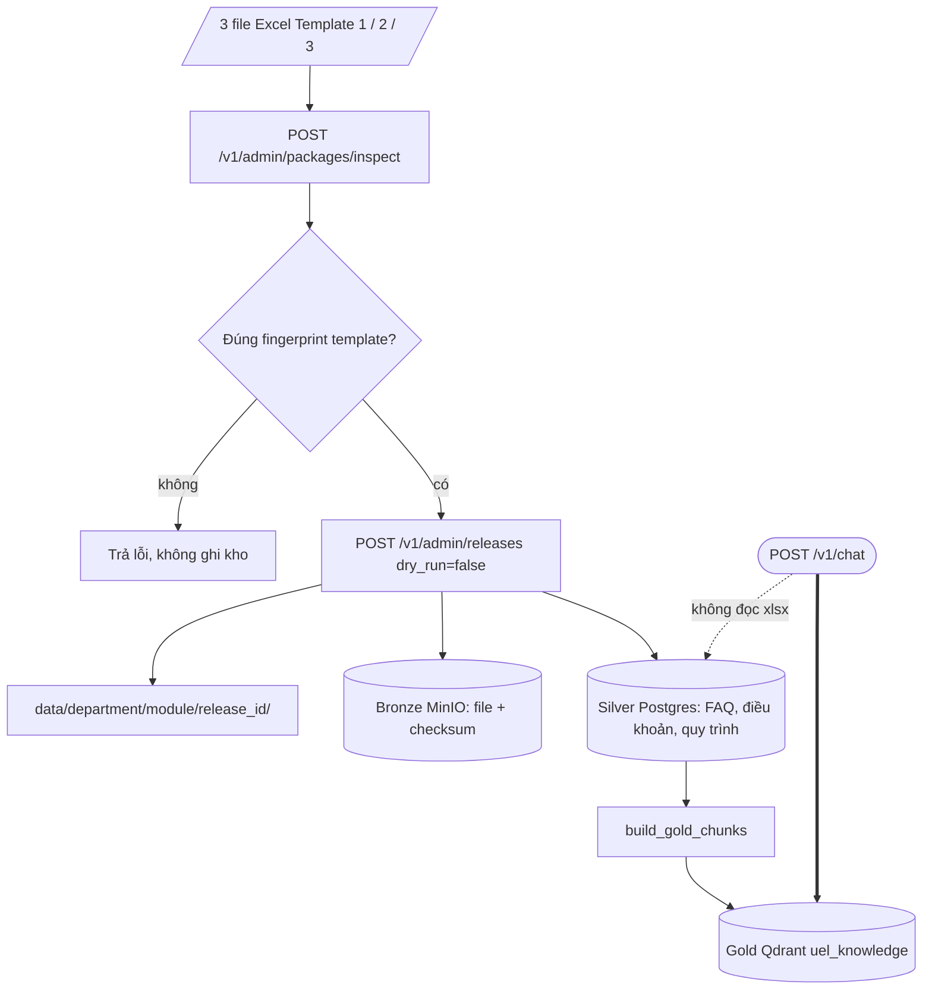
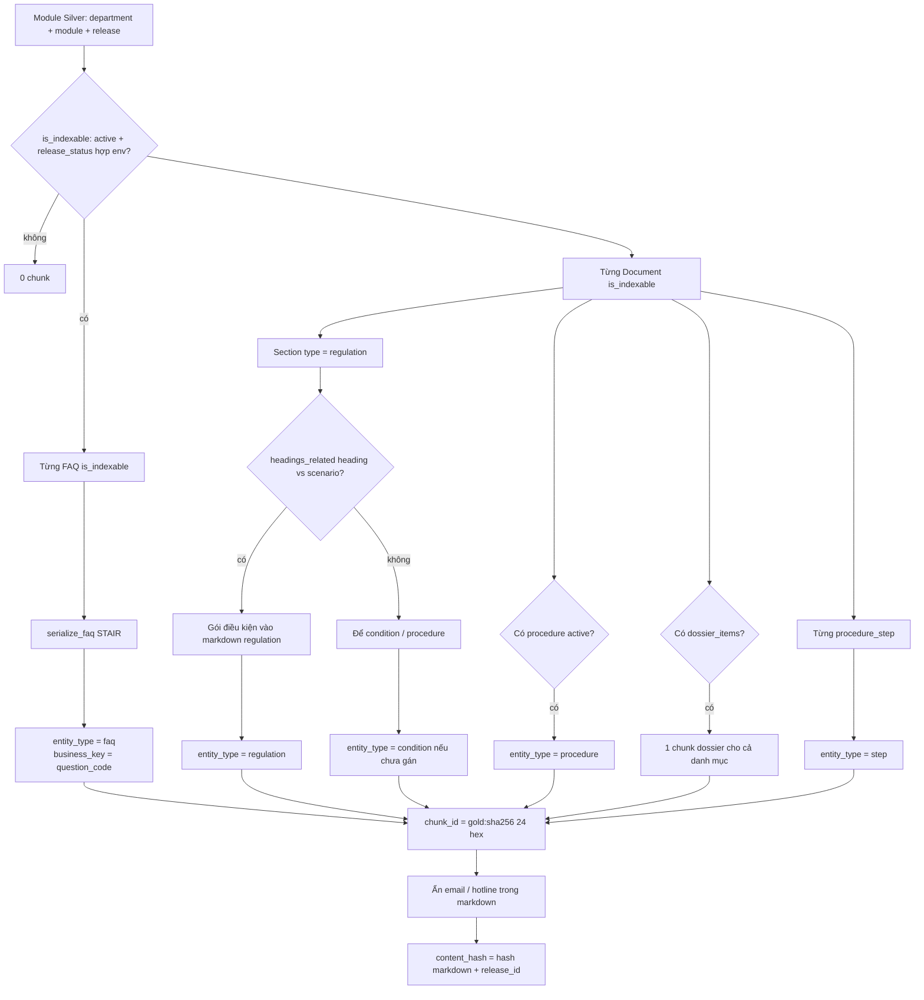
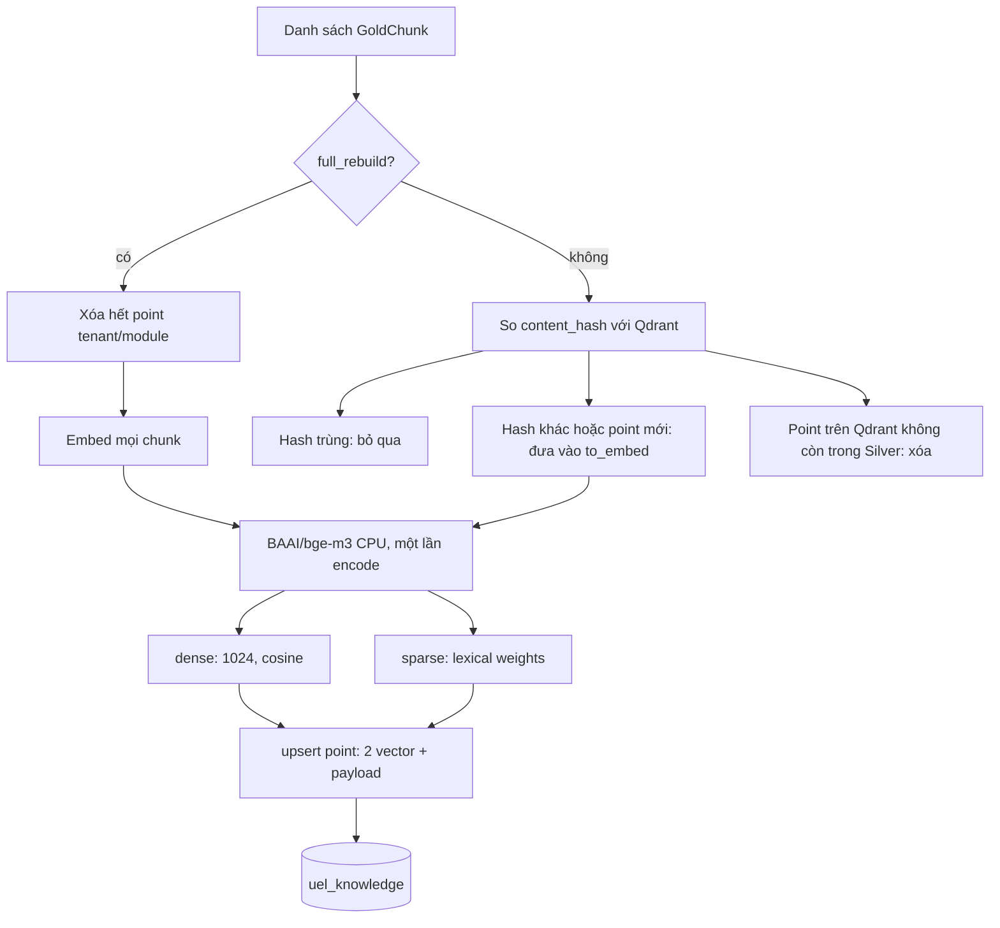
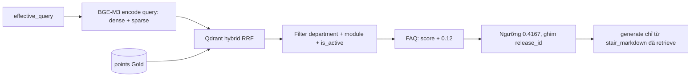

# Pipeline dữ liệu và chunking (Bronze → Silver → Gold)

Tài liệu mô tả **cách Excel thành vector** trước khi chat. Retrieve lúc hỏi nằm ở `docs/co-che-retrieve.md`. PoC, chưa production-ready.

Hệ thống **không cắt văn bản trượt cửa sổ** (sliding window). Chunk Gold = **một đơn vị nghiệp vụ** đã parse trên Silver, viết thành markdown STAIR, rồi embed.

---

## 1. Ba lớp — chat không đọc Excel



| Lớp | Chỗ lưu | Việc |
|---|---|---|
| Nguồn | `data/{department_id}/{module_code}/{release_id}/` | Bản Excel + manifest |
| Bronze | MinIO | Snapshot file, checksum |
| Silver | PostgreSQL | Bản ghi đã chuẩn hóa (FAQ, section, procedure…) |
| Gold | Qdrant collection `uel_knowledge` | Vector dense + sparse để retrieve |

Cập nhật nội dung = Excel mới + `release_id` mới. Không ghi đè thư mục cũ.

Ba template:

1. **Template 1** — thông tin mô-đun, phạm vi trả lời (routing)
2. **Template 2** — FAQ (`question_code`, câu hỏi, câu trả lời)
3. **Template 3** — tài liệu nghiệp vụ (TL01…): điều khoản, điều kiện, quy trình, hồ sơ, bước

---

## 2. Chunking: Silver → STAIR → một point Qdrant

`build_gold_chunks` (`app/gold/builder.py`) đọc module đang indexable theo môi trường, rồi **mỗi bản ghi đủ điều kiện = 1 chunk**.



### Loại chunk

| `entity_type` | Nguồn Silver | Một chunk ứng với |
|---|---|---|
| `faq` | Template 2 | Một FAQ (`question_code`, ví dụ `I.2.012`) |
| `regulation` | Template 3, section `regulation` | Một điều khoản; điều kiện liên quan (heading ⊂ scenario hoặc ngược lại) **nhồi vào cùng markdown** |
| `condition` | Section không phải regulation, **chưa** gán vào regulation | Một ngoại lệ / tình huống còn lại |
| `procedure` | `document.procedure` | Tóm tắt thủ tục, thời hạn, địa điểm, `fee_type` |
| `dossier` | `dossier_items` | **Cả danh mục hồ sơ** một tài liệu (không tách từng dòng) |
| `step` | `procedure_steps` | Một bước (`step_number`) |

Không chunk theo số token/ký tự. Điều khoản dài vẫn **một** vector. Hồ sơ nhiều dòng vẫn **một** chunk `dossier`.

### ID ổn định

```text
chunk_id  = gold: + sha256(department_id | module_code | entity_type | business_key)[:24]
point_id  = UUID5(chunk_id)   ← id point trên Qdrant
```

Cùng FAQ/điều khoản giữa các lần rebuild giữ nguyên id; đổi nội dung thì cùng point, vector mới (vì `content_hash` đổi).

---

## 3. STAIR — cái gì được embed

Embed **toàn bộ** `stair_markdown`, không tách header. `BgeM3Embedder.embed([chunk.stair_markdown, …])`.

FAQ (rút gọn):

```text
# <câu hỏi>

- Phòng ban: Phòng Bảo đảm chất lượng
- Mô-đun: Mô-đun Khảo khí
- Đối tượng: Người học
- Trạng thái release: approved_for_dev
- Mã câu hỏi: I.2.012

## Câu trả lời
<Faq.answer>

## Văn bản căn cứ
<legal_basis hoặc "Chưa có văn bản căn cứ trong nguồn.">

Nguồn: <file> / <sheet> / dòng <n>
```

Regulation tương tự: heading, nội dung điều, block `## Điều kiện và ngoại lệ`, mã `TLxx`.

Email/hotline trong markdown bị thay `[email đã ẩn]` / `[số liên hệ đã ẩn]` **trước** hash và embed.

---

## 4. Index Gold: BGE-M3 dense + sparse



Cùng model, **hai vector / chunk** (ColBERT tắt). Payload gồm `department_id`, `module_code`, `entity_type`, `is_active`, `release_id`, `document_code` / `question_code`, `stair_markdown`, ngày hiệu lực…

Incremental mặc định: chỉ embed chunk đổi hash. `rebuild-gold --full` xóa tenant rồi embed lại.

PoC Khảo khí từng index khoảng **130** chunk.

---

## 5. Lúc chat: lấy lại chunk đã index



Chi tiết nhánh FAQ exact vs hybrid: `docs/co-che-retrieve.md`.

---

## 6. File liên quan

| File | Vai trò |
|---|---|
| `app/gold/builder.py` | Silver → danh sách chunk |
| `app/gold/stair.py` | Markdown STAIR; `headings_related` |
| `app/gold/ids.py` | `gold:…` và UUID point |
| `app/gold/embedder.py` | BGE-M3 / `hash-test` |
| `app/gold/indexer.py` | Incremental upsert |
| `app/gold/qdrant_store.py` | Collection, hybrid search |
| `python -m app.cli rebuild-gold` | Chạy index từ Silver |
| `HUONG_DAN_ONBOARDING.md` | Upload 3 Excel |

Test không tải Hugging Face: `EMBEDDING_MODEL=hash-test`.
