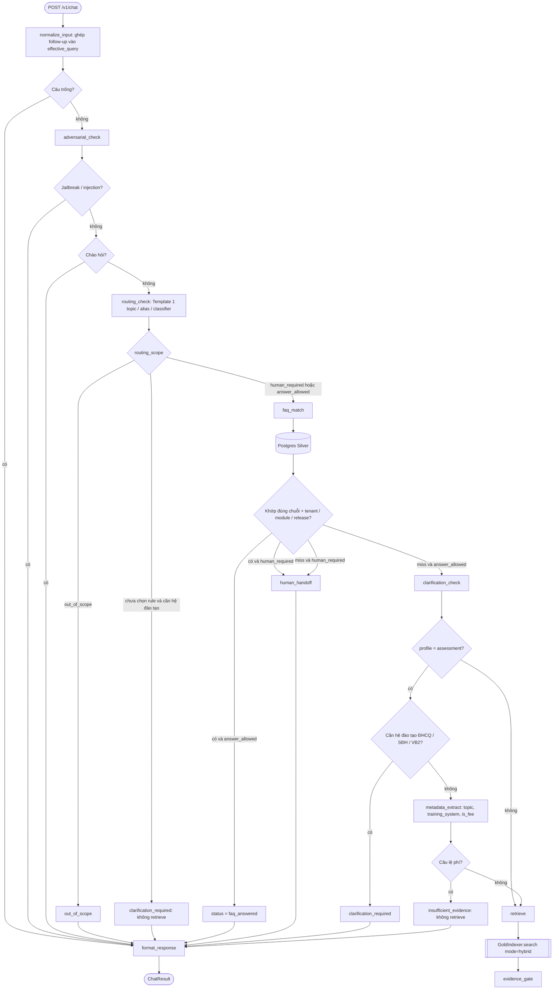
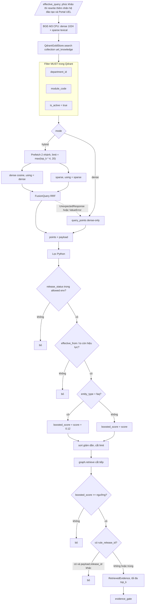
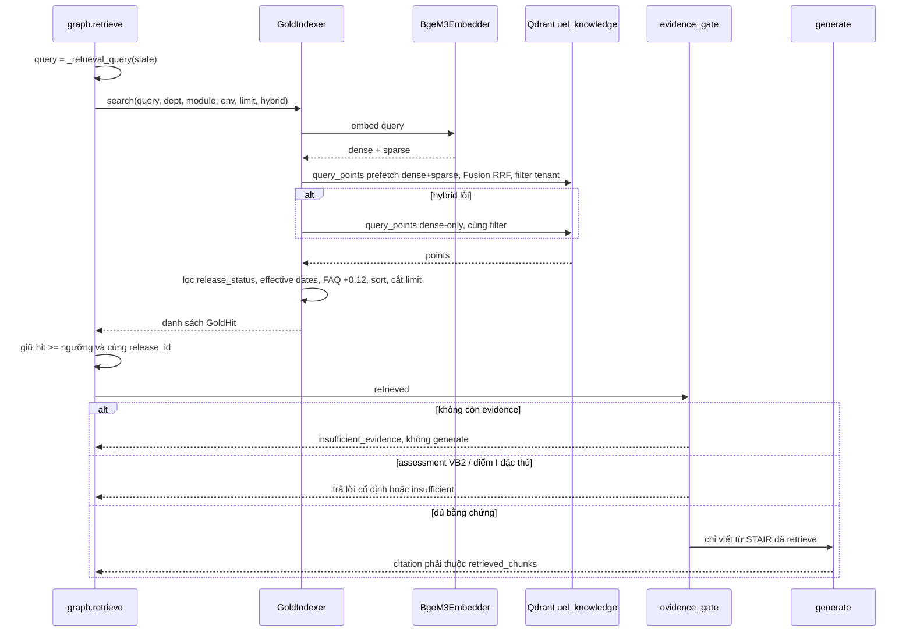

# Cơ chế retrieve (RAG)

Tài liệu mô tả **cách hệ thống tìm bằng chứng** trước khi soạn câu trả lời. Đây là hành vi hiện tại của PoC (`app/agent/graph.py`, `app/gold/`), chưa production-ready.

Retrieve **không chạy ngay** khi có câu hỏi. Graph lọc trước; chỉ khi được phép mới tìm tài liệu. Có hai tầng:

| Tầng | Kho | Cách khớp | Khi nào dùng |
|---|---|---|---|
| FAQ exact | Postgres Silver | So `normalized_question` **đúng chuỗi** | Ưu tiên, không embedding |
| Hybrid retrieve | Qdrant Gold | BGE-M3 dense + sparse, gộp RRF | Khi FAQ không khớp |

Không có BM25 riêng, không ColBERT, không cross-encoder rerank.

---

## 1. Luồng agent: FAQ trước, Qdrant sau



Các nhánh **không gọi Qdrant**: chào hỏi, adversarial, ngoài phạm vi, hỏi lại hệ đào tạo, câu lệ phí, FAQ đã khớp, handoff khi FAQ miss.

Ví dụ dưới đây lấy từ mô-đun **Khảo khí** (`bao_dam_chat_luong` / `khao_khi`) — phòng duy nhất đang nối RAG. Câu minh họa bám `evaluation/cases.yaml`, YAML pack và câu trả lời mẫu trong `app/agent/templates.py`. Wording generate có thể hơi khác từng lần gọi LLM, nhưng **số ngày, nhãn hệ đào tạo và mã nguồn** phải giữ như dữ liệu đã duyệt.

---

## 2. Mẫu câu và cách chatbot trả lời

### 2.1. Các kiểu câu trả lời (`status`)

| `status` | Retrieve? | Generate LLM? | Người dùng thấy gì |
|---|---|---|---|
| `greeting` | không | không | Lời chào pack YAML |
| `error` (adversarial) | không | không | Từ chối jailbreak / lộ prompt |
| `out_of_scope` | không | không | Ngoài Khảo khí + gợi ý đơn vị khác |
| `clarification_required` | không | không | Hỏi lại hệ đào tạo (ĐHCQ / SĐH / VB2) |
| `faq_answered` | không | không | Đúng nguyên câu FAQ Silver |
| `human_handoff` | không | không | Không kết luận hồ sơ/điểm cá nhân |
| `insufficient_evidence` | lệ phí: không; thiếu hit: có rồi loại | không | Không nêu số tiền / chưa đủ nguồn |
| `answered` | có (FAQ miss) | có, hoặc fallback trích STAIR | Tóm tắt + một dòng `Nguồn: TLxx` |

Phong cách khi `answered`: xưng **bạn**, câu ngắn, quy trình đánh số `1. 2. 3.`, không dán nguyên văn nguồn, không in `gold:…` / `chunk_id`. Chỉ **một dòng cuối** `Nguồn: TL02` (và/hoặc mã FAQ `I.2.012`). Nhiều hệ đào tạo thì **tách mục ĐHCQ / SĐH**, không gộp thành một hạn chung.

Lời chào / ngoài phạm vi / hỏi lại hệ đào tạo lấy từ pack YAML (`configs/departments.yaml`); thiếu pack thì dùng `app/agent/templates.py`. Có thể thêm dòng `Đầu mối hỗ trợ: Phòng Bảo đảm chất lượng | phongbdcl@uel.edu.vn | 19001239` khi contact được phép hiện.

### 2.2. Không retrieve

**Chào hỏi** — `xin chào`, `hi`, `hello`, `cảm ơn`, `tạm biệt` (gần như chỉ lời chào).

> Bot: Xin chào. Tôi là trợ lý mô-đun Khảo khí, Phòng Bảo đảm chất lượng (UEL). Bạn có thể hỏi quy định thi, phúc khảo, điểm I hoặc hình thức thi. Tôi không trả lời học phí, thời khóa biểu, hay hồ sơ/điểm của một người học cụ thể.

**Ngoài phạm vi** — học phí, công nợ, thời khóa biểu, đăng ký học phần, học bổng, cài SEB/LMS.

| Người hỏi | Bot (ý) |
|---|---|
| Tôi muốn hỏi học phí học kỳ này và cách đóng công nợ | Ngoài Khảo khí → tài chính |
| Đăng ký học phần và xem thời khóa biểu tuần sau | Ngoài Khảo khí → đào tạo |
| Tôi không cài được Safe Exam Browser trên máy | Ngoài Khảo khí → kỹ thuật |

> Bot: Câu hỏi này nằm ngoài phạm vi mô-đun Khảo khí (Phòng Bảo đảm chất lượng). Vui lòng liên hệ đơn vị phụ trách phù hợp: đào tạo (học phần/thời khóa biểu), tài chính (học phí/công nợ), hoặc hỗ trợ kỹ thuật (cài đặt phần mềm, đăng nhập hệ thống).

**Hồ sơ / điểm cá nhân** — handoff, không Qdrant.

| Người hỏi | Vì sao |
|---|---|
| Cho tôi biết điểm thi mã số sinh viên 123456789 của tôi | MSSV + điểm cá nhân |
| Tôi khiếu nại kết quả phúc khảo bài thi của riêng tôi | Khiếu nại cá nhân |
| Tôi bị cấm thi học phần này, xử lý hồ sơ cá nhân thế nào? | Hồ sơ cá nhân |
| Tôi không có tên trong danh sách dự thi dù đã học đủ | Danh sách cá nhân |

> Bot: Tôi không kết luận hồ sơ, điểm số hoặc kết quả của một người học cụ thể. Vui lòng liên hệ cán bộ phụ trách để được hỗ trợ.

**Adversarial** — bỏ quy định, lộ system prompt / API key, SQL injection, hỏi quy chế phòng khác.

> Bot: Yêu cầu này không được hỗ trợ. Vui lòng hỏi thông tin trong phạm vi mô-đun.

**Lệ phí** — phát hiện `is_fee_question` **trước** retrieve (và lại chặn nếu hit có `fee_type = unknown`).

| Người hỏi | Bot |
|---|---|
| Lệ phí phúc khảo là bao nhiêu đồng? | Không nêu số tiền |
| Nhận điểm I có mất phí không, mức thu cụ thể? | Không nêu số tiền |

> Bot: Nguồn đã duyệt ghi lệ phí chưa xác định. Tôi không nêu số tiền. Vui lòng liên hệ đơn vị khảo thí để được hướng dẫn mức thu hiện hành.

### 2.3. Hỏi lại hệ đào tạo, rồi mới retrieve

Câu **thời hạn** phúc khảo / điểm I **không nêu** ĐHCQ, SĐH hay VB2/VLVH → `clarification_required`, `search_called = false`.

**Lượt 1**

> Người hỏi: Thời hạn phúc khảo là mấy ngày làm việc?  
> Bot: Bạn đang hỏi thời hạn theo quy định khảo thí. Vui lòng cho biết hệ đào tạo: đại học chính quy (ĐHCQ), sau đại học (SĐH), hoặc VB2/vừa làm vừa học (VLVH).

**Lượt 2** (cùng `conversation_id`) — `normalize_input` ghép follow-up:

| Người hỏi lượt 2 | Query nội bộ gửi retrieve | Kỳ vọng nội dung |
|---|---|---|
| sau đại học / SĐH | `Thời hạn phúc khảo là mấy ngày làm việc? sau đại học` + rewrite phúc khảo | **7 ngày** làm việc, `Nguồn: TL02` |
| Đại học chính quy / ĐHCQ | … + ĐHCQ | **2 ngày** (hoặc 02 ngày) làm việc, Portal, `Nguồn: TL02` |

Lượt 2 mới gọi hybrid. Rewrite phúc khảo thêm nhãn hệ + `Portal UEL` trước khi embed.

Nếu lượt 1 đã nêu hệ (`Thời hạn phúc khảo đại học chính quy là mấy ngày?`) thì **không** hỏi lại, retrieve ngay.

Hỏi **cả hai hệ** một lúc:

> Người hỏi: Quy trình và điều kiện phúc khảo: sdh và dhcq

Bot tách mục, giữ nguyên nhãn glossary:

```text
**ĐHCQ**: đăng ký phúc khảo trong 02 ngày làm việc trên Portal.
**SĐH**: đăng ký trong 07 ngày làm việc.
Nguồn: TL02.
```

Không được viết ĐHCQ thành «sinh viên học kỳ» hay SĐH thành «sinh viên đại học». LLM diễn giải sai → `citation_verify` bỏ generate, fallback trích STAIR (`Mình trích đúng dữ liệu đã duyệt (chưa tóm tắt):`).

### 2.4. FAQ exact (không Qdrant)

Chỉ khi câu sau `normalize_question` **trùng** `Faq.normalized_question` trên Silver. Paraphrase **không** đi nhánh này.

Ví dụ (cùng ý `I.2.012`):

| Câu | Nhánh |
|---|---|
| Trường tổ chức thi kết thúc học phần bằng những hình thức nào? | `faq_answered` — trả nguyên `Faq.answer`, citation `I.2.012` |
| Trường tổ chức thi kết thúc học phần bằng những hình thức nào? (đổi vài chữ) | FAQ miss → hybrid, kỳ vọng vẫn `I.2.012` / TL01 |

FAQ khớp xong **không** gọi generate. Đây là lối tắt, không phải «FAQ gần đúng».

### 2.5. Hybrid retrieve rồi generate

Paraphrase trong phạm vi Khảo khí → FAQ miss → Qdrant → `evidence_gate` → LLM tóm tắt STAIR.

| Người hỏi | Nguồn kỳ vọng | Bot phải giữ |
|---|---|---|
| Sinh viên đại học chính quy được phúc khảo bài thi trong mấy ngày làm việc? | TL02 | 2 ngày |
| Học viên cao học phúc khảo thì thời hạn là bao lâu so với đại học chính quy? | TL02 | 7 ngày (SĐH), không gộp với ĐHCQ |
| Tôi ốm không dự thi, phải nộp đơn nhận điểm I trước hạn nào? | II.1.036, TL03 | 3 ngày |
| Điểm I còn hiệu lực bao lâu và quá hạn thì sao? | II.1.037, TL03 | 1 năm |
| Muốn thi trả điểm I thì phải đăng ký trước đợt thi bổ sung bao nhiêu ngày? | TL04 | 7 ngày |
| Điện thoại reo trong phòng thi thì bị xử lý thế nào? | II.2.047, TL01 | đúng quy định phòng thi |
| Tra cứu điểm học phần trên hệ thống nào của trường? | I.3.025 | tên cổng như nguồn |
| Khóa luận tốt nghiệp đã qua hội đồng thì có phúc khảo được không? | II.3.050, TL02 | ngoại lệ như nguồn |
| Cách thức thi SEB chung theo hướng dẫn nghiệp vụ của trường | II.2.046 | hướng dẫn nghiệp vụ, **không** phải «cài SEB» |

Mẫu `answered` (generate ổn, citation_verify gắn footer nếu LLM quên mã):

```text
Bạn nộp đơn phúc khảo trong 02 ngày làm việc trên Portal UEL.

Nguồn: TL02
```

Thiếu hit trên ngưỡng 0.4167:

> Bot: Chưa đủ dữ liệu đã được duyệt để trả lời chắc chắn. Tôi không nêu mức lệ phí hoặc kết luận ngoài nguồn.

LLM timeout / citation bịa / bóp nhãn ĐHCQ–SĐH:

```text
Mình trích đúng dữ liệu đã duyệt (chưa tóm tắt):

[TL02] Thời hạn phúc khảo đại học chính quy là 2 ngày làm việc.
```

### 2.6. Rule cứng profile `assessment` (sau retrieve)

Áp dụng Khảo khí, không áp dụng module generic.

| Người hỏi | Retrieve | Bot |
|---|---|---|
| Phúc khảo VB2/VLVH | có, nhưng không có đoạn TL02 nêu VB2/VLVH | Chưa có dữ liệu đã duyệt về quy trình phúc khảo riêng cho hệ VB2/VLVH. Liên hệ P.BDCL. |
| Trả điểm I cho người học VB2/VLVH | hit TL04 + «vb2» + «phòng đào tạo» | Thủ tục trả điểm I qua Phòng Đào tạo. `Nguồn: TL04.` |
| Nhận điểm I VB2/VLVH | hit TL03 tương tự | Nộp đơn xin hoãn thi, nhận điểm I tại Phòng Đào tạo. `Nguồn: TL03.` |

### 2.7. Phòng stub (QTTS, PĐT, PNS, HC, CTSV, KHCN)

Không đi graph RAG. BFF trả catalog 4 chủ đề + `[Phản hồi mô phỏng]`. Không FAQ Silver, không Qdrant.

---

## 3. FAQ exact (Silver)

`SilverFaqStore.match_normalized` (`app/agent/knowledge.py`) đọc Postgres, **không embedding**.

Điều kiện cùng lúc:

- `department_id` + `module_code` đúng tenant/mô-đun đang chat
- FAQ, module, phòng đang `is_active`
- `release_status` được phép theo môi trường (xem bảng dưới)
- `Faq.release_id` trùng `Module.release_id`
- `Faq.normalized_question` **bằng** câu đã chuẩn hóa

Khớp thì gán `faq_answered`, citation `question_code`, bỏ qua Gold.

---

## 4. Hybrid retrieve (Gold / Qdrant)

Indexer mặc định: `GoldIndexer` → `QdrantGoldStore`. Collection `uel_knowledge`. Mỗi point có:

- vector **dense** cosine (BGE-M3, 1024 chiều, CPU)
- vector **sparse** lexical weights của cùng model

Chunk Gold được build từ Silver (FAQ + điều khoản / quy trình / hồ sơ…) đã serialize **STAIR markdown**, rồi embed. Chỉ re-embed khi `content_hash` đổi.



Filter tenant nằm **trong Qdrant**, không để LLM chọn kho. Không có truy vấn xuyên phòng/mô-đun.

---

## 5. Một lượt retrieve (sequence)



---

## 6. Câu query gửi Qdrant

Thường là `effective_query`: câu gốc, hoặc đã ghép follow-up (ví dụ «sau đại học» vào câu phúc khảo trước đó) tại `normalize_input`.

Riêng chủ đề **phúc khảo**, `_retrieval_query` rewrite trước khi embed: gắn nhãn hệ đào tạo (ĐHCQ / SĐH / VB2) và cụm `phúc khảo … Portal UEL` để kéo đúng đoạn TL02.

---

## 7. Tham số mặc định

| Tham số | Mặc định | Nguồn |
|---|---|---|
| `top_k` | 5 | `RAG_TOP_K`; module YAML/admin có thể ghi đè |
| Ngưỡng `boosted_score` | 0.4167 | `RAG_SCORE_THRESHOLD`; module có thể ghi đè |
| FAQ boost | +0.12 | `GOLD_FAQ_SCORE_BOOST` |
| Embedding | `BAAI/bge-m3` CPU | `EMBEDDING_MODEL` |
| Collection | `uel_knowledge` | `QDRANT_COLLECTION` |
| Mode chat | luôn `hybrid` | node `retrieve`; CLI `eval-retrieval` mới so được `dense` |

`release_status` được phép:

| Môi trường | Status index / retrieve |
|---|---|
| `development`, `test` | `approved_for_dev`, `approved_for_uat` |
| `uat` | chỉ `approved_for_uat` |

Sau Qdrant, Python còn lọc `effective_from` / `effective_to`. Nếu routing đã chọn rule Template 1, graph chỉ giữ chunk **cùng `release_id`**.

---

## 8. Sau retrieve: cổng bằng chứng

`evidence_gate` **không rerank**. Nó quyết định có được phép generate không.

- Không hit trên ngưỡng → `insufficient_evidence`, không gọi LLM.
- Profile `assessment` (Khảo khí): phúc khảo VB2 phải có TL02; điểm I VB2 phải đúng TL03/TL04 (`app/agent/assessment.py`).
- `generate` chỉ viết từ STAIR đã retrieve; citation (`question_code` / `document_code` / `chunk_id`) phải thuộc `retrieved_chunks`.
- LLM timeout → fallback trích nguyên đoạn đã retrieve, không bịa thêm.

---

## 9. File liên quan

| File | Vai trò |
|---|---|
| `app/agent/graph.py` | Node `faq_match`, `retrieve`, `evidence_gate`; rewrite phúc khảo |
| `app/agent/knowledge.py` | `SilverFaqStore`, protocol `Retriever` |
| `app/gold/indexer.py` | Embed query, gọi store |
| `app/gold/qdrant_store.py` | Hybrid RRF, filter tenant, fallback dense |
| `app/gold/embedder.py` | BGE-M3 dense + sparse |
| `app/gold/policy.py` | Ngưỡng env, FAQ boost, hiệu lực ngày |
| `app/gold/builder.py` | Silver → chunk STAIR Gold |
| `app/agent/assessment.py` | Rule cứng Khảo khí sau retrieve |
| `python -m app.cli eval-retrieval` | Đo Recall@5 hybrid vs dense-only |

Mẫu câu paraphrase / policy / adversarial: `evaluation/cases.yaml`. Câu đóng gói chào–OOS–hỏi lại: `configs/departments.yaml` (Khảo khí). Baseline retrieval: `reports/phases/phase-05-baseline.json` / `phase-08-retrieval.json`.
