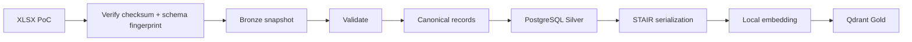

# Data Mapping — Bronze → Silver → Gold

## 1. Mục đích

Tài liệu mô tả cách dữ liệu PoC của Phòng Bảo đảm chất lượng, Mô-đun Khảo khí được chuyển từ XLSX sang PostgreSQL và Qdrant.

## 2. Context bắt buộc

Mọi record phải được gắn context từ server/release manifest:

```yaml
department_id: bao_dam_chat_luong
department_name: Phòng Bảo đảm chất lượng
module_code: khao_khi
module_name: Mô-đun Khảo khí
audience: nguoi_hoc
```

Client không được phép thay đổi context này trong PoC.

## 3. Luồng tổng quát



## 4. Workbook mô-đun

### 4.1. Module metadata

| Bronze | Transform | Silver |
|---|---|---|
| `1. Phạm vi trả lời!C4` | Trim, Unicode NFC | `modules.name` |
| `1. Phạm vi trả lời!C5` | Parse date | `modules.source_created_at` |
| `1. Phạm vi trả lời!C6` | Parse date | `modules.source_updated_at` |
| Release manifest | Enum mapping | `modules.release_status` |
| Server config | Resolve FK | `modules.department_id` |
| Release manifest | Direct | `modules.code=khao_khi` |

### 4.2. Routing rules

Header: `A9:G9`; data bắt đầu từ dòng 10.

| Bronze column | Transform | Silver field |
|---|---|---|
| A — STT | Integer | `source_order` |
| B — Phạm vi mô-đun | Enum mapping | `scope_type` |
| C — Chủ đề/tình huống | Normalize text | `topic` |
| D — Cách chatbot xử lý | Normalize nullable text | `bot_behavior` |
| E — Đầu mối hỗ trợ | Normalize nullable text | `support_contact` |
| F — Thông tin liên hệ | Parse contact string | `contact_information` |
| G — Kênh trực tuyến | Validate URL/string | `online_channel` |

Các dòng chỉ có STT nhưng không có `scope_type` và `topic` bị bỏ qua.

## 5. Workbook FAQ

Header: `1. FAQ!B4:K4`; dữ liệu bắt đầu từ dòng 5.

| Bronze column | Transform | Silver field |
|---|---|---|
| B — STT | Integer | `source_order` |
| C — Mã câu hỏi | Trim, giữ dấu chấm | `question_code` |
| D — Phân mục | Normalize text | `category` |
| E — Phân mục chi tiết | Normalize text | `subcategory` |
| F — Câu hỏi | Normalize text | `question` |
| F — Câu hỏi | Unicode/case/punctuation normalization | `normalized_question` |
| G — Câu trả lời | Normalize, giữ xuống dòng có nghĩa | `answer` |
| H — Văn bản căn cứ | Normalize nullable text | `legal_basis` |
| I — Đầu mối | Normalize hoặc inherit | `support_contact` |
| J — Thông tin liên hệ | Normalize hoặc inherit | `contact_information` |
| K — Kênh trực tuyến | Validate hoặc inherit | `online_channel` |

### 5.1. Normalized question

Thứ tự chuẩn hóa:

1. Unicode NFC.
2. Chuyển lowercase.
3. Trim.
4. Chuẩn hóa khoảng trắng.
5. Chuẩn hóa dấu câu ở đầu/cuối.
6. Không bỏ dấu tiếng Việt.

FAQ exact match chỉ thành công khi normalized input bằng normalized question hoặc một alias đã được duyệt.

## 6. Workbook tài liệu nghiệp vụ

Chỉ đọc các sheet khớp `Tài liệu <số>`. Bỏ qua:

- `Hướng dẫn`.
- `MẪU`.
- `_DS`.

### 6.1. Document metadata

| Bronze | Transform | Silver |
|---|---|---|
| `C1` | Regex lấy `TL\d+` | `document_code` |
| `C4` | Normalize text | `title` |
| `C5` | Normalize multiline text | `summary` |
| `C6` | Split `;`, trim, deduplicate | `aliases` |
| Sheet structure | Controlled inference | `document_type` |
| Release manifest | Enum mapping | `release_status` |

Controlled inference:

- Có nội dung quy định nhưng không có thủ tục/hồ sơ/bước: `regulation`.
- Có ít nhất một procedure field hoặc procedure step: `procedure`.
- Có cả hai: `regulation_and_procedure`.
- Không đủ dữ liệu để phân loại: validation `ERROR`.

Kết quả dự kiến:

| Document | Type |
|---|---|
| TL01 | `regulation` |
| TL02 | `regulation_and_procedure` |
| TL03 | `regulation_and_procedure` |
| TL04 | `regulation_and_procedure` |

### 6.2. Section B — Nội dung quy định

Header: `A9:F9`; rows 10–19.

Chỉ tạo record khi có `content` hoặc heading.

| Bronze | Silver |
|---|---|
| A | `source_order` |
| B | `heading` |
| C | `subheading` |
| D | `content` |
| E | `condition` |
| F | `resolution` |

`section_type=regulation`.

### 6.3. Section C — Điều kiện/ngoại lệ/lỗi

Header: `A22:E22`; rows 23–32.

Chỉ tạo record khi có `scenario` và `resolution`.

| Bronze | Silver |
|---|---|
| A | `source_order` |
| B | `scenario` |
| D | `resolution` |
| E | `condition_type` |

`condition_type` được map qua canonical enum.

### 6.4. Section D — Thủ tục

Nhãn nằm ở `B35:B43`, giá trị ở cột C.

| Source row | Silver |
|---:|---|
| 35 | `result` |
| 36 | `processing_time_type` |
| 37 | `max_working_days` |
| 38 | `location` |
| 39 | `submission_url` |
| 40 | `special_schedule` |
| 41 | `fee_type` |
| 42 | `fee_amount_vnd` |
| 43 | `fee_note` |

Nếu `fee_note` chứa “Chưa xác định”:

```text
fee_type = unknown
fee_amount_vnd = null
answer_policy = abstain_or_handoff
```

### 6.5. Section E — Hồ sơ

Header: `A46:E46`; rows 47–56.

| Bronze | Silver |
|---|---|
| A | `source_order` |
| B | `name` |
| C | `form_url` |
| D | `quantity_specification` |
| E | `is_required` |

### 6.6. Section F — Các bước

Header: `A59:F59`; rows 60–71.

| Bronze | Silver |
|---|---|
| A | `step_number` |
| B | `instruction` |
| C | `url_or_location` |
| D | `responsible_unit` |
| E | `time_requirement` |
| F | `channel` |

## 7. Kế thừa contact

```text
record contact
    ↓ nếu trống
module default contact đã xác nhận
    ↓ nếu trống
department default contact đã xác nhận
    ↓ nếu trống
null + human_handoff không có thông tin liên hệ
```

Không được lấy contact từ một routing rule không liên quan nếu chưa cấu hình làm default.

## 8. Approval và hiệu lực

Workbook hiện không có status đầy đủ. Silver sử dụng release manifest:

| Release status | Được load Silver | Được index dev | Được dùng UAT |
|---|---:|---:|---:|
| `candidate` | Có | Không | Không |
| `approved_for_dev` | Có | Có | Không |
| `approved_for_uat` | Có | Có | Có |
| `retired` | Có, inactive | Không | Không |

Nếu không có ngày hiệu lực:

- `effective_from=null`.
- `effective_to=null`.
- Chỉ được coi là đang áp dụng khi release đã được approve cho môi trường tương ứng.
- Không tự suy ra ngày hiệu lực từ ngày tạo file.

## 9. STAIR mapping

Mỗi chunk Gold phải gồm:

```markdown
# {document_title}

- Phòng ban: Phòng Bảo đảm chất lượng
- Mô-đun: Khảo khí
- Mã tài liệu: {document_code}
- Đối tượng: Người học
- Trạng thái release: {release_status}

## {section_heading}

{section_content}

### Điều kiện/ngoại lệ liên quan

{relevant_conditions}

Nguồn: {source_file} / {source_sheet} / dòng {source_row}
```

### 9.1. Qdrant payload bắt buộc

```json
{
  "department_id": "bao_dam_chat_luong",
  "module_code": "khao_khi",
  "document_code": "TL01",
  "section_id": "uuid",
  "section_type": "regulation",
  "release_status": "approved_for_dev",
  "effective_from": null,
  "effective_to": null,
  "source_file": "3. Tài liệu nghiệp vụ.xlsx",
  "source_sheet": "Tài liệu 1",
  "source_row": 10,
  "content_hash": "sha256"
}
```

Mọi query Qdrant trong PoC phải hard-filter:

```text
department_id == bao_dam_chat_luong
AND module_code == khao_khi
AND release_status in allowed_statuses_for_environment
```

## 10. Error handling

| Lỗi | Hành vi |
|---|---|
| File checksum khác manifest | Dừng sync, yêu cầu release mới |
| Schema fingerprint không khớp | Dừng parser, báo schema drift |
| Thiếu trường bắt buộc | Record `ERROR`, không publish release |
| Trùng business key | Release `ERROR` |
| URL không hợp lệ | `WARNING` hoặc `ERROR` theo mức bắt buộc |
| Contact chưa xác minh | `WARNING`, không hiển thị như contact đã xác nhận |
| Lệ phí chưa xác định | `WARNING`, gắn answer policy |
| Qdrant upsert lỗi | `partial_failed`, cho phép rebuild từ Silver |

## 11. Kiểm tra số lượng sau mapping

Với release hiện tại, kết quả kỳ vọng:

| Entity | Số lượng |
|---|---:|
| Department | 1 |
| Module | 1 |
| Routing rule | 17 |
| FAQ | 71 |
| Document | 4 |
| Regulation section | 15 |
| Condition/exception section | 26 |
| Dossier item | 4 |
| Procedure step | 13 |

Số lượng procedure field không dùng làm acceptance count cứng vì các field nullable theo loại thủ tục.
