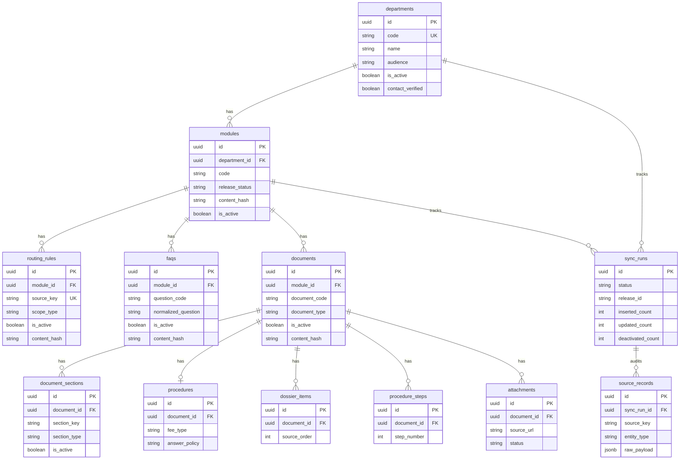

# ERD — Silver Layer (Phase 3)

PostgreSQL là nguồn chân lý đã chuẩn hóa. Mọi bảng nghiệp vụ gắn cả `department_id` và `module_id`. Qdrant (Phase 4) rebuild từ các bảng này.

## Cardinality

```text
departments 1 ── N modules
modules     1 ── N routing_rules
modules     1 ── N faqs
modules     1 ── N documents
documents   1 ── N document_sections
documents   1 ── 0..1 procedures
documents   1 ── N dossier_items
documents   1 ── N procedure_steps
documents   1 ── N attachments
sync_runs   1 ── N source_records
```

## Sơ đồ



## Business keys

| Entity | Key |
|---|---|
| Department | `code` |
| Module | `department.code + module.code` |
| Routing rule | `module_id + source_key` |
| FAQ | `module_id + question_code` |
| Document | `module_id + document_code` |
| Document section | `document_id + section_key` |
| Procedure | `document_id` |
| Dossier item | `document_id + source_order` |
| Procedure step | `document_id + step_number` |
| Attachment | `document_id + source_url` |

`source_key` routing: `route:{sha256(department_id\|module_code\|scope_type\|normalized_topic)[0:20]}`.

`section_key`: `section:{sha256(document_code\|section_type\|normalized_heading\|source_order)[0:20]}`.

STT không phải business key. Record biến mất khỏi nguồn được `is_active=false` (soft-delete), không xóa cứng.
